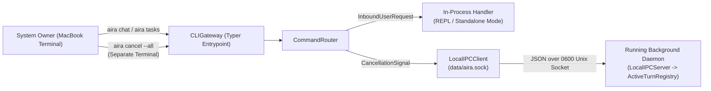
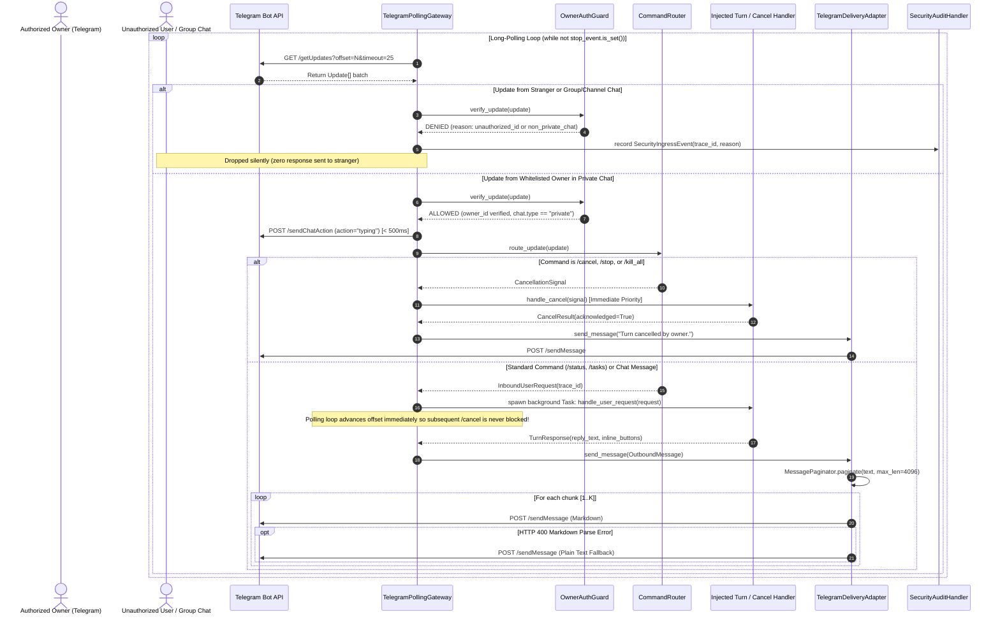

# AIRA MOCHTAR — `CMP-02`: Communication Gateway Implementation Plan

| Plan Metadata | Details |
| :--- | :--- |
| **Document ID** | `DOC-ARCH-CMP02-PLAN-007` |
| **Component ID & Name** | `CMP-02`: Communication Gateway (`src/aira/interfaces` & `src/aira/ports/channel.py`) |
| **Linked Requirements** | `FR-COMM-001`, `FR-AUTO-004`, `INT-002`, `SEC-001`, `SEC-002`, `NFR-001` |
| **Upstream Specifications** | `PRODUCT_REQUIREMENTS.md`, `SYSTEM_ARCHITECTURE.md`, `COMPONENT_OVERVIEW.md`, `TECH_STACK_DECISIONS.md`, `PERMISSION_MATRIX.md`, `SECURITY_BASELINE.md`, `CMP-01-IMPLEMENTATION.md` |
| **Governing ADRs & Remediations** | `ADR-007` (Four Principal External Ports), `ADR-008` / `ISS-02` (Dual-Channel Cancellation & Unix Socket IPC), `ISS-07` (`chat.type == "private"`), `ISS-08` (Stateless Stage 1 Paginator) |
| **Current Status** | **Implementation Plan (Awaiting Owner Approval — Zero Code Written for `CMP-02`)** |

---

## 1. Executive Summary & Architectural Boundaries

`CMP-02` (**Communication Gateway**) is the authenticated perimeter ingress and egress layer (`Zone 1`) of **AIRA MOCHTAR**. It provides two interactive operator channels in Stage 1 MVP—the **Local CLI** and the **Telegram Bot API (Outbound Long-Polling)**—plus the **Local Unix Domain Socket IPC** (`data/aira.sock`) required for cross-process cancellation (`ADR-008`).

### Strict Boundary Rules
1. **No Second Application Core:** `CMP-02` contains **zero** AI reasoning, prompt construction, database query logic, or tool execution logic. It translates raw terminal inputs, IPC packets, and Telegram JSON updates into validated internal DTOs (`InboundUserRequest` and `CancellationSignal`) and delegates them via **dependency-injected handlers** to `CMP-03` (`Aira Core Engine`).
2. **Adherence to the Four Principal External Ports (`ADR-007`):** Outbound message delivery implements `ChannelDeliveryPort` (`src/aira/ports/channel.py`).
3. **100% Credential-Free Testability:** Because both the upstream message/cancellation handlers and the low-level Telegram HTTP transport are injected via Python `Protocol` interfaces, the entire `CMP-02` gateway can be unit- and integration-tested offline using mocked Telegram updates and simulated CLI/IPC streams without a real Telegram Bot Token or Gemini API integration.

---

## 2. Component & File Structure

Upon approval, `CMP-02` will introduce the following package layout inside `src/aira/` and `tests/`:

```text
aira-mochtar/
├── src/
│   └── aira/
│       ├── config/                         # Existing (CMP-01 Configuration & Secret Manager)
│       ├── ports/                          # NEW: Principal External Ports (ADR-007)
│       │   ├── __init__.py
│       │   └── channel.py                  # ChannelDeliveryPort & DI handler protocols
│       └── interfaces/                     # NEW: CMP-02 Communication Gateway
│           ├── __init__.py                 # Public exports for CMP-02
│           ├── models.py                   # Immutable Pydantic v2 DTOs & Telegram schemas
│           ├── auth_guard.py               # OwnerAuthGuard (whitelist + private-chat guard)
│           ├── router.py                   # CommandRouter (/status, /tasks, /cancel, chat)
│           ├── paginator.py                # 4,096-char paginator & code-fence preserver (ISS-08)
│           ├── telegram_adapter.py         # Long-polling gateway & TelegramDeliveryAdapter
│           ├── ipc_control.py              # Unix Domain Socket server/client (data/aira.sock)
│           └── cli_adapter.py              # Interactive REPL, single-shot CLI & CLIDeliveryAdapter
└── tests/
    ├── test_config.py                      # Existing (35 tests for CMP-01)
    └── test_communication_gateway.py       # NEW: Offline unit & integration tests for CMP-02
```

### Detailed Module Responsibilities

| File Path | Key Classes / Protocols | Responsibility |
| :--- | :--- | :--- |
| `src/aira/ports/channel.py` | `ChannelDeliveryPort`, `InboundTurnHandler`, `CancellationHandler`, `SecurityAuditHandler` | Defines the canonical outbound delivery port (`send_message`, `send_typing_indicator`) and the callable/protocol contracts injected into `CMP-02` for handling user turns, cancellation signals, and security audit events. |
| `src/aira/interfaces/models.py` | `InboundUserRequest`, `CancellationSignal`, `OutboundMessage`, `DeliveryReceipt`, `TurnResponse`, `CancelResult`, `SecurityIngressEvent`, `TelegramUpdate` | Strict, immutable (`frozen=True`) Pydantic v2 data structures for internal normalized messages and incoming Telegram Bot API payloads (`message`, `edited_message`, `callback_query`). |
| `src/aira/interfaces/auth_guard.py` | `OwnerAuthGuard`, `AuthCheckResult` | Perimeter security filter verifying `from_user.id in AUTHORIZED_TELEGRAM_USER_IDS`, `chat.type == "private"`, `chat.id == from_user.id`, and `from_user.is_bot is False`. |
| `src/aira/interfaces/router.py` | `CommandRouter`, `SlashCommand` | Validates incoming text, strips `@bot_username` suffixes, enforces the closed command whitelist (`/status`, `/tasks`, `/notes`, `/briefing`, `/cancel`, `/stop`, `/kill_all`, `/help`), and separates emergency cancellation signals from standard conversational requests. |
| `src/aira/interfaces/paginator.py` | `MessagePaginator` | Stateless Stage 1 formatting helper (`ISS-08`) that splits outbound messages exceeding `4,096` characters at paragraph/line boundaries while closing and reopening fenced Markdown code blocks (` ``` `) across chunks (`INT-002`). |
| `src/aira/interfaces/telegram_adapter.py` | `TelegramTransportProtocol`, `HttpxTelegramTransport`, `TelegramDeliveryAdapter`, `TelegramPollingGateway` | Manages outbound long-polling (`getUpdates`), dispatches `< 500 ms` typing indicators, spawns non-blocking turn tasks so `/cancel` remains responsive mid-turn, implements `ChannelDeliveryPort`, and handles `HTTP 400` plain-text fallback and `HTTP 429`/`5xx` retries. |
| `src/aira/interfaces/ipc_control.py` | `LocalIPCServer`, `LocalIPCClient` | Implements the local `0600` Unix Domain Socket (`data/aira.sock`) control channel (`ADR-008`, `ISS-02`) so `aira cancel` or `aira status` from a separate terminal tab can signal the running daemon. |
| `src/aira/interfaces/cli_adapter.py` | `CLIDeliveryAdapter`, `CLIGateway` | Provides the local interactive REPL (`aira chat`), single-shot CLI commands (`aira status`, `aira tasks`, `aira notes`, `aira cancel`), and `ChannelDeliveryPort` terminal rendering. |

---

## 3. Dependencies & Proposed Library Selection

### 3.1 Telegram Bot Integration: `httpx` + Pydantic v2 (Recommended) vs. Heavy Bot Frameworks

| Evaluation Criterion | Option A: `httpx` (`AsyncClient`) + Pydantic v2 Schemas (Selected) | Option B: `aiogram 3.x` / `python-telegram-bot` |
| :--- | :--- | :--- |
| **Architectural Control & Security (`SEC-001`, `SEC-002`)** | **Superior:** Full control over line-1 raw JSON inspection, URL secret redaction via `CMP-01` `settings.redact_text()`, and custom `OwnerAuthGuard` rejection before any framework middleware runs. | Framework routers and internal loggers can log request URLs or require custom middleware hooks to suppress default error behaviors. |
| **Offline Unit Testability** | **Superior:** `httpx.MockTransport` or a 4-method `TelegramTransportProtocol` allows testing all polling, retry, rate-limit, and pagination edge cases with synthetic tokens (e.g., `"synthetic-test-token"`). | `aiogram.Bot` enforces strict regex validation on bot token format (`123456:ABC...`) at instantiation and couples tests to framework internals. |
| **Dependency & Memory Footprint (MacBook Air M2)** | **Minimal:** Single lightweight async HTTP library (`httpx`) that is already required in Stage 2 (`arXiv`/`PubMed` APIs) and Stage 3 (`MT5` bridge). | Pulls in `aiohttp`, `magic-filter`, `babel`, and framework-specific state machines that duplicate `CMP-03`/`CMP-11`. |
| **Stage 1 Scope Fit** | Covers 100% of Stage 1 needs (`getUpdates`, `sendMessage`, `sendChatAction`, `answerCallbackQuery`) in ~180 lines of clean, typed code. | Overkill for a single-owner private bot where state and workflows are managed by Aira's own SQLite/Core layers. |

### 3.2 CLI Framework Selection: `typer` + `rich` (Selected)

- **Selected:** `typer` and `rich` (aligned with `TECH_STACK_DECISIONS.md` Section 2).
- **Rationale:** `typer` provides clean, type-hinted subcommands (`aira chat`, `aira status`, `aira tasks`, `aira notes`, `aira cancel`) while `rich` renders readable Markdown panels and status tables in the macOS terminal.

### 3.3 Planned `pyproject.toml` Additions (To Be Installed Only After Approval)

- **Runtime `dependencies`:**
  - `httpx>=0.27.0,<1.0.0`
  - `typer>=0.12.0,<1.0.0`
  - `rich>=13.7.0,<14.0.0`
- **Development `optional-dependencies.dev`:**
  - `pytest-asyncio>=0.23.0,<1.0.0` (for testing async polling, IPC sockets, and concurrent `/cancel` tasks)

---

## 4. CLI Interaction Design

The Local CLI (`src/aira/interfaces/cli_adapter.py`) supports two execution modes using the same underlying `CommandRouter` and injected handlers:



### 4.1 Interactive REPL Mode (`aira chat`)
1. Starts an asynchronous terminal loop displaying the prompt `You > `.
2. Normalizes input lines into `InboundUserRequest(channel=ChannelType.CLI, user_id="local_owner", ...)` or `CancellationSignal` (when `/cancel` or `/stop` is typed).
3. Pressing `Ctrl+C` (`SIGINT`) while a turn is running cancels the active in-process turn (`CancellationSignal(scope=CancellationScope.SESSION)`) without crashing the REPL; pressing `Ctrl+D` (`EOF`) or typing `exit` / `quit` triggers a clean shutdown.
4. Renders responses through `CLIDeliveryAdapter.send_message()`.

### 4.2 Single-Shot Commands & Cross-Process Cancellation
- `aira status`: Dispatches `/status` request and prints system health.
- `aira tasks [list|...]`: Dispatches `/tasks` command.
- `aira notes [search|...]`: Dispatches `/notes` command.
- `aira cancel [--turn-id <id> | --all]`:
  - Checks if the background daemon socket (`settings.ipc_socket_path`, default `data/aira.sock`) exists.
  - If active, connects via `LocalIPCClient`, sends a signed/authenticated JSON payload `{"action": "cancel", "turn_id": ..., "scope": "all", "auth_token": ...}`, and prints the daemon's `CancelResult` acknowledgment (`ADR-008`).
  - If no daemon is running, invokes the injected in-process `CancellationHandler` and reports the result.

---

## 5. Telegram Interaction Lifecycle

### 5.1 End-to-End Sequence (Long-Polling, Typing Ack, Concurrent Execution & `/cancel`)



### 5.2 Key Lifecycle Mechanics
1. **Offset Management & Poison-Pill Prevention:** `offset` is tracked in memory as `last_update_id + 1`. Once an update is either dropped by `OwnerAuthGuard`, dispatched to a background task, or logged as malformed, `offset` advances immediately so a single failing turn never causes an infinite retry loop.
2. **Non-Blocking Turn Execution for Instant `/cancel`:** If `TelegramPollingGateway` awaited a 7-second LLM turn inline inside the `getUpdates` loop, it could not read the user's `/cancel` message until the turn finished. Therefore, normal turns run in tracked `asyncio.Task` objects per chat session, while `/cancel` executes immediately on the polling loop to abort the active task within `< 3.0 seconds` (`FR-AUTO-004`).
3. **Callback Query Support (`callback_query`):** Inline button taps (e.g., future `hitl:approve:<id>` or `hitl:reject:<id>`) pass through the exact same `OwnerAuthGuard` check, call `answerCallbackQuery` to stop the Telegram button loading spinner, and route to the injected handler.
4. **Graceful Shutdown (`SIGINT` / `SIGTERM`):**
   - Sets `_stop_event` to break the `getUpdates` loop cleanly.
   - Cancels or awaits in-flight turn tasks within a bounded shutdown timeout (`default = 3.0s`).
   - Closes the `LocalIPCServer` and unlinks `data/aira.sock`.
   - Closes the underlying `httpx.AsyncClient` connection pool.

---

## 6. Security Controls (`SEC-001`, `SEC-002`, `ISS-07`, `ADR-008`)

1. **Line-1 Owner Identity & Private Chat Guard (`SEC-002`, `ISS-07`):**
   - `OwnerAuthGuard.verify()` enforces:
     $$\text{ALLOW} \iff (\text{user.id} \in \text{settings.authorized\_telegram\_user\_ids}) \land (\text{chat.type} == \text{"private"}) \land (\text{chat.id} == \text{user.id}) \land (\neg \text{user.is\_bot})$$
   - Updates from `group`, `supergroup`, or `channel` chats—even if sent by the owner's account inside a group—are rejected immediately so private tasks, notes, or financial data can never leak into a group room.
   - Zero error messages, status texts, or typing indicators are sent to unauthorized callers.
2. **Zero Bot Token Leakage (`SEC-001`):**
   - `TelegramPollingGateway` and `HttpxTelegramTransport` receive `settings.telegram_bot_token` as a `SecretStr` from `CMP-01`.
   - The raw token is used solely inside private request URL construction (`https://api.telegram.org/bot<token>/<method>`).
   - Every exception, `httpx.HTTPError`, or diagnostic log string inside `telegram_adapter.py` is passed through `settings.redact_text()` before being logged or re-raised, guaranteeing that `https://api.telegram.org/bot[REDACTED_SECRET]/...` is all that ever appears in logs or tracebacks.
3. **Closed Command Routing & No Arbitrary Execution:**
   - `CommandRouter` only recognizes the explicit `SlashCommand` enum (`/status`, `/tasks`, `/notes`, `/briefing`, `/cancel`, `/help` plus aliases `/stop`, `/kill_all`).
   - Unknown slash commands (e.g., `/exec`, `/sh`, `/admin`) are rejected with a safe user-facing help message and are never passed to OS shells (`subprocess` / `os.system` are completely absent from `CMP-02`).
   - `CMP-02` has zero access to `ToolAdapterPort` (`CMP-07`); it cannot invoke tools or bypass `PermissionEngine` (`CMP-08`).
4. **Authenticated Local Unix Socket IPC (`ADR-008`, `SECURITY_BASELINE.md` Control 6):**
   - `LocalIPCServer` creates `data/aira.sock` with POSIX permissions `0600` (owner read/write only).
   - When `settings.ipc_auth_token` is configured, every IPC JSON payload must supply a matching `auth_token` verified in constant time via `hmac.compare_digest()`.

---

## 7. Error Handling & Resilience Matrix

| Failure Scenario | Component Behavior | Recovery & Logging Action |
| :--- | :--- | :--- |
| **Telegram `HTTP 429 Too Many Requests`** | Inspects JSON response `parameters.retry_after` (defaulting to `5s` if absent). | Sleeps for `retry_after` seconds, logs a redacted rate-limit warning, and resumes polling/delivery. |
| **Telegram `HTTP 500 / 502 / 503 / 504` or Network Drop** | Catches `httpx.TransportError` / `5xx` status in `TelegramPollingGateway`. | Applies exponential backoff with full jitter (`1.0s -> 2.0s -> 4.0s ...` up to `30.0s` cap) without crashing the daemon. |
| **Telegram `HTTP 400 Bad Request` on Markdown Delivery** | `TelegramDeliveryAdapter` detects entity parse error on `sendMessage`. | Automatically strips `parse_mode` and retries sending the exact chunk as plain text (`CMP-10` Row 9) so the message is still delivered. |
| **Outbound Message Exceeds `4,096` Characters** | `MessagePaginator` intercepts before transmission. | Splits cleanly on paragraph/line boundaries, closes and reopens active Markdown code fences (` ``` `), and prefixes parts with `[1/N] ... [N/N]`. |
| **Malformed Telegram Update JSON / Missing Fields** | `TelegramUpdate` validation fails or lacks both `message` and `callback_query`. | Logs warning with `trace_id`, advances `offset = update_id + 1`, and continues polling. |
| **Input Text Exceeds Maximum Safe Length (`> 32,000` chars)** | `CommandRouter` input length guard triggers. | Rejects oversized payload cleanly before forwarding to `Core Engine`, returning a concise validation message. |
| **Downstream Turn Handler Raises Unhandled Exception** | Caught by the turn task wrapper in `TelegramPollingGateway` / `CLIGateway`. | Scrubs exception text via `settings.redact_text()`, logs error with `trace_id`, and delivers a safe diagnostic notice to the owner. |
| **Stale `data/aira.sock` File on Daemon Startup** | `LocalIPCServer` detects existing socket path. | Probes socket; if no process is listening, safely unlinks the stale socket file before binding with `0600` permissions. |

---

## 8. Testing Strategy (100% Offline & Credential-Free)

All tests in `tests/test_communication_gateway.py` will run offline using `pytest` and `pytest-asyncio` with **zero real Telegram tokens, zero network sockets to `api.telegram.org`, and zero Gemini API calls**:

### Test Doubles & Fixtures
1. **`FakeTelegramTransport` (implements `TelegramTransportProtocol`):**
   - Queues synthetic Telegram `Update` dicts for `get_updates()`.
   - Records all outbound `send_chat_action()`, `send_message()`, and `answer_callback_query()` calls for assertion.
   - Can be configured to simulate `HTTP 429` (`retry_after`), `HTTP 502` network errors, and `HTTP 400` Markdown parse failures.
2. **`FakeTurnHandler` & `FakeCancelHandler`:**
   - Dependency-injected async callables recording received `InboundUserRequest` and `CancellationSignal` objects, with configurable artificial delay (e.g., `asyncio.Event` wait) to test mid-flight `/cancel` interruption.
3. **`FakeSecurityAuditSink`:**
   - Captures all `SecurityIngressEvent` emissions for assertion.

### Planned Test Cases (`tests/test_communication_gateway.py`)
1. **Owner Verification & Private Chat Enforcement (`OwnerAuthGuard`):**
   - Whitelisted user ID in `"private"` chat where `chat.id == from.id` $\rightarrow$ **ALLOWED**.
   - Non-whitelisted user ID in `"private"` chat $\rightarrow$ **DENIED** + `SECURITY_UNAUTHORIZED_INGRESS` logged + zero outbound calls.
   - Whitelisted owner ID inside `"group"`, `"supergroup"`, or `"channel"` chat $\rightarrow$ **DENIED** + `SECURITY_NON_PRIVATE_CHAT` logged + zero outbound calls.
   - Message from a bot account (`is_bot=True`) or missing `from` field $\rightarrow$ **DENIED**.
2. **Command Routing & Input Validation (`CommandRouter`):**
   - Parses `/status`, `/tasks`, `/notes`, `/briefing`, `/help` (with and without `@aira_bot` suffix and arguments).
   - Routes `/cancel`, `/cancel trn_123`, `/stop`, and `/kill_all` to `CancellationSignal` with correct `CancellationScope`.
   - Rejects unknown slash commands (`/exec rm -rf`) safely without invoking turn handler or shell.
   - Rejects empty/whitespace-only messages and oversized payloads (`> 32,000` chars).
3. **Outbound Delivery & 4,096-Char Pagination (`MessagePaginator` & `TelegramDeliveryAdapter`):**
   - Short message (`<= 4,096` chars) sends in 1 chunk without `[1/1]` prefix.
   - 10,000-character Markdown response with fenced Python code blocks splits into 3 numbered chunks (`[1/3]`, `[2/3]`, `[3/3]`) with balanced ` ``` ` fences in every chunk.
   - Simulated `HTTP 400 can't parse entities` automatically retries and succeeds in plain-text mode.
4. **Telegram Long-Polling Lifecycle, Typing Ack & Mid-Turn `/cancel`:**
   - Valid owner update triggers `send_chat_action("typing")` before turn handler finishes.
   - While Turn 1 is awaiting completion in the background, a second update containing `/cancel` arrives in the next poll batch, immediately invokes `CancellationHandler`, and cancels Turn 1.
   - Simulated `HTTP 429` (`retry_after=0.01`) and `HTTP 502` transient errors back off and recover cleanly without stopping the poller.
   - Calling `gateway.stop()` exits the polling loop and cleans up resources gracefully.
5. **Token Redaction in Transport Errors (`SEC-001`):**
   - Simulated `httpx.HTTPError` containing the full URL `https://api.telegram.org/botsynthetic-secret-token-12345/getUpdates` has the token scrubbed to `[REDACTED_SECRET]` in all raised errors and logs.
6. **Local CLI & Cross-Process Unix Socket IPC (`CLIGateway`, `LocalIPCServer`, `LocalIPCClient`):**
   - Interactive REPL processes chat turns, `/status`, `/cancel`, and exits cleanly on `EOF`.
   - `LocalIPCServer` binds to `tmp_path / "aira.sock"` with `0600` permissions; `LocalIPCClient` sends `CancellationSignal` with valid `ipc_auth_token` and receives `CancelResult`.
   - Invalid `ipc_auth_token` over Unix socket is rejected and logged as `SECURITY_INVALID_IPC_TOKEN`.

---

## 9. Step-by-Step Implementation Sequence

Once this plan is approved, implementation will proceed in five disciplined steps:

1. **Step 1 — Dependencies & Port Contracts:**
   - Update `pyproject.toml` (`httpx`, `typer`, `rich`, `pytest-asyncio`) and install into `.venv`.
   - Create `src/aira/ports/__init__.py` and `src/aira/ports/channel.py` (`ChannelDeliveryPort` and handler protocols).
2. **Step 2 — Domain DTOs, `OwnerAuthGuard`, `CommandRouter`, and `MessagePaginator`:**
   - Implement `src/aira/interfaces/models.py`, `auth_guard.py`, `router.py`, and `paginator.py`.
3. **Step 3 — Telegram Long-Polling & Delivery Adapter:**
   - Implement `src/aira/interfaces/telegram_adapter.py` with `HttpxTelegramTransport`, `TelegramDeliveryAdapter`, and `TelegramPollingGateway`.
4. **Step 4 — Unix Socket IPC & Local CLI Gateway:**
   - Implement `src/aira/interfaces/ipc_control.py` (`data/aira.sock` server/client) and `src/aira/interfaces/cli_adapter.py` (`CLIDeliveryAdapter` and `CLIGateway`), plus export public interfaces in `src/aira/interfaces/__init__.py`.
5. **Step 5 — Offline Unit & Integration Testing + Implementation Documentation:**
   - Write and run `tests/test_communication_gateway.py`, verify syntax/tests/secret-exposure gates, and document results in `docs/architecture/CMP-02-IMPLEMENTATION.md`.

---

## 10. Acceptance Criteria (`GATE-CMP-02`)

`CMP-02` will be declared complete only when all of the following criteria are verified by automated command execution:

| Criterion ID | Requirement Link | Pass Condition |
| :--- | :--- | :--- |
| **`AC-CMP02-01`** | `SEC-002`, `ISS-07` | 100% of non-whitelisted user IDs, bot accounts, and non-private chats (`group`, `supergroup`, `channel`) are rejected at line 1 with zero outbound reply and a recorded `SecurityIngressEvent`. |
| **`AC-CMP02-02`** | `NFR-001` | Valid owner Telegram messages trigger `sendChatAction("typing")` before turn execution proceeds. |
| **`AC-CMP02-03`** | `FR-COMM-001` | Core commands (`/status`, `/tasks`, `/notes`, `/briefing`, `/cancel`, `/help`) and conversational messages route accurately from both Telegram and Local CLI to the injected handler. |
| **`AC-CMP02-04`** | `FR-AUTO-004`, `ADR-008` | Both in-process `/cancel` (Telegram/REPL) and cross-process CLI cancellation over `data/aira.sock` (`0600`) interrupt an active turn and return a `CancelResult` acknowledgment. |
| **`AC-CMP02-05`** | `INT-002`, `ISS-08` | Outbound messages `> 4,096` characters are paginated cleanly without breaking Markdown code fences, and automatically fall back to plain text on `HTTP 400` entity errors. |
| **`AC-CMP02-06`** | `SEC-001` | Zero bot tokens or IPC secrets appear in logs, exceptions, `repr()`, or test files; all tests pass 100% offline without real Telegram or Gemini credentials. |
