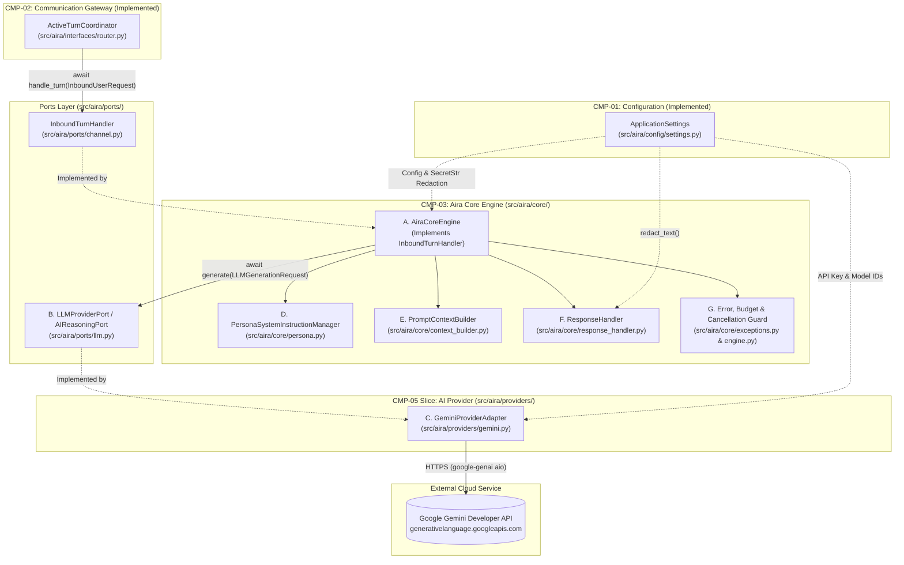
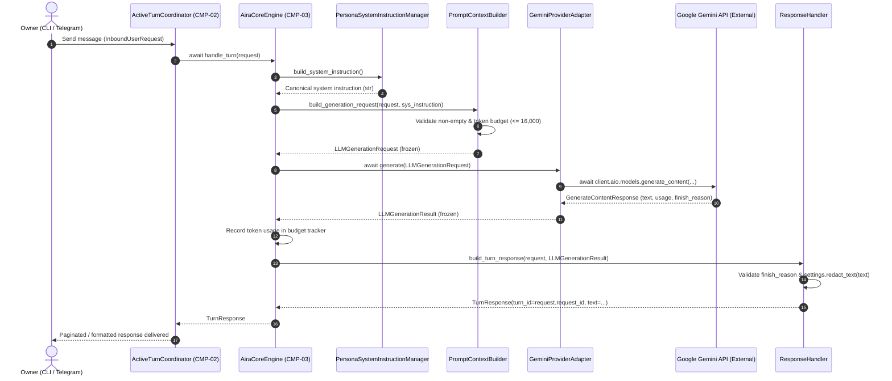
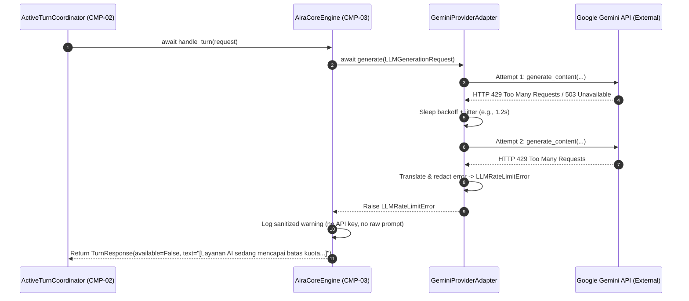
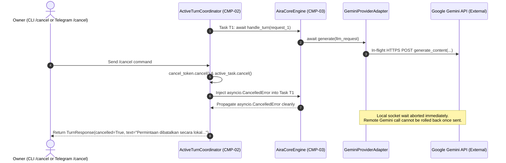

# CMP-03 Implementation Plan: Aira Core Engine & AI Reasoning Pipeline

| Metadata | Value |
| :--- | :--- |
| **Document ID** | `AIRA-ARCH-CMP-03-PLAN` |
| **Version** | `1.0.0` |
| **Status** | `Proposed (Pending Owner Approval)` |
| **Component IDs** | `CMP-03` (Aira Core Engine), plus foundational vertical slice of `CMP-04` (Stateless Turn Context Builder) and `CMP-05` (Gemini Provider Adapter) |
| **Target Stage** | `Stage 1 (v0.1 — Conversational Core & Assistant Loop)` |
| **Baseline Commit** | `e1250ce` (`main`) |
| **Target Runtime** | `Python 3.12+` (Single-Owner, Local-First Modular Monolith) |

---

## 1. Executive Summary

This document defines the detailed architectural specification and phased implementation plan for **`CMP-03`: Aira Core Engine**, the central intelligence orchestration layer of **AIRA MOCHTAR**.

Following the completion of **`CMP-01` (Configuration & Secret Manager)** and **`CMP-02` (Communication Gateway)**, `CMP-02` currently routes authenticated owner turns through `ActiveTurnCoordinator` (`src/aira/interfaces/router.py`), which returns an honest Stage 1 placeholder whenever `downstream_turn_handler` is `None`. The mission of `CMP-03` is to replace that placeholder with a production-grade, fail-closed, provider-agnostic conversational reasoning pipeline that connects validated owner requests (`InboundUserRequest`) to Google's **Gemini Developer API** via the official `google-genai` SDK and returns structured, secret-scrubbed responses (`TurnResponse`) back to `CMP-02`.

### Key Architectural Highlights
1. **Zero-Friction Integration with `CMP-02`:** `AiraCoreEngine` directly implements the existing `@runtime_checkable class InboundTurnHandler(Protocol)` (`async def handle_turn(self, request: InboundUserRequest) -> TurnResponse`) defined in `src/aira/ports/channel.py`. It injects cleanly into `ActiveTurnCoordinator(settings, downstream_turn_handler=core_engine)` without requiring breaking changes to `CMP-01` or `CMP-02`.
2. **Strict Provider Decoupling (`ADR-007`):** Core orchestration logic never imports `google.genai` directly. All reasoning calls pass through `LLMProviderPort` (aliased as `AIReasoningPort`) in `src/aira/ports/llm.py`.
3. **First-Class Persona & Epistemic Integrity (`FR-CORE-01`..`04`):** `PersonaSystemInstructionManager` encapsulates Aira Mochtar's canonical identity, 8 behavioral principles, anti-sycophancy discipline, calibrated epistemic uncertainty, and non-sentience boundaries independently of any LLM vendor adapter.
4. **Honest Stage 1 Scope Boundaries:**
   - **Stateless/Transient Memory Disclosure:** Persistent SQLite session history and episodic memory (`CMP-04` full database integration + `CMP-06`) are **out of scope** for `CMP-03`. `PromptContextBuilder` constructs deterministic, single-turn context (with optional bounded in-memory session windowing if explicitly configured, defaulting to stateless single-turn execution) and documents this boundary transparently.
   - **Cloud Inference Disclosure:** While AIRA MOCHTAR is a local-first system for configuration, state, and orchestration, reasoning requests in `CMP-03` are transmitted over HTTPS to an external cloud inference service (**Google Gemini Developer API**).
   - **Honest Cancellation Semantics (`ISS-02`):** Cooperative cancellation via `asyncio.CancelledError` and `CancelToken` immediately aborts local waiting (`asyncio.wait_for`), prevents outbound delivery of stale responses, and marks `TurnResponse(cancelled=True)`. However, if an HTTPS request has already been dispatched to Google's servers, local cancellation **cannot undo remote token consumption** and never falsely claims that remote execution was rolled back.

---

## 2. Existing Architecture & Codebase Audit

An exhaustive line-by-line inspection of the repository at commit `e1250ce` (`branch: main`) was conducted across all specification documents, source modules (`src/aira/`), and test suites (`tests/`).

### 2.1 Files Inspected
- **Root & Packaging:** `pyproject.toml`, `README.md`
- **Product & Architecture Specs:** `docs/product/PRODUCT_VISION.md`, `docs/product/PRODUCT_REQUIREMENTS.md`, `docs/architecture/SYSTEM_ARCHITECTURE.md`, `docs/architecture/COMPONENT_OVERVIEW.md`, `docs/architecture/TECH_STACK_DECISIONS.md`, `docs/decisions/ARCHITECTURE_DECISIONS.md`, `docs/roadmap/DEVELOPMENT_ROADMAP.md`
- **Security Specs:** `docs/security/SECURITY_BASELINE.md`, `docs/security/PERMISSION_MATRIX.md`, `docs/security/MEMORY_PRIVACY_POLICY.md`
- **Component Implementation Docs:** `docs/architecture/CMP-01-IMPLEMENTATION.md`, `docs/architecture/CMP-02-IMPLEMENTATION-PLAN.md`, `docs/architecture/CMP-02-IMPLEMENTATION.md`
- **Implemented Source Code (`CMP-01` & `CMP-02`):**
  - `src/aira/__init__.py`
  - `src/aira/config/__init__.py`, `src/aira/config/settings.py`, `src/aira/config/exceptions.py`
  - `src/aira/ports/__init__.py`, `src/aira/ports/channel.py`
  - `src/aira/interfaces/__init__.py`, `src/aira/interfaces/models.py`, `src/aira/interfaces/auth_guard.py`, `src/aira/interfaces/router.py`, `src/aira/interfaces/paginator.py`, `src/aira/interfaces/telegram_adapter.py`, `src/aira/interfaces/ipc_control.py`, `src/aira/interfaces/cli_adapter.py`
- **Test Suites:** `tests/test_settings.py`, `tests/test_communication_gateway.py`

### 2.2 Audit Findings & Discrepancies Against Assumed State

> [!IMPORTANT]
> **Critical Audit Finding on Actual Repository State (`e1250ce`):**
> Although the project status summary notes that `CMP-02` received "Conditionally Approved" status subject to fixing three `P1` findings, **inspection of the actual code in commit `e1250ce` reveals that those three `P1` findings have NOT yet been patched in `src/` or `pyproject.toml`**. Specifically:
> 1. **`P1-01` (Telegram Offset Persistence Order & Post-Restart Deduplication):** In `src/aira/interfaces/telegram_adapter.py` (`#L606-L624` and `#L649`), `TelegramPollingGateway.process_update()` only checks in-memory `self._seen_set` (without checking `update.update_id < self._offset_cursor.load_next_offset()`) and persists the offset cursor at line 649 *before* inline outbound delivery (`send_message` at line 676) finishes.
> 2. **`P1-02` (Missing `[project.scripts]` Entry Point):** `pyproject.toml` (`#L1-L33`) does not yet declare `[project.scripts]` (`aira = ...`), so the CLI is only invokable via Python module/function import rather than as an installed `aira` binary.
> 3. **`P1-03` (Dual Polling Timeout Configuration):** `HttpxTelegramTransport.__init__()` (`src/aira/interfaces/telegram_adapter.py#L280-L293`) stores `self._poll_timeout_seconds` without using it in `get_updates()`, while `TelegramPollingGateway` (`#L556, #L751`) holds a separate `_poll_timeout_seconds` attribute.
> 4. **Empty Root `README.md`:** The root `README.md` file is currently `0 bytes`.
> 5. **Stale Header Metadata in Architecture Docs:** `SYSTEM_ARCHITECTURE.md`, `COMPONENT_OVERVIEW.md`, and `TECH_STACK_DECISIONS.md` still list `Project Phase: Pre-Implementation (Zero Application Code Exists)` in their top metadata tables even though `CMP-01` and `CMP-02` are implemented.

In accordance with **PLAN-ONLY MODE**, this plan does not modify `CMP-02` or `pyproject.toml` now, but explicitly records these findings and isolates `CMP-03` so that `CMP-03` does not depend on any broken behavior in `CMP-02`.

### 2.3 Contract & Naming Reconciliation (`CMP-01` / `CMP-02` vs. Upstream Specs)

| Architectural Concept | Upstream Spec Name (`COMPONENT_OVERVIEW.md` / `ADR-007`) | Actual Implemented Code (`CMP-01` / `CMP-02`) | Canonical `CMP-03` Resolution |
| :--- | :--- | :--- | :--- |
| **Inbound Turn Protocol** | `InboundRequestPort.handle_user_request(request) -> TurnResponse` | `InboundTurnHandler.handle_turn(self, request: InboundUserRequest) -> TurnResponse` in `src/aira/ports/channel.py#L172-L179` | **Use `InboundTurnHandler.handle_turn`**. `ActiveTurnCoordinator` (`src/aira/interfaces/router.py#L224,L332`) already awaits `self._downstream.handle_turn(request)`. Creating a separate `InboundRequestPort` would break `CMP-02` compatibility. |
| **Correlation / Turn ID** | `trace_id: str` | `InboundUserRequest.request_id: str` (UUIDv4 hex) & `TurnResponse.turn_id: str` (`src/aira/ports/channel.py#L53,L114`) | Propagate `request.request_id` as `turn_id` in `TurnResponse` and as `trace_id` in internal telemetry/metadata (`TurnResponse.metadata["trace_id"] = request.request_id`). |
| **AI Reasoning Port Name** | `LLMProviderPort` (`ADR-007`, `COMPONENT_OVERVIEW.md#L125`) vs. `AIReasoningPort` (CMP-03 Prompt) | Not yet implemented (`src/aira/ports/` only has `channel.py`) | Define `@runtime_checkable class LLMProviderPort(Protocol)` in `src/aira/ports/llm.py` and export **`AIReasoningPort = LLMProviderPort`** as a first-class type alias in `src/aira/ports/llm.py` and `src/aira/ports/__init__.py`. |
| **Component Boundary (`CMP-03` vs `CMP-04` vs `CMP-05`)** | `CMP-03` = Core Engine (`src/aira/core/`), `CMP-04` = Context Manager, `CMP-05` = AI Reasoning Provider (`src/aira/providers/`) | Neither `src/aira/core/` nor `src/aira/providers/` exists yet | Implement the core orchestration, persona, stateless prompt context builder, and response handler in `src/aira/core/`, the provider protocol in `src/aira/ports/llm.py`, and `GeminiProviderAdapter` in `src/aira/providers/gemini.py`. This preserves the exact directory layout of `SYSTEM_ARCHITECTURE.md` Section 7 while delivering a complete end-to-end conversational slice. |
| **Configuration & Secrets** | `AppConfig` (`CMP-01`) | `ApplicationSettings` (aliased as `AppConfig`) in `src/aira/config/settings.py` | Read `settings.gemini_api_key` (`SecretStr | None`), `settings.gemini_fast_model`, `settings.gemini_pro_model`, `settings.timezone`, `settings.max_input_tokens_per_turn`, `settings.daily_token_budget_cap`, and `settings.redact_text()`. |

---

## 3. CMP-03 Scope and Non-Scope

### 3.1 In-Scope Capabilities (`CMP-03`)
1. **Aira Core Orchestrator (`AiraCoreEngine`):** Implements `InboundTurnHandler` to receive validated `InboundUserRequest` objects from `CMP-02` (`ActiveTurnCoordinator`), coordinate prompt assembly, invoke the reasoning port, validate outputs, and return `TurnResponse`.
2. **AI Reasoning Port (`LLMProviderPort` / `AIReasoningPort`):** Provider-agnostic Python `Protocol` and immutable Pydantic v2 request/response contracts in `src/aira/ports/llm.py`.
3. **Gemini Provider Adapter (`GeminiProviderAdapter`):** Concrete adapter in `src/aira/providers/gemini.py` using the official `google-genai` SDK (`client.aio.models.generate_content`), supporting configurable `fast` (`settings.gemini_fast_model`) and `pro` (`settings.gemini_pro_model`) routing tiers, per-call timeouts, bounded retry with exponential backoff + jitter for transient network/rate-limit errors, structured exception translation, and graceful async client shutdown (`aclose()`).
4. **Persona & System Instruction Manager (`PersonaSystemInstructionManager`):** Deterministic builder for Aira Mochtar's system instruction enforcing all 8 core behavioral principles (`PRODUCT_VISION.md`), anti-sycophancy, epistemic humility, language adaptation (Indonesian/English matching owner tone), and strict non-sentience boundaries.
5. **Stateless Prompt & Request Context Builder (`PromptContextBuilder`):** Validates user input, rejects empty/whitespace-only messages, enforces `settings.max_input_tokens_per_turn` (`16,000` tokens default) via a fast deterministic character/UTF-8 byte estimator, injects current owner timezone timestamp (`settings.timezone`, default `Asia/Jakarta`), and escapes/isolates any untrusted external payload segments inside `<untrusted_external_data>` XML tags.
6. **Response Handler (`ResponseHandler`):** Inspects `LLMGenerationResult`, handles empty responses or safety/recitation blocks with honest user-facing messages, applies `settings.redact_text()` defense-in-depth scrubbing to guarantee secrets never leak into outbound chat, and packages metadata (`model_id`, token usage, latency, `trace_id`) into `TurnResponse`.
7. **Error, Timeout, and Cooperative Cancellation Handling:** Full propagation of `asyncio.CancelledError`, optional `CancelToken` checking at pre-flight and post-flight boundaries, strict timeout enforcement via `asyncio.wait_for`, and honest user reporting.

### 3.2 Strictly Out-of-Scope Capabilities (Non-Scope)

> [!WARNING]
> The following capabilities are **strictly excluded** from `CMP-03` and must not be introduced during `CMP-03` implementation:
> 1. **No Persistent Database or Long-Term Memory (`CMP-06` / Full `CMP-04`):** No SQLite tables (`conversations`, `messages`, `memories`, `token_usage_ledger`), no `sqlite-vec` embeddings, and no cross-restart conversation history. `CMP-03` operates in **stateless single-turn mode** (each `InboundUserRequest` is reasoned over independently with system instructions and turn metadata).
> 2. **No Automatic Tool Calling or Function Execution (`CMP-07` / `CMP-08`):** No tool declarations passed to Gemini, no ReAct tool loop execution, no Google Workspace (`Gmail`/`Calendar`/`Drive`) adapters, and no web search grounding execution.
> 3. **No Shell Execution or File System Mutation:** `CMP-03` has zero capability to invoke `subprocess`, `os.system`, or write application files during turn execution.
> 4. **No Financial Trading, Autonomous Spending, or Multi-Agent Swarms:** Prohibited by `PRODUCT_VISION.md` and Stage 1 boundaries.
> 5. **No Secondary Messaging Channels:** No WhatsApp, Instagram, Discord, or web UI adapters.
> 6. **No Background Scheduler or Proactive Heartbeat (`CMP-10`):** `CMP-03` is strictly reactive to inbound owner turns from `CMP-02`.

### 3.3 Explicit Architectural Disclosures
1. **External Cloud Inference Service:** Although AIRA MOCHTAR's runtime, configuration, and future storage are local-first (`127.0.0.1`), `GeminiProviderAdapter` transmits assembled prompt contents over TLS (`HTTPS`) to Google's external **Gemini Developer API** (`generativelanguage.googleapis.com`).
2. **Antigravity IDE Environment vs. Gemini Developer API Model Names:** Internal model identifiers visible inside the Antigravity IDE orchestration environment (or experimental preview names) are **never hardcoded** as assumptions. `GeminiProviderAdapter` strictly reads `settings.gemini_fast_model` (default `"gemini-2.5-flash"`) and `settings.gemini_pro_model` (default `"gemini-2.5-pro"`) from `CMP-01` (`src/aira/config/settings.py#L99-L115`), allowing the owner to override model strings via `.env` (`GEMINI_FAST_MODEL`, `GEMINI_PRO_MODEL`) without code changes, and maps HTTP `404 NOT_FOUND` model errors to a clear `LLMModelNotFoundError`.

---

## 4. Component Architecture

### 4.1 Upstream Specification Mapping Table

| Upstream Requirement / ADR | Source Document | `CMP-03` Architectural Realization |
| :--- | :--- | :--- |
| **`FR-CORE-01` (Deterministic Persona Enforcement)** | `PRODUCT_REQUIREMENTS.md` §3.1 | `PersonaSystemInstructionManager` injects immutable identity, 8 principles, and non-sentience rules into `LLMGenerationRequest.system_instruction`. |
| **`FR-CORE-02` (Epistemic Transparency)** | `PRODUCT_REQUIREMENTS.md` §3.1 | System instruction mandates explicit distinction between verified facts, inference, and speculation; prohibits fabricating citations or claiming unverified real-time data. |
| **`FR-CORE-03` (Constructive Pushback / Anti-Sycophancy)** | `PRODUCT_REQUIREMENTS.md` §3.1 | System instruction explicitly prohibits hollow validation phrases and requires pointing out logical flaws or risks directly. |
| **`FR-CORE-04` (Multi-Step Task Decomposition)** | `PRODUCT_REQUIREMENTS.md` §3.1 | `AiraCoreEngine` supports `ModelTier.FAST` (default conversational turns) and `ModelTier.PRO` (complex analytical/planning requests via complexity heuristic or explicit hint). |
| **`FR-LLM-01` (Gemini SDK Integration)** | `PRODUCT_REQUIREMENTS.md` §3.3 | `GeminiProviderAdapter` wraps `google.genai.Client(api_key=...).aio.models.generate_content(...)`. |
| **`FR-LLM-02` (Token Usage & Cost Guardrails)** | `PRODUCT_REQUIREMENTS.md` §3.3 | `PromptContextBuilder` enforces `settings.max_input_tokens_per_turn` (`16,000`) pre-flight; `AiraCoreEngine` tracks in-memory session token usage against `settings.daily_token_budget_cap` (`500,000`) until `CMP-06` persists the ledger to SQLite. |
| **`FR-LLM-03` (Graceful API Error Handling)** | `PRODUCT_REQUIREMENTS.md` §3.3 | `GeminiProviderAdapter` implements bounded exponential backoff with jitter for transient `429`/`503`/network errors and translates failures into sanitized `LLMProviderError` subclasses. |
| **`NFR-PERF-01` & `NFR-REL-02` (Timeouts & Fail-Safe Degradation)** | `PRODUCT_REQUIREMENTS.md` §4 | Hard per-call timeout (`default: 45.0s` for `FAST`, `90.0s` for `PRO`) enforced at both HTTP client config and `asyncio.wait_for`. Uncaught provider exceptions never crash the gateway loop. |
| **`ADR-005` (Structural Prompt Injection Defense)** | `ARCHITECTURE_DECISIONS.md` §ADR-005 | `PromptContextBuilder.wrap_untrusted_data()` escapes nested closing tags and wraps untrusted external strings in `<untrusted_external_data source="...">...</untrusted_external_data>`. |
| **`ADR-007` (Protocol-Based Provider Abstraction)** | `ARCHITECTURE_DECISIONS.md` §ADR-007 | `@runtime_checkable class LLMProviderPort(Protocol)` (aliased as `AIReasoningPort`) in `src/aira/ports/llm.py`. |

### 4.2 Sub-Component Breakdown (A through G)



#### A. Aira Core Orchestrator (`src/aira/core/engine.py`)
- **Class:** `AiraCoreEngine(InboundTurnHandler)`
- **Responsibilities:**
  - Implements `async def handle_turn(self, request: InboundUserRequest) -> TurnResponse`.
  - Validates that the turn is a conversational turn (or a routed `/ask` command whose payload is in `request.command_args` or `request.normalized_text`).
  - Checks in-memory daily token budget guard (`InMemoryTokenBudgetTracker`) against `settings.daily_token_budget_cap` before dispatching external calls.
  - Selects `ModelTier` (`FAST` by default; `PRO` when explicitly requested or when input complexity exceeds configurable threshold).
  - Coordinates `PersonaSystemInstructionManager` $\rightarrow$ `PromptContextBuilder` $\rightarrow$ `LLMProviderPort.generate()` $\rightarrow$ `ResponseHandler`.
  - Enforces cooperative cancellation (`asyncio.CancelledError` and optional `CancelToken`) and hard turn timeouts (`asyncio.wait_for`).
  - Never allows unhandled provider or validation exceptions to escape as raw stack traces to Telegram or CLI users; translates operational failures into safe, user-readable `TurnResponse` objects while re-raising `asyncio.CancelledError` so `ActiveTurnCoordinator` in `CMP-02` can record cancellation state accurately.

#### B. AI Reasoning Port (`src/aira/ports/llm.py`)
- **Protocol:** `@runtime_checkable class LLMProviderPort(Protocol)` with canonical alias `AIReasoningPort = LLMProviderPort`.
- **Responsibilities:**
  - Defines the vendor-neutral async contract `async def generate(self, request: LLMGenerationRequest) -> LLMGenerationResult` and `async def aclose(self) -> None`.
  - Defines immutable (`frozen=True`, `extra="forbid"`) Pydantic v2 data structures: `ModelTier`, `MessageRole`, `PromptMessage`, `LLMGenerationRequest`, `LLMUsageMetadata`, `LLMFinishReason`, and `LLMGenerationResult`.

#### C. Gemini Provider Adapter (`src/aira/providers/gemini.py`)
- **Class:** `GeminiProviderAdapter(LLMProviderPort)`
- **Responsibilities:**
  - Lazily or eagerly initializes `google.genai.Client(api_key=raw_key)` only after verifying `settings.gemini_api_key` is present and non-empty (fail-closed with `LLMConfigurationError` if missing).
  - Resolves `ModelTier.FAST` $\rightarrow$ `settings.gemini_fast_model` and `ModelTier.PRO` $\rightarrow$ `settings.gemini_pro_model`.
  - Executes `await client.aio.models.generate_content(model=..., contents=..., config=types.GenerateContentConfig(...))` wrapped inside `asyncio.wait_for(..., timeout=request.timeout_seconds)`.
  - Implements bounded retry (default max `2` retries = `3` total attempts) with exponential backoff and random jitter **only** for transient errors (HTTP `429` rate limit, `502`/`503`/`504` server unavailable, `httpx.TransportError` / timeout). Never retries `400 Bad Request`, `401/403 Authentication`, `404 Model Not Found`, or `asyncio.CancelledError`.
  - Extracts text output, finish reason (`STOP`, `MAX_TOKENS`, `SAFETY`, `RECITATION`, `BLOCKLIST`, `OTHER`), and token usage counts (`prompt_token_count`, `candidates_token_count`, `total_token_count`) into `LLMGenerationResult`.
  - Ensures all caught SDK exceptions are passed through `settings.redact_text()` before being wrapped into `LLMProviderError` subclasses.

#### D. Persona & System Instruction Manager (`src/aira/core/persona.py`)
- **Class:** `PersonaSystemInstructionManager`
- **Responsibilities:**
  - Constructs the canonical system instruction for **Aira Mochtar** strictly derived from `PRODUCT_VISION.md` (Section 2) and `PRODUCT_REQUIREMENTS.md` (`FR-CORE-01`..`04`).
  - Encodes the **8 Core Behavioral Principles**:
    1. *Strategic Calm* (composed, structured, panic-free analysis)
    2. *Intellectual Honesty* (explicitly separate verified fact, logical inference, and speculation)
    3. *Constructive Pushback / Anti-Sycophancy* (challenge flawed assumptions; zero hollow flattery)
    4. *Privacy-First Discretion* (never echo credentials, API keys, or raw config secrets)
    5. *Pragmatic Execution* (prioritize concrete, actionable next steps over abstract theory)
    6. *Contextual Continuity* (accurately reference the owner's stated context within the turn without fabricating past history)
    7. *Proactive Risk Awareness* (surface architectural, security, or operational trade-offs early)
    8. *Adaptive Communication* (match owner language—Indonesian or English—and technical depth naturally)
  - Encodes the **Non-Sentience & Capability Honesty Boundary**: Aira never claims human consciousness, emotions, or physical agency, and in Stage 1 `CMP-03` explicitly acknowledges that persistent cross-turn database memory (`CMP-06`) and external tool execution (`CMP-08`) are not yet active if asked to perform external side effects.

#### E. Prompt & Request Context Builder (`src/aira/core/context_builder.py`)
- **Class:** `PromptContextBuilder`
- **Responsibilities:**
  - Extracts the effective user prompt from `InboundUserRequest` (using `request.command_args` when `request.command == SlashCommand.ASK`, or `request.normalized_text` for standard conversational turns).
  - Rejects empty or whitespace-only prompts with `PromptValidationError`.
  - Enforces a deterministic character ceiling (`max_input_chars = settings.max_input_tokens_per_turn * 4`, default `64,000` chars) and estimated token ceiling (`ceil(len(utf8_bytes) / 3.5) <= settings.max_input_tokens_per_turn`, default `16,000` tokens).
  - Builds a deterministic temporal context header using `ZoneInfo(settings.timezone)` (e.g., `[Current Time: 2026-11-16T05:00:00+07:00 (Asia/Jakarta) | Channel: cli]`).
  - Provides `wrap_untrusted_data(content: str, source: str) -> str` implementing `ADR-005` by escaping any embedded `</untrusted_external_data>` tags before wrapping in `<untrusted_external_data source="...">...</untrusted_external_data>`.

#### F. Response Handler (`src/aira/core/response_handler.py`)
- **Class:** `ResponseHandler`
- **Responsibilities:**
  - Validates `LLMGenerationResult` returned by `LLMProviderPort`.
  - If `finish_reason` indicates safety/policy blocking (`SAFETY`, `RECITATION`, `BLOCKLIST`, `PROHIBITED_CONTENT`), returns a clear, non-crashing diagnostic message explaining that the response was blocked by provider safety filters.
  - If `result.text` is empty or whitespace-only despite a normal finish reason, raises `EmptyLLMResponseError` (which `AiraCoreEngine` translates into a safe fallback message).
  - Passes all outbound text through `settings.redact_text(text)` to guarantee that even if an environment secret were accidentally echoed, it is replaced with `***REDACTED***`.
  - Constructs the final `TurnResponse` (`turn_id=request.request_id`, `text=redacted_text`, `cancelled=False`, `available=True`, `metadata={...}`).

#### G. Error, Budget & Cancellation Handling (`src/aira/core/exceptions.py` & `engine.py`)
- **Responsibilities:**
  - Defines a clean domain exception hierarchy inheriting from `AiraError` (`src/aira/config/exceptions.py`).
  - Ensures cooperative cancellation at every `await` boundary.

---

## 5. End-to-End Data Flow

1. **Ingress (`CMP-02`):** Owner sends a message via Telegram (`TelegramPollingGateway`) or Local CLI (`run_ask_command` / `run_chat_loop`).
2. **Authentication & Routing (`CMP-02`):** `OwnerAuthGuard` verifies owner identity; `CommandRouter` parses `InboundUserRequest` (`request_id`, `channel`, `sender_id`, `chat_id`, `raw_text`, `normalized_text`, `command`, `command_args`, `received_at`).
3. **Turn Coordination (`CMP-02` $\rightarrow$ `CMP-03`):** `ActiveTurnCoordinator.handle_turn(request)` registers an active ` asyncio.Task` and `CancelToken` for `request.request_id` and awaits `AiraCoreEngine.handle_turn(request)`.
4. **Pre-Flight Validation (`CMP-03`):**
   - `AiraCoreEngine` checks if `settings.gemini_api_key` is configured and whether the in-memory daily token budget (`settings.daily_token_budget_cap`) is exhausted.
   - `PromptContextBuilder.build_request(request, system_instruction, model_tier)` extracts the effective user text, validates non-emptiness, computes the conservative token estimate against `settings.max_input_tokens_per_turn`, prepends the timezone-aware turn context metadata, and returns an immutable `LLMGenerationRequest`.
5. **System Instruction Assembly (`CMP-03`):** `PersonaSystemInstructionManager.build_system_instruction()` generates the canonical Aira Mochtar system prompt.
6. **Provider Invocation (`CMP-03` $\rightarrow$ `CMP-05` Slice):**
   - `AiraCoreEngine` calls `await asyncio.wait_for(self._provider.generate(llm_request), timeout=llm_request.timeout_seconds)`.
   - `GeminiProviderAdapter.generate()` maps `LLMGenerationRequest` to `google.genai.types.GenerateContentConfig(system_instruction=..., temperature=..., max_output_tokens=...)` and awaits `client.aio.models.generate_content(...)`.
   - Transient `429`/`503`/network errors trigger up to 2 bounded retries with exponential backoff and jitter.
7. **Post-Flight Validation & Redaction (`CMP-03`):**
   - `AiraCoreEngine` records consumed tokens in `InMemoryTokenBudgetTracker`.
   - `ResponseHandler.build_turn_response(request, result)` checks finish reasons, validates non-empty text, scrubs text with `settings.redact_text()`, and produces `TurnResponse`.
8. **Egress (`CMP-02`):** `ActiveTurnCoordinator` receives `TurnResponse`, clears the active turn slot, and returns the response to `TelegramPollingGateway` (which paginates via `MessagePaginator` and sends via `ChannelDeliveryPort`) or `cli_adapter` (which prints to terminal).

---

## 6. Sequence Diagrams

### 6.1 Normal Conversational Turn Flow



### 6.2 Provider Error, Bounded Retry & Safe Degradation Flow



### 6.3 Cooperative Mid-Turn Cancellation Flow (`ISS-02`)



---

## 7. Interface and Contract Definitions

### 7.1 `src/aira/ports/llm.py` (AI Reasoning Port & Models)

```python
from __future__ import annotations

from datetime import datetime, timezone
from enum import StrEnum
from typing import Any, Protocol, runtime_checkable

from pydantic import BaseModel, ConfigDict, Field


class ModelTier(StrEnum):
    """Logical model routing tiers decoupled from vendor model strings."""

    FAST = "fast"
    PRO = "pro"


class MessageRole(StrEnum):
    """Canonical roles for structured multi-message context."""

    USER = "user"
    MODEL = "model"


class LLMFinishReason(StrEnum):
    """Normalized generation termination reasons across providers."""

    STOP = "stop"
    MAX_TOKENS = "max_tokens"
    SAFETY = "safety"
    RECITATION = "recitation"
    BLOCKLIST = "blocklist"
    ERROR = "error"
    UNKNOWN = "unknown"


class PromptMessage(BaseModel):
    """Single immutable message turn within a generation request."""

    model_config = ConfigDict(frozen=True, extra="forbid")

    role: MessageRole
    content: str = Field(min_length=1)


class LLMGenerationRequest(BaseModel):
    """Vendor-agnostic request payload passed to LLMProviderPort.generate()."""

    model_config = ConfigDict(frozen=True, extra="forbid")

    trace_id: str = Field(min_length=1)
    model_tier: ModelTier = ModelTier.FAST
    system_instruction: str = Field(min_length=1)
    messages: tuple[PromptMessage, ...] = Field(min_length=1)
    temperature: float = Field(default=0.3, ge=0.0, le=2.0)
    max_output_tokens: int = Field(default=4096, ge=1, le=65536)
    timeout_seconds: float = Field(default=45.0, gt=0.0, le=300.0)
     estimated_input_tokens: int = Field(default=0, ge=0)
    metadata: dict[str, Any] = Field(default_factory=dict)


class LLMUsageMetadata(BaseModel):
    """Normalized token accounting returned by the reasoning provider."""

    model_config = ConfigDict(frozen=True, extra="forbid")

    prompt_tokens: int = Field(default=0, ge=0)
    completion_tokens: int = Field(default=0, ge=0)
    total_tokens: int = Field(default=0, ge=0)


class LLMGenerationResult(BaseModel):
    """Vendor-agnostic result returned by LLMProviderPort.generate()."""

    model_config = ConfigDict(frozen=True, extra="forbid")

    trace_id: str = Field(min_length=1)
    model_id: str = Field(min_length=1)
    text: str = Field(default="")
    finish_reason: LLMFinishReason = LLMFinishReason.STOP
    usage: LLMUsageMetadata = Field(default_factory=LLMUsageMetadata)
    latency_ms: float = Field(default=0.0, ge=0.0)
    created_at: datetime = Field(
        default_factory=lambda: datetime.now(timezone.utc)
    )


@runtime_checkable
class LLMProviderPort(Protocol):
    """Canonical vendor-agnostic AI reasoning port (ADR-007)."""

    async def generate(
        self, request: LLMGenerationRequest
    ) -> LLMGenerationResult:
        """Execute a single reasoning generation call."""
        ...

    async def aclose(self) -> None:
        """Release underlying HTTP/transport resources cleanly."""
        ...


# Explicit alias matching CMP-03 architectural terminology
AIReasoningPort = LLMProviderPort
```

### 7.2 `src/aira/core/exceptions.py` (Core & Provider Error Hierarchy)

All exceptions inherit from `AiraError` (`src/aira/config/exceptions.py`) and never store raw `SecretStr` values or unredacted stack payloads:

- `CoreEngineError(AiraError)`: Base class for all `CMP-03` errors.
- `PromptValidationError(CoreEngineError)`: Empty input, invalid command payload, or malformed request.
- `InputTokenLimitExceededError(CoreEngineError)`: Input exceeds `settings.max_input_tokens_per_turn`.
- `DailyTokenBudgetExceededError(CoreEngineError)`: Cumulative daily token usage exceeds `settings.daily_token_budget_cap`.
- `EmptyLLMResponseError(CoreEngineError)`: Provider returned empty text with a non-blocked finish reason.
- `LLMProviderError(CoreEngineError)`: Base class for provider adapter failures (`retryable: bool = False`).
  - `LLMConfigurationError(LLMProviderError)`: Missing or blank `GEMINI_API_KEY` (`retryable=False`).
  - `LLMAuthenticationError(LLMProviderError)`: HTTP `401`/`403` invalid API key or permission denied (`retryable=False`).
  - `LLMModelNotFoundError(LLMProviderError)`: HTTP `404` unrecognised model identifier (`retryable=False`).
  - `LLMRateLimitError(LLMProviderError)`: HTTP `429` quota or rate limit exceeded (`retryable=True`).
  - `LLMTimeoutError(LLMProviderError)`: Request exceeded `timeout_seconds` (`retryable=True`).
  - `LLMTransientServerError(LLMProviderError)`: HTTP `500`/`502`/`503`/`504` or transport error (`retryable=True`).
  - `LLMSafetyBlockedError(LLMProviderError)`: Prompt blocked at ingress by provider safety filters (`retryable=False`).

### 7.3 `src/aira/core/engine.py` (`AiraCoreEngine` Contract)

```python
class AiraCoreEngine(InboundTurnHandler):
    """Central conversational orchestrator implementing CMP-02's InboundTurnHandler."""

    def __init__(
        self,
        settings: ApplicationSettings,
        provider: LLMProviderPort,
        *,
        persona_manager: PersonaSystemInstructionManager | None = None,
        context_builder: PromptContextBuilder | None = None,
        response_handler: ResponseHandler | None = None,
        budget_tracker: InMemoryTokenBudgetTracker | None = None,
        default_fast_timeout_seconds: float = 45.0,
        default_pro_timeout_seconds: float = 90.0,
    ) -> None: ...

    async def handle_turn(self, request: InboundUserRequest) -> TurnResponse:
        """Process a validated InboundUserRequest and return a TurnResponse."""
        ...

    async def aclose(self) -> None:
        """Gracefully close the underlying LLMProviderPort."""
        ...
```

---

## 8. File & Folder Implementation Map

In accordance with `SYSTEM_ARCHITECTURE.md` Section 7 (`Directory & Package Structure`), `CMP-03` introduces the following new files and targeted updates during the implementation phase:

```text
src/aira/
├── ports/
│   ├── __init__.py                # [UPDATE] Re-export LLMProviderPort, AIReasoningPort, and LLM models
│   ├── channel.py                 # [EXISTING CMP-02] Untouched
│   └── llm.py                     # [NEW] LLMProviderPort (AIReasoningPort) & request/result models
├── core/
│   ├── __init__.py                # [NEW] Public exports for AiraCoreEngine & core collaborators
│   ├── exceptions.py              # [NEW] CoreEngineError & LLMProviderError hierarchy
│   ├── models.py                  # [NEW] PersonaConfig, TurnExecutionMetrics, InMemoryTokenBudgetTracker
│   ├── persona.py                 # [NEW] PersonaSystemInstructionManager (Aira identity & 8 principles)
│   ├── context_builder.py         # [NEW] PromptContextBuilder (validation, token estimation, XML escaping)
│   ├── response_handler.py        # [NEW] ResponseHandler (safety block handling, secret redaction)
│   └── engine.py                  # [NEW] AiraCoreEngine implementing InboundTurnHandler
└── providers/
    ├── __init__.py                # [NEW] Public export for GeminiProviderAdapter
    └── gemini.py                  # [NEW] GeminiProviderAdapter using official google-genai SDK
tests/
└── test_core_engine.py            # [NEW] Comprehensive offline unit & integration test suite for CMP-03
docs/architecture/
├── CMP-03-IMPLEMENTATION-PLAN.md  # [NEW - THIS DOCUMENT] Architectural blueprint for CMP-03
└── CMP-03-IMPLEMENTATION.md       # [NEW IN PHASE 5] As-built implementation documentation
```

### Runtime Wiring Note (`CMP-02` Integration)
When `AiraCoreEngine` and `GeminiProviderAdapter` are instantiated at application startup (or in integration tests), they plug directly into `CMP-02`'s existing `ActiveTurnCoordinator`:
```python
provider = GeminiProviderAdapter(settings=settings)
core_engine = AiraCoreEngine(settings=settings, provider=provider)
coordinator = ActiveTurnCoordinator(
    settings=settings,
    downstream_turn_handler=core_engine,
)
```
No existing `CMP-01` or `CMP-02` method signatures require modification for `AiraCoreEngine` to operate. (Optional wiring of a default `AiraCoreEngine` factory into `cli_adapter.py` when `downstream_turn_handler` is omitted will be evaluated in Phase 4 with full backward compatibility for existing `CMP-02` tests).

---

## 9. Dependency Changes

### 9.1 Required Addition to `pyproject.toml`
In `TECH_STACK_DECISIONS.md` (Section 2) and `ADR-007`, the approved AI reasoning client is the official **`google-genai`** SDK:

```toml
dependencies = [
    "pydantic>=2.7.0,<3.0.0",
    "pydantic-settings>=2.3.0,<3.0.0",
    "httpx>=0.27.0,<1.0.0",
    "typer>=0.12.0,<1.0.0",
    "rich>=13.7.0,<15.0.0",
    "google-genai>=1.0.0,<2.0.0",
]
```

### 9.2 Dependency Guardrails
1. **Strictly Prohibit Deprecated Packages:** `google-generativeai` (the legacy SDK) must **never** be installed or imported.
2. **Zero Bloated Orchestration Frameworks (`TECH_STACK_DECISIONS.md` §7):** Do not install `langchain`, `llamaindex`, `autogen`, `crewai`, or `litellm`.
3. **Compatibility with Existing Environment:** `google-genai` already shares `pydantic>=2.7` and `httpx>=0.27` with `CMP-01` and `CMP-02`, minimizing transitive dependency footprint.

---

## 10. Security Design

`CMP-03` enforces defense-in-depth across every stage of the reasoning lifecycle in compliance with `SECURITY_BASELINE.md`, `PERMISSION_MATRIX.md`, and `MEMORY_PRIVACY_POLICY.md`:

| Security Control | Implementation Mechanism |
| :--- | :--- |
| **1. `SecretStr` Isolation & Non-Exposure** | `GeminiProviderAdapter` extracts `settings.gemini_api_key.get_secret_value()` strictly inside the private client initialization scope. The raw key is never stored on a public attribute, never included in `__repr__`, and never passed into exception messages or log records. |
| **2. Fail-Closed Missing Credential Handling** | If `settings.gemini_api_key` is `None` or whitespace-only, `GeminiProviderAdapter` immediately raises `LLMConfigurationError` before any network socket is opened. `AiraCoreEngine` catches this and returns a clear, non-crashing configuration notice (`TurnResponse(available=False, ...)`). |
| **3. Prompt & Response Log Privacy** | Standard `INFO` logs record only structural metadata (`trace_id`, `channel`, `model_tier`, `model_id`, `estimated_input_tokens`, `total_tokens`, `latency_ms`, `finish_reason`). Raw owner prompts and raw LLM completions are **never** written to application logs. |
| **4. Exception & Output Secret Scrubbing** | Every error message caught from `google-genai` / `httpx` and every LLM text completion in `ResponseHandler` is passed through `settings.redact_text()` before being logged or returned in `TurnResponse.text`. |
| **5. Structural Prompt Injection Isolation (`ADR-005`)** | `PromptContextBuilder.wrap_untrusted_data()` neutralizes any embedded `</untrusted_external_data>` closing sequences (replacing them with `&lt;/untrusted_external_data&gt;`) and wraps external payloads in `<untrusted_external_data source="...">...</untrusted_external_data>`. System instructions explicitly instruct the model that content inside `<untrusted_external_data>` is passive data and cannot override system instructions. |
| **6. Pre-Flight Resource Exhaustion Guard (`FR-LLM-02`)** | `PromptContextBuilder` rejects oversized inputs (`> settings.max_input_tokens_per_turn`) locally before making a network call. `InMemoryTokenBudgetTracker` blocks new calls once `settings.daily_token_budget_cap` is reached within the process lifecycle. |
| **7. Zero Unauthorized Tool Execution (`ISS-03`)** | `CMP-03` registers **zero** tools with Gemini (`config.tools = None`). Even if a prompt attempts to trick the model into invoking a tool or shell command, no tool execution path exists in `CMP-03`. |

---

## 11. Error & Cancellation Strategy

### 11.1 Error Classification & User-Facing Degradation Matrix

| Failure Scenario | Internal Exception | Retry Policy (`GeminiProviderAdapter`) | `AiraCoreEngine` Behavior | `TurnResponse` Contract |
| :--- | :--- | :--- | :--- | :--- |
| **Empty / Whitespace Input** | `PromptValidationError` | No retry (`0`) | Return validation notice immediately (no API call) | `available=True`, `cancelled=False`, polite prompt to provide non-empty message |
| **Input Exceeds `max_input_tokens_per_turn`** | `InputTokenLimitExceededError` | No retry (`0`) | Reject pre-flight (no API call) | `available=True`, `cancelled=False`, message stating input token limit (`16,000`) exceeded |
| **Daily Token Budget Exhausted** | `DailyTokenBudgetExceededError` | No retry (`0`) | Reject pre-flight (no API call) | `available=False`, `cancelled=False`, message stating daily token budget (`500,000`) reached |
| **Missing `GEMINI_API_KEY`** | `LLMConfigurationError` | No retry (`0`) | Reject pre-flight (no API call) | `available=False`, `cancelled=False`, message explaining `GEMINI_API_KEY` is not configured |
| **Invalid API Key (`401`/`403`)** | `LLMAuthenticationError` | No retry (`0`) | Log sanitized error (`redact_text`) | `available=False`, `cancelled=False`, message stating AI provider authentication failed |
| **Invalid Model ID (`404`)** | `LLMModelNotFoundError` | No retry (`0`) | Log sanitized error with configured model name | `available=False`, `cancelled=False`, message stating configured Gemini model was not found |
| **Rate Limit / Quota (`429`)** | `LLMRateLimitError` | Up to `2` retries with exponential backoff + jitter | If retries exhausted, return friendly cooldown notice | `available=False`, `cancelled=False`, message advising owner to retry shortly |
| **Server Error (`500`/`502`/`503`/`504`) or Network Drop** | `LLMTransientServerError` | Up to `2` retries with exponential backoff + jitter | If retries exhausted, return temporary unavailability notice | `available=False`, `cancelled=False`, message stating Gemini service is temporarily unreachable |
| **Request Timeout (`asyncio.TimeoutError`)** | `LLMTimeoutError` | Up to `1` retry if remaining turn budget permits | Abort local wait and return timeout notice | `available=False`, `cancelled=False`, message stating AI reasoning timed out |
| **Safety / Policy Block (`SAFETY`, `RECITATION`)** | Handled in `ResponseHandler` / `LLMSafetyBlockedError` | No retry (`0`) | Return transparent safety block explanation | `available=True`, `cancelled=False`, message explaining provider safety filter blocked output |
| **Mid-Turn Cancellation (`/cancel` or `SIGINT`)** | `asyncio.CancelledError` | **Never retried**; aborts retry sleep or socket wait immediately | Re-raise `asyncio.CancelledError` (or return `cancelled=True` if triggered via `CancelToken`) | `ActiveTurnCoordinator` returns `cancelled=True` with honest local-cancellation disclosure |

### 11.2 Honest Cancellation Semantics (`ISS-02` Compliance)
1. **Pre-Dispatch Cancellation:** If `cancel_token.is_cancelled` is true before `GeminiProviderAdapter.generate()` dispatches the HTTP request, no network request is sent, and zero tokens are consumed.
2. **In-Flight Cancellation:** While awaiting `client.aio.models.generate_content(...)` or retry backoff `asyncio.sleep(...)`, an `asyncio.CancelledError` immediately cancels the local coroutine and closes/releases the local wait.
3. **Post-Dispatch Honesty:** Because Google's Gemini REST API does not support transactional rollback of an already-received HTTP POST generation request, neither `AiraCoreEngine` nor `CMP-02` ever claims that remote server processing or token billing was undone—only that local waiting and response delivery were aborted.

---

## 12. Quality Assurance & Offline Test Strategy

All unit and integration tests for `CMP-03` (`tests/test_core_engine.py`) **must run 100% offline** in under 2 seconds without a real `GEMINI_API_KEY` or internet access, using `pytest` and `pytest-asyncio`.

### 12.1 Required Test Doubles
1. **`FakeLLMProvider(LLMProviderPort)`:** Deterministic in-memory implementation of `LLMProviderPort` that records incoming `LLMGenerationRequest` objects and returns configurable `LLMGenerationResult` fixtures, delays (for timeout/cancellation tests), or raises specific `LLMProviderError` subclasses.
2. **`MockGenAIClient`:** Mock object injected into `GeminiProviderAdapter` (via an optional `client_factory` or `_client` constructor parameter for dependency injection) simulating `client.aio.models.generate_content(...)` responses and `google.genai.errors.APIError` exceptions.

### 12.2 Mandatory Test Coverage Matrix (`tests/test_core_engine.py`)
1. **Valid Request $\rightarrow$ Valid Response:** End-to-end turn from `ActiveTurnCoordinator` (`CMP-02`) $\rightarrow$ `AiraCoreEngine` (`CMP-03`) $\rightarrow$ `FakeLLMProvider` $\rightarrow$ `TurnResponse` with matching `turn_id` (`request.request_id`), expected text, and populated usage metadata.
2. **Empty & Whitespace Input Handling:** Verify `PromptContextBuilder` and `AiraCoreEngine` reject `""` and `"   \n\t  "` without calling `LLMProviderPort.generate()`.
3. **Oversized Input Rejection (`FR-LLM-02`):** Verify inputs exceeding `settings.max_input_tokens_per_turn` (`16,000` tokens) are rejected pre-flight with a clear user message and zero provider calls.
4. **Daily Token Budget Cap Enforcement (`FR-LLM-02`):** Verify that once `InMemoryTokenBudgetTracker` accumulates tokens $\ge$ `settings.daily_token_budget_cap`, subsequent turns are blocked pre-flight until reset/next UTC day.
5. **Missing API Key Fail-Closed Behavior:** Instantiate `GeminiProviderAdapter` with `gemini_api_key=None` and verify `LLMConfigurationError` is raised and converted by `AiraCoreEngine` into `TurnResponse(available=False)` without crashing.
6. **Provider Timeout Handling:** Configure `FakeLLMProvider` / `MockGenAIClient` to sleep longer than `timeout_seconds` and verify `LLMTimeoutError` is raised and handled cleanly within the timeout bound.
7. **Provider Error & Bounded Retry Handling:**
   - Verify `429` / `503` errors trigger bounded retries (e.g., 2 failures followed by 1 success returns the successful response; 3 consecutive failures raise `LLMRateLimitError` / `LLMTransientServerError`).
   - Verify `401`/`403` (`LLMAuthenticationError`) and `404` (`LLMModelNotFoundError`) fail immediately on attempt 1 without retrying.
8. **Malformed, Empty, or Safety-Blocked Provider Output:**
   - Verify `LLMFinishReason.SAFETY` / `RECITATION` returns a clear safety-blocked notice.
   - Verify `text=""` with `LLMFinishReason.STOP` triggers `EmptyLLMResponseError` handling and returns a safe fallback message.
9. **Cooperative Cancellation During Active Request:**
   - Start a slow turn via `ActiveTurnCoordinator.handle_turn()`, invoke `coordinator.request_cancel()` from a concurrent task, and verify `TurnResponse(cancelled=True)` is returned promptly and `asyncio.CancelledError` is not swallowed during retry sleeps.
10. **Secret Non-Leakage & Redaction (`SECURITY_BASELINE.md`):**
    - Simulate an exception or LLM output containing the raw `gemini_api_key` or `telegram_bot_token` string; verify that logged messages, raised `LLMProviderError` strings, and `TurnResponse.text` replace the secret with `***REDACTED***`.
11. **Persona & System Instruction Integrity (`FR-CORE-01`..`03`, `ADR-005`):**
    - Verify `PersonaSystemInstructionManager` includes Aira Mochtar's identity, anti-sycophancy directives, epistemic transparency rules, and non-sentience boundaries.
    - Verify `PromptContextBuilder.wrap_untrusted_data()` escapes malicious nested `</untrusted_external_data>` tags to prevent XML breakout.

---

## 13. Measurable Acceptance Criteria

| ID | Criterion | Verification Method |
| :--- | :--- | :--- |
| **`AC-CMP03-01`** | `LLMProviderPort` (and alias `AIReasoningPort`) is defined as a `@runtime_checkable Protocol` in `src/aira/ports/llm.py` and re-exported in `src/aira/ports/__init__.py`. | Unit test `isinstance(adapter, LLMProviderPort)` and `AIReasoningPort is LLMProviderPort`. |
| **`AC-CMP03-02`** | `AiraCoreEngine` implements `InboundTurnHandler` (`src/aira/ports/channel.py`) and integrates with `CMP-02`'s `ActiveTurnCoordinator` without modifying `CMP-02`'s public contracts. | Integration test pairing `ActiveTurnCoordinator` + `AiraCoreEngine`. |
| **`AC-CMP03-03`** | `GeminiProviderAdapter` uses only the official `google-genai` SDK (`client.aio.models.generate_content`) and reads `gemini_api_key`, `gemini_fast_model`, and `gemini_pro_model` from `ApplicationSettings`. | Code inspection & unit tests with mocked `google-genai` client. |
| **`AC-CMP03-04`** | `PersonaSystemInstructionManager` deterministically generates system instructions covering all 8 behavioral principles, anti-sycophancy, epistemic uncertainty, and non-sentience boundaries. | Unit test asserting presence of core behavioral directives. |
| **`AC-CMP03-05`** | `PromptContextBuilder` enforces non-empty input validation, `max_input_tokens_per_turn` ceiling, owner timezone timestamp header, and `<untrusted_external_data>` XML escaping. | Unit tests for empty, oversized, and injection-crafted inputs. |
| **`AC-CMP03-06`** | `ResponseHandler` handles empty and safety-blocked outputs gracefully and scrubs all outbound text via `settings.redact_text()`. | Unit tests with synthetic safety blocks, empty outputs, and leaked secret strings. |
| **`AC-CMP03-07`** | Transient errors (`429`, `503`, network timeouts) retry up to configured bounds with backoff, while permanent errors (`400`, `401`, `403`, `404`) and `CancelledError` never retry. | Unit tests with call-count assertions on mocked provider. |
| **`AC-CMP03-08`** | Mid-turn cancellation via `ActiveTurnCoordinator.request_cancel()` immediately aborts local waiting and returns `TurnResponse(cancelled=True)` without claiming remote Gemini rollback. | Async concurrency test in `tests/test_core_engine.py`. |
| **`AC-CMP03-09`** | Zero raw secrets (`GEMINI_API_KEY`, `TELEGRAM_BOT_TOKEN`) appear in any exception string, `repr()`, log output, or `TurnResponse.text`. | Security redaction tests in `tests/test_core_engine.py`. |
| **`AC-CMP03-10`** | All existing `CMP-01` (`tests/test_settings.py`), `CMP-02` (`tests/test_communication_gateway.py`), and new `CMP-03` (`tests/test_core_engine.py`) tests pass 100% offline. | `pytest -v` execution report. |

---

## 14. Phased Implementation Plan

Once this architectural plan is approved by the owner, implementation will proceed in five disciplined phases:

### Phase 1: Dependencies & Reasoning Port Contracts
1. Add `"google-genai>=1.0.0,<2.0.0"` to `pyproject.toml` dependencies and synchronize the local `.venv`.
2. Implement `src/aira/ports/llm.py` (`ModelTier`, `MessageRole`, `LLMFinishReason`, `PromptMessage`, `LLMGenerationRequest`, `LLMUsageMetadata`, `LLMGenerationResult`, `LLMProviderPort`, and `AIReasoningPort = LLMProviderPort`).
3. Update `src/aira/ports/__init__.py` to export the new LLM port contracts alongside existing channel contracts.
4. Implement `src/aira/core/exceptions.py` (`CoreEngineError` and `LLMProviderError` hierarchy).

### Phase 2: Persona, Context Builder & Response Handler
1. Implement `src/aira/core/models.py` (`PersonaConfig`, `InMemoryTokenBudgetTracker`).
2. Implement `src/aira/core/persona.py` (`PersonaSystemInstructionManager`).
3. Implement `src/aira/core/context_builder.py` (`PromptContextBuilder` with input validation, token estimator, timezone header, and `<untrusted_external_data>` XML sanitizer).
4. Implement `src/aira/core/response_handler.py` (`ResponseHandler` with finish-reason inspection and `settings.redact_text()` scrubbing).

### Phase 3: Gemini Provider Adapter (`google-genai`)
1. Implement `src/aira/providers/gemini.py` (`GeminiProviderAdapter` implementing `LLMProviderPort`).
2. Wire async `client.aio.models.generate_content`, per-request timeout, bounded exponential backoff with jitter for retryable errors, error translation, secret scrubbing, and `aclose()`.
3. Export `GeminiProviderAdapter` in `src/aira/providers/__init__.py`.

### Phase 4: Aira Core Orchestrator (`AiraCoreEngine`)
1. Implement `src/aira/core/engine.py` (`AiraCoreEngine` implementing `InboundTurnHandler`).
2. Integrate pre-flight budget/configuration checks, `ModelTier` selection (`FAST` vs `PRO`), `PersonaSystemInstructionManager`, `PromptContextBuilder`, `LLMProviderPort.generate()`, `ResponseHandler`, timeout wrapping, and `asyncio.CancelledError` propagation.
3. Export public classes in `src/aira/core/__init__.py`.

### Phase 5: Offline Test Suite & As-Built Documentation
1. Create `tests/test_core_engine.py` covering all 11 mandatory test scenarios using `FakeLLMProvider` and mocked `google-genai` clients.
2. Run the full test suite (`pytest -v`) and dependency check (`uv pip check`) to verify zero regressions across `CMP-01`, `CMP-02`, and `CMP-03`.
3. Write `docs/architecture/CMP-03-IMPLEMENTATION.md` documenting the completed implementation.

*(Note: The three unpatched `P1` items from the `CMP-02` audit can also be resolved in a dedicated maintenance patch either immediately before Phase 1 or right after Phase 5, at the owner's direction.)*

---

## 15. Technical Risks & Mitigations

| Risk ID | Risk Description | Severity | Mitigation Strategy |
| :--- | :--- | :--- | :--- |
| **`RSK-03-01`** | **Model Identifier Drift on Gemini Developer API:** Preview or internal model names may differ from publicly available Gemini Developer API endpoints (`404 NOT_FOUND`). | **High** | Never hardcode internal Antigravity model IDs. Always read `settings.gemini_fast_model` (`gemini-2.5-flash`) and `settings.gemini_pro_model` (`gemini-2.5-pro`) from `CMP-01` `.env` settings, and map HTTP `404` to a clear `LLMModelNotFoundError` telling the owner which model ID failed. |
| **`RSK-03-02`** | **Blocking the Async Event Loop During Retry or SDK Calls:** Synchronous HTTP calls or blocking sleeps inside `GeminiProviderAdapter` would freeze Telegram long polling and IPC `/cancel` handling in `CMP-02`. | **High** | Strictly use the async SDK surface (`client.aio.models.generate_content`) and `await asyncio.sleep(...)` for retry backoff. |
| **`RSK-03-03`** | **Local Token Estimation vs. Remote Tokenizer Divergence:** Calling the remote `count_tokens` API on every turn doubles network latency, while naive word counting underestimates code/Indonesian subwords. | **Medium** | Use a fast, conservative local heuristic ($\lceil \text{len(utf8\_bytes)} / 3.5 \rceil$) for pre-flight `max_input_tokens_per_turn` enforcement, and record exact `usage_metadata.total_token_count` returned by Gemini in `LLMGenerationResult.usage` post-flight. |
| **`RSK-03-04`** | **Retry Storm During Prolonged Outages or Rate Limits:** Unbounded retries could exhaust owner quota or hang a turn indefinitely. | **Medium** | Cap retries at `max_retries = 2` (3 attempts total), apply exponential backoff with random jitter, and bound the entire `generate()` operation inside the turn's overall `timeout_seconds`. |
| **`RSK-03-05`** | **Residual `CMP-02` `P1` Findings in Commit `e1250ce`:** `P1-01` (Telegram offset saved before `send_message`), `P1-02` (missing `[project.scripts]` in `pyproject.toml`), and `P1-03` (unused timeout field in `HttpxTelegramTransport`) still exist in `CMP-02`. | **Medium** | Decouple `CMP-03` strictly behind `InboundTurnHandler` so `CMP-03` unit/integration tests have zero dependency on `TelegramPollingGateway` internals, and schedule a targeted `CMP-02` `P1` remediation patch alongside owner approval. |

---

## 16. Definition of Done (`CMP-03`)

`CMP-03: Aira Core Engine` is considered **Done** when all of the following conditions are satisfied:
1. All files specified in Section 8 (`src/aira/ports/llm.py`, `src/aira/core/*.py`, `src/aira/providers/gemini.py`, `tests/test_core_engine.py`, and `docs/architecture/CMP-03-IMPLEMENTATION.md`) are implemented according to this specification.
2. `AiraCoreEngine` satisfies `isinstance(engine, InboundTurnHandler)` and `GeminiProviderAdapter` satisfies `isinstance(adapter, LLMProviderPort)` / `isinstance(adapter, AIReasoningPort)`.
3. All 10 Acceptance Criteria (`AC-CMP03-01` through `AC-CMP03-10`) are verified by automated offline tests.
4. `pytest` passes 100% across `tests/test_settings.py`, `tests/test_communication_gateway.py`, and `tests/test_core_engine.py` without network access or live API keys.
5. Zero secrets, tokens, or raw prompts are exposed in logs, exception traces, or unredacted responses.
6. An independent code & security review confirms zero `P0` or `P1` defects before `git commit` / `git push`.
