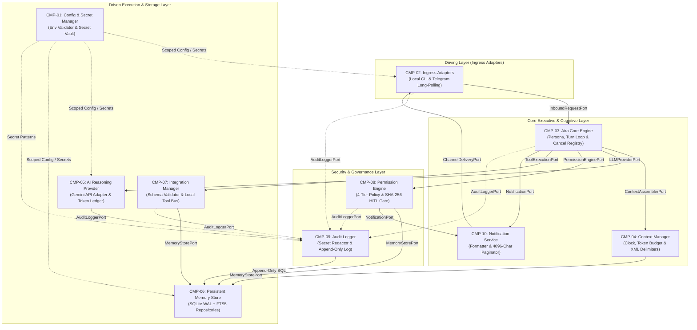
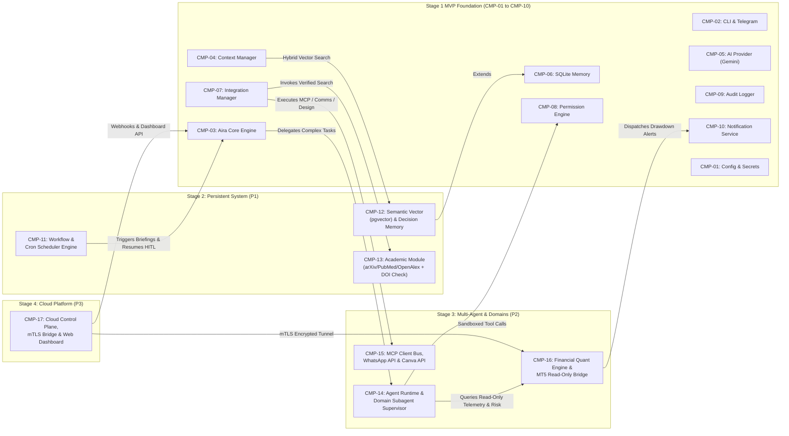

# AIRA MOCHTAR — Component Overview & Detailed Design Specification

| Document Metadata | Details |
| :--- | :--- |
| **Document ID** | `DOC-ARCH-CMP-004` |
| **Project Name** | AIRA MOCHTAR — Personal AI Operating System (PAI-OS) |
| **Upstream Specifications** | `PRODUCT_VISION.md` (`DOC-PRD-VISION-001`), `PRODUCT_REQUIREMENTS.md` (`DOC-PRD-REQ-002`), `SYSTEM_ARCHITECTURE.md` (`DOC-ARCH-SYS-003`) |
| **Status** | Baseline Component Specification (v1.0.0) |
| **Current Implementation State** | **Pre-Implementation (Zero Application Code Exists)** |
| **Target Audience** | Senior Software Architects, Backend/AI Engineers, QA Engineers, System Owner |

---

## Document Purpose & Architectural Rules

This document provides the low-level component engineering specification for **AIRA MOCHTAR**. It decomposes the Modular Monolith and Hexagonal (Ports & Adapters) architecture defined in `docs/architecture/SYSTEM_ARCHITECTURE.md` into concrete, testable software components.

### Key Architectural Constraints

1. **Zero Existing Code Assumption:** No runtime code currently exists in the workspace. All package paths (`src/aira/...`), interfaces (`*Port`), and data transfer objects (`DTOs`) defined in this document represent the target engineering blueprint.
2. **Strict Separation of MVP vs. Future Components:**
   - **Part I (`CMP-01` through `CMP-10`):** **Stage 1 (MVP) Core Components (`P0`)** required for the initial local MacBook prototype.
   - **Part II (`CMP-11` through `CMP-17`):** **Future Components (`P1`–`P3`)** planned for Stage 2 (Persistent System), Stage 3 (Multi-Agent & Domain Expansion), and Stage 4 (Cloud Platform).
3. **Acyclic Dependency Rule (Clean Hexagonal Boundaries):**
   - Outer layers (Interfaces, Providers, Database Adapters) depend inward on **Ports** (`src/aira/ports`).
   - Inner layers (`Aira Core Engine`, `Context Manager`, `Permission Engine`) **never** import concrete external SDKs (such as `google.genai`, `aiogram`, or `sqlite3`) directly.

---

## Part I: Stage 1 (MVP) Core Components (`P0`)

The following 10 components form the **Stage 1 Local AI Prototype**. Together, they deliver a secure, single-process Modular Monolith running on the user's MacBook with CLI and Telegram Long-Polling access, SQLite persistence, Google Gemini reasoning, 4-Tier permission enforcement, and immutable audit logging.

---

### `CMP-01`: Configuration & Secret Manager

| Attribute | Specification |
| :--- | :--- |
| **1. Component Name** | **Configuration & Secret Manager** (`src/aira/config`) |
| **Stage & Priority** | Stage 1 MVP (`P0`) — Linked to `SYS-001`, `SEC-001` |
| **2. Purpose** | Centralizes startup environment loading, strict schema validation of all runtime settings, and isolated storage of sensitive credentials so secrets never leak into prompts, logs, or unprivileged modules. |
| **3. Responsibilities** | 1. Load environment variables from `.env` (or OS environment / macOS Keychain) at process startup. 2. Validate all configuration values (types, ranges, required fields, valid timezone, valid numeric Telegram IDs) using strict schema definitions. 3. Wrap sensitive credentials (`GEMINI_API_KEY`, `TELEGRAM_BOT_TOKEN`) in opaque `SecretStr` containers that prevent accidental string serialization. 4. Register all loaded literal secret strings with the `RedactionFilter` inside `Audit Logger` (`CMP-09`). 5. Fail fast at startup with actionable diagnostic messages if any mandatory `P0` setting is missing or malformed. |
| **4. Inputs** | - OS environment variables (`os.environ`). - Local `.env` file (permissions `0600`). - CLI startup flags (e.g., `--env`, `--config-file`). |
| **5. Outputs** | - Immutable `AppConfig` object (non-sensitive operational parameters: timezone, model names, token caps, DB path). - Scoped credential objects injected exclusively into authorized adapter constructors (`GeminiProviderAdapter`, `TelegramBotAdapter`). - List of secret fingerprints/literals provided to `SecretRedactorPort`. |
| **6. Dependencies** | - **Internal:** None (Root dependency leaf). - **External:** Python standard library (`os`, `pathlib`), `pydantic` / `pydantic-settings`. |
| **7. Interfaces** | - `ConfigLoaderPort.load_config() -> AppConfig` - `SecretVaultPort.get_secret(key: SecretKey) -> SecretStr` - `SecretVaultPort.get_redaction_patterns() -> list[str]` |
| **8. Security Boundaries** | - **Trust Zone:** Zone 3 (Restricted Kernel). - **Boundary Rule:** `SecretVaultPort` is never passed to `Aira Core Engine`, `Context Manager`, or any LLM tool. Only concrete infrastructure adapters initialized at the application entrypoint (`main.py`) receive their specific required secret. |
| **9. Error Handling** | - `ConfigurationError`: Raised immediately at startup if `.env` is missing required keys, `AUTHORIZED_TELEGRAM_USER_IDS` is empty in bot mode, or `AIRA_TIMEZONE` is invalid. Terminates startup with exit code `2`. - `InsecureFilePermissionWarning`: Logged if `.env` has world-readable permissions on macOS/Linux. |
| **10. Testing Requirements** | - **Unit Tests:** Verify valid configuration parsing, default value assignment, `SecretStr` masking on `repr()`/`str()`, and immediate `ConfigurationError` on missing/invalid fields. - **Security Tests (`GATE-MVP-02`):** Verify that dumping `AppConfig` to JSON never outputs raw API keys. |

---

### `CMP-02`: Ingress Adapters (Local CLI & Telegram Bot Adapter)

| Attribute | Specification |
| :--- | :--- |
| **1. Component Name** | **Ingress Adapters & Owner Auth Guard** (`src/aira/interfaces`) |
| **Stage & Priority** | Stage 1 MVP (`P0`) — Linked to `FR-COMM-001`, `INT-002`, `SEC-002`, `NFR-001` |
| **2. Purpose** | Serves as the authenticated front door for the human owner via the MacBook Terminal (CLI) and Telegram Bot API (Long-Polling), rejecting unauthorized callers at the perimeter and normalizing valid inputs into typed internal requests. |
| **3. Responsibilities** | 1. **Telegram Adapter:** Maintain resilient outbound HTTPS long-polling (`getUpdates`) with Telegram servers. 2. **Owner Auth Guard (`SEC-002`):** Verify `message.from.id` and `callback_query.from.id` against `AUTHORIZED_TELEGRAM_USER_IDS` before parsing content. 3. **Immediate Acknowledgment (`NFR-001`):** Dispatch `sendChatAction("typing")` within 1.5 seconds of receiving a valid owner message. 4. **CLI Adapter:** Provide interactive REPL (`aira chat`) and direct command execution (`aira tasks`, `aira notes`, `aira status`, `aira cancel`). 5. Normalize raw CLI strings or Telegram payloads into a canonical `InboundUserRequest` with a freshly generated UUIDv4 `trace_id`. |
| **4. Inputs** | - Raw Telegram JSON Updates (`message`, `callback_query`) via HTTPS long-polling. - Local terminal `stdin` and command-line arguments. - Whitelisted owner ID list from `CMP-01`. |
| **5. Outputs** | - Normalized `InboundUserRequest(trace_id, channel, user_id, command_or_text, attachments, timestamp)`. - Normalized `CancellationSignal(trace_id, target_task_id, scope)` when `/cancel` or `/kill_all` is invoked. - `SecurityAuditEvent` sent to `CMP-09` (`Audit Logger`) upon any unauthorized ingress attempt. |
| **6. Dependencies** | - **Internal:** `CMP-01` (Config/Secrets), `CMP-03` (`Aira Core Engine` via `InboundRequestPort`), `CMP-09` (`Audit Logger`). - **External:** Telegram Bot API over HTTPS (`httpx` / `aiogram`), CLI framework (`typer` / `rich`). |
| **7. Interfaces** | - **Inbound (Driving):** Calls `InboundRequestPort.handle_user_request(request: InboundUserRequest) -> TurnResponse` - **Inbound (Cancel):** Calls `InboundRequestPort.handle_cancel(signal: CancellationSignal) -> CancelResult` - **Outbound (Driven):** Implements `ChannelDeliveryPort.send_message(payload: OutboundMessage) -> DeliveryReceipt` |
| **8. Security Boundaries** | - **Trust Zone:** Zone 0 (External Internet) $\rightarrow$ Zone 1 (Authenticated Ingress). - **Boundary Rule:** Unwhitelisted Telegram User IDs are dropped at line 1 of the handler; zero system metadata, error stack traces, or bot status details are ever returned to non-owners. |
| **9. Error Handling** | - **Telegram Network Drop / `HTTP 502/504`:** Automatic long-polling reconnection with exponential backoff (`1s` to `30s`) without crashing the process. - **Telegram Rate Limit (`HTTP 429 RetryAfter`):** Sleeps for the exact `retry_after` duration specified by Telegram. - **Malformed Update Payload:** Logged as warning with `trace_id` and safely skipped so the polling offset advances cleanly. |
| **10. Testing Requirements** | - **Unit Tests:** Test `OwnerAuthGuard` with whitelisted ID (passes) vs. non-whitelisted IDs, empty IDs, and spoofed group chats (all blocked and logged). - **Integration Tests:** Simulate `/status`, `/tasks`, `/notes`, and `/cancel` commands through both CLI and mocked Telegram polling loops (`GATE-MVP-02`, `GATE-MVP-03`). |

---

### `CMP-03`: Aira Core Engine

| Attribute | Specification |
| :--- | :--- |
| **1. Component Name** | **Aira Core Engine** (`src/aira/core/engine`) |
| **Stage & Priority** | Stage 1 MVP (`P0`) — Linked to `FR-CORE-001`, `FR-CORE-002`, `FR-AUTO-004` |
| **2. Purpose** | Acts as the central executive brain of AIRA MOCHTAR, enforcing Aira's identity, critical-thinking behavioral rules, epistemic honesty, and coordinating the multi-step reasoning and tool-execution loop. |
| **3. Responsibilities** | 1. Maintain and inject the canonical **Aira Mochtar Persona & Behavioral Specification** (warm, analytical, critical thinker, anti-sycophancy, assumption challenger, explicit uncertainty disclosure, non-sentience boundary). 2. Orchestrate the turn lifecycle: Context Assembly (`CMP-04`) $\rightarrow$ LLM Inference (`CMP-05`) $\rightarrow$ Permission Check (`CMP-08`) $\rightarrow$ Tool Execution (`CMP-07`) $\rightarrow$ Final Synthesis $\rightarrow$ Memory Persistence (`CMP-06`). 3. Enforce a hard maximum tool-call loop ceiling per turn (`MAX_TOOL_ITERATIONS = 5` in Stage 1) to prevent infinite reasoning loops. 4. Register active turns in an in-memory `ActiveTurnRegistry` bound to cancellation tokens so `/cancel` (`FR-AUTO-004`) halts execution within 3 seconds. |
| **4. Inputs** | - `InboundUserRequest` or `CancellationSignal` from `CMP-02` (or `SystemTrigger` from `CMP-11` in Stage 2). - `AssembledContext` from `CMP-04`. - `LLMResponse` from `CMP-05` and `ToolExecutionResult` from `CMP-07`. |
| **5. Outputs** | - `TurnResponse(trace_id, final_text, citations, tool_calls_summary, token_usage, status)` passed to `CMP-10` (`Notification Service`). - Session turn records committed to `CMP-06` (`Persistent Memory`). - Turn lifecycle audit events committed to `CMP-09` (`Audit Logger`). |
| **6. Dependencies** | - **Internal Ports Only:** `ContextAssemblerPort` (`CMP-04`), `LLMProviderPort` (`CMP-05`), `MemoryStorePort` (`CMP-06`), `ToolExecutionPort` (`CMP-07`), `PermissionEnginePort` (`CMP-08`), `AuditLoggerPort` (`CMP-09`), `NotificationPort` (`CMP-10`). - **External:** None (100% pure domain/application logic). |
| **7. Interfaces** | - Implements `InboundRequestPort`:   - `async handle_user_request(request: InboundUserRequest) -> TurnResponse`   - `async handle_cancel(signal: CancellationSignal) -> CancelResult` |
| **8. Security Boundaries** | - **Trust Zone:** Zone 2 (Trusted Core). - **Boundary Rule:** `Aira Core Engine` cannot execute any tool directly; it must pass every LLM-proposed `ToolCall` through `PermissionEnginePort.evaluate()` (`CMP-08`) before calling `ToolExecutionPort.execute()` (`CMP-07`). |
| **9. Error Handling** | - **`asyncio.CancelledError` (`/cancel` invoked):** Catches cancellation cleanly, marks the turn `CANCELLED_BY_USER` in `CMP-06`/`CMP-09`, and returns an immediate cancellation confirmation. - **`MaxIterationsExceededError`:** Stops tool looping after 5 iterations, synthesizes partial findings, and informs the user. - **Unhandled Downstream Exceptions:** Caught at the top-level turn boundary, logged with full stack trace and `trace_id` to `CMP-09`, and converted into a safe, user-friendly diagnostic message. |
| **10. Testing Requirements** | - **Unit Tests:** Test single-turn chat, multi-step tool loop, max-iteration circuit breaker, and mid-flight `/cancel` termination. - **Adversarial Persona Suite (`GATE-MVP-01`):** Verify 20 adversarial prompts testing anti-sycophancy, flawed premise pushback, uncertainty labeling, and refusal to claim human consciousness/emotions. |

---

### `CMP-04`: Context Manager

| Attribute | Specification |
| :--- | :--- |
| **1. Component Name** | **Context Manager** (`src/aira/core/context`) |
| **Stage & Priority** | Stage 1 MVP (`P0`) — Linked to `FR-CORE-003`, `SEC-003`, `NFR-001` |
| **2. Purpose** | Assembles a deterministic, token-budgeted, and security-delimited prompt payload before every LLM invocation so Aira's reasoning is grounded in accurate time, user preferences, active tasks, and relevant notes. |
| **3. Responsibilities** | 1. Inject authoritative system clock metadata (`ISO-8601` timestamp, day of week, `Asia/Jakarta` timezone). 2. Query `CMP-06` (`Persistent Memory`) for structured user preferences, recent session history, active high-priority tasks, and keyword-relevant notes. 3. Enforce strict token budgeting across prompt sections so total input never exceeds `MAX_INPUT_TOKENS_PER_TURN`. 4. Wrap any external or third-party text in `<untrusted_external_data>` XML delimiters and set the `is_tainted` flag on the context object (`SEC-003`). |
| **4. Inputs** | - `InboundUserRequest` (user query, channel metadata, `trace_id`). - Retrieved records from `CMP-06` (`UserPreferences`, `SessionMessage[]`, `Task[]`, `KnowledgeNote[]`). - Token budget configuration from `CMP-01`. |
| **5. Outputs** | - `AssembledContext(trace_id, system_instruction, messages, authorized_tool_declarations, token_estimate, is_tainted, retrieved_source_ids)`. |
| **6. Dependencies** | - **Internal:** `MemoryStorePort` (`CMP-06`), `ToolRegistryPort` (`CMP-07`), `AppConfig` (`CMP-01`). - **External:** Standard library `datetime`/`zoneinfo`. |
| **7. Interfaces** | - Implements `ContextAssemblerPort`:   - `async assemble_context(request: InboundUserRequest, domain_scope: str) -> AssembledContext` |
| **8. Security Boundaries** | - **Trust Zone:** Zone 2 (Trusted Core). - **Boundary Rule:** Sanitizes external inputs by stripping any attempt to close `</untrusted_external_data>` tags prematurely (preventing XML delimiter escape attacks). |
| **9. Error Handling** | - **Token Budget Overflow:** Deterministically trims oldest session messages first, then lowest-ranked retrieved notes, while preserving System Persona, User Preferences, and the current user message. - **Memory Query Timeout (> 300 ms):** Logs latency warning and proceeds with base persona + current message rather than failing the turn. |
| **10. Testing Requirements** | - **Unit Tests:** Verify timestamp injection, deterministic token trimming order, and XML delimiter escaping on malicious input strings containing `</untrusted_external_data>`. - **Performance Tests (`NFR-001`):** Verify context assembly completes in $< 300\text{ ms}$ at p95. |

---

### `CMP-05`: AI Reasoning Provider

| Attribute | Specification |
| :--- | :--- |
| **1. Component Name** | **AI Reasoning Provider** (`src/aira/providers/ai`) |
| **Stage & Priority** | Stage 1 MVP (`P0`) — Linked to `INT-001`, `NFR-006` |
| **2. Purpose** | Isolates all vendor-specific LLM and embedding API communication behind a clean interface, managing Google Gemini API calls, structured tool declarations, token accounting, retries, and model fallback. |
| **3. Responsibilities** | 1. Implement `GeminiProviderAdapter` using the official `google-genai` SDK. 2. Route requests between `GEMINI_FAST_MODEL` (routine chat, CRUD parsing) and `GEMINI_PRO_MODEL` (critical decision review, complex analysis). 3. Translate internal `ToolSchema` definitions into Gemini `FunctionDeclaration` objects and parse returned `FunctionCall` parts. 4. Enforce pre-call daily token budget checks against `DAILY_TOKEN_BUDGET_CAP` and record exact post-call token usage (`prompt_tokens`, `output_tokens`, `total_tokens`). 5. Execute exponential backoff with jitter on transient errors (`HTTP 429`, `500`, `503`) and degrade gracefully from `Pro` to `Flash` if the `Pro` endpoint is unavailable. |
| **4. Inputs** | - `AssembledContext` from `CMP-04`. - `ModelTier` selection (`FAST` or `PRO`), `temperature`, `max_output_tokens`, and optional `response_schema`. - `GEMINI_API_KEY` injected at startup from `CMP-01`. |
| **5. Outputs** | - `LLMResponse(trace_id, text_content, proposed_tool_calls, usage_metadata, model_used, latency_ms, finish_reason)`. - `TokenUsageRecord` persisted via `CMP-06` / `CMP-09`. |
| **6. Dependencies** | - **Internal:** `CMP-01` (Scoped `GEMINI_API_KEY` & model config), `CMP-09` (`Audit Logger`). - **External:** Official `google-genai` Python SDK (communicating with `generativelanguage.googleapis.com` over TLS 1.3). |
| **7. Interfaces** | - Implements `LLMProviderPort`:   - `async generate(context: AssembledContext, tier: ModelTier, cancel_token: CancelToken) -> LLMResponse`   - `async generate_structured(context: AssembledContext, schema: type[BaseModel]) -> BaseModel` - Implements `EmbeddingProviderPort` (Stage 2+):   - `async embed_texts(texts: list[str]) -> list[list[float]]` |
| **8. Security Boundaries** | - **Trust Zone:** Zone 2 (Core) $\rightarrow$ Zone 1 (Egress to Google Gemini API). - **Boundary Rule:** `GEMINI_API_KEY` is held strictly inside the private client instance; HTTP headers are never logged. Remember: This component calls the production Gemini API directly and has zero dependency on the Antigravity IDE. |
| **9. Error Handling** | - **`QuotaExceededError` (Daily Token Cap Reached):** Blocks outbound API call and returns a clear message to the owner (*"Daily token safety budget reached; adjust DAILY_TOKEN_BUDGET_CAP to continue"*). - **`ProviderRateLimitError` (`429`) / `ProviderUnavailableError` (`503`):** Retries up to 3 times with exponential backoff (`1s, 2s, 4s` + jitter); falls back from `Pro` to `Flash` if `Pro` fails. - **`SafetyBlockedError`:** Surfaces the exact finish reason transparently to the user without crashing. |
| **10. Testing Requirements** | - **Unit Tests:** Test request mapping, tool-call parsing, token budget cap blocking, retry backoff timing, and `Pro` $\rightarrow$ `Flash` fallback using `MockLLMProvider`. - **Contract Tests:** Verify compatibility with live Gemini API structured output and function-calling payload formats (`NFR-006`). |

---

### `CMP-06`: Persistent Memory Store (Stage 1 Core Repositories)

| Attribute | Specification |
| :--- | :--- |
| **1. Component Name** | **Persistent Memory Store** (`src/aira/memory`) |
| **Stage & Priority** | Stage 1 MVP (`P0`) — Linked to `FR-PERS-001`, `FR-PERS-002`, `SYS-002` |
| **2. Purpose** | Provides durable, ACID-compliant local storage and fast full-text retrieval for conversational sessions, personal tasks, knowledge notes, user preferences, and HITL approval states. |
| **3. Responsibilities** | 1. Manage the local SQLite 3 database connection pool with `WAL` mode, `foreign_keys = ON`, and `busy_timeout = 5000` enforced on every connection. 2. Execute versioned, idempotent SQL schema migrations at startup. 3. Provide repository operations for:    - `SessionRepository`: Append and fetch conversation turns.    - `TaskRepository`: CRUD and status/priority/deadline filtering for tasks (`FR-PERS-001`).    - `NoteRepository`: CRUD and **SQLite FTS5 (BM25)** keyword search over personal notes and ingested Markdown files (`FR-PERS-002`).    - `PreferenceRepository`: Upsert and load structured user preferences. |
| **4. Inputs** | - Typed domain entities (`TaskCreate`, `TaskUpdate`, `NoteCreate`, `SessionMessage`, `PreferenceEntry`) and search queries (`SearchFilter`). |
| **5. Outputs** | - Hydrated domain models (`Task`, `KnowledgeNote`, `SessionMessage`, `UserPreference`) with database IDs, timestamps, and FTS5 relevance scores. |
| **6. Dependencies** | - **Internal:** `CMP-01` (`DATABASE_URL`), `CMP-09` (`Audit Logger`). - **External:** SQLite 3 (`aiosqlite` / standard `sqlite3` with FTS5 extension enabled). |
| **7. Interfaces** | - Implements `MemoryStorePort`:   - `Tasks`: `create_task()`, `update_task()`, `list_tasks()`, `get_task_by_id()`   - `Notes`: `save_note()`, `search_notes_fts()`, `get_note_by_id()`, `archive_note()`   - `Sessions`: `append_turn()`, `get_recent_turns()`   - `Preferences`: `set_preference()`, `get_all_preferences()` |
| **8. Security Boundaries** | - **Trust Zone:** Zone 3 (Restricted Kernel). - **Boundary Rule:** All SQL queries use 100% parameterized prepared statements (`?` / `:param`)—string concatenation in SQL is strictly prohibited to prevent SQL injection. Database file is created with `0600` owner-only permissions. |
| **9. Error Handling** | - **`DatabaseLockedError` (`SQLITE_BUSY`):** Mitigated by `WAL` mode and `5000ms` busy timeout; retries transaction up to 3 times before raising `StorageUnavailableError`. - **`MigrationFailureError`:** Rolls back failed migration transaction and aborts startup to prevent schema corruption. |
| **10. Testing Requirements** | - **Unit & Integration Tests (`GATE-MVP-03`):** Test all CRUD methods, FTS5 ranking accuracy, concurrent read/write safety under `WAL` mode, and persistence across simulated process restarts. |

---

### `CMP-07`: Integration Manager & Local Tool Bus

| Attribute | Specification |
| :--- | :--- |
| **1. Component Name** | **Integration Manager & Tool Execution Bus** (`src/aira/integrations`) |
| **Stage & Priority** | Stage 1 MVP (`P0`) — Linked to `FR-AUTO-001`, `NFR-002`, `NFR-003` |
| **2. Purpose** | Acts as the central registry, JSON Schema validator, timeout isolator, and deterministic execution bus for all tools invoked by Aira. |
| **3. Responsibilities** | 1. Register every available tool with a unique name, description, strict Pydantic/JSON Schema input contract, execution timeout, and mandatory `PermissionTier` (`Tier A`–`Tier D`). 2. Validate raw LLM tool arguments against the tool's schema before execution. 3. Execute Stage 1 built-in deterministic tools: `create_task`, `list_tasks`, `complete_task`, `save_note`, `search_notes`, `set_user_preference`, `get_system_status`, and deterministic date/math calculators (`NFR-002`). 4. Enforce per-tool execution timeouts and strip any environment secrets from tool outputs before returning results to `Aira Core Engine`. |
| **4. Inputs** | - `VerifiedToolInvocation(trace_id, tool_name, raw_arguments, approval_token_or_tier_status)` from `CMP-03` after passing `CMP-08` (`Permission Engine`). |
| **5. Outputs** | - `ToolExecutionResult(trace_id, tool_name, status, structured_output, error_message, execution_ms, is_external_untrusted)`. |
| **6. Dependencies** | - **Internal:** `CMP-06` (`MemoryStorePort`), `CMP-08` (`PermissionEnginePort`), `CMP-09` (`AuditLoggerPort`). - **External:** `pydantic` for schema validation. |
| **7. Interfaces** | - Implements `ToolRegistryPort`: `get_tool_declarations(domain_scope: str) -> list[ToolSchema]` - Implements `ToolExecutionPort`: `async execute_tool(invocation: VerifiedToolInvocation) -> ToolExecutionResult` |
| **8. Security Boundaries** | - **Trust Zone:** Zone 2 (Core) $\leftrightarrow$ Zone 1 (Adapters). - **Boundary Rule:** `execute_tool()` refuses to run any tool unless the passed invocation carries a valid `PolicyClearance` object issued by `CMP-08` (`Permission Engine`). |
| **9. Error Handling** | - **`ToolValidationError`:** If the LLM supplies invalid argument types or missing required fields, returns a structured validation error back to the LLM so it can self-correct on the next step. - **`ToolTimeoutError` (`NFR-003`):** Cancels tool execution exceeding its timeout (default `10s` local, `15s` external) and returns a safe timeout status without crashing the runtime. |
| **10. Testing Requirements** | - **Unit Tests:** Test schema validation rejection on malformed LLM arguments, timeout isolation on a hanging mock tool, and deterministic accuracy of math/date utilities (`NFR-002`). |

---

### `CMP-08`: Permission Engine (4-Tier Policy & HITL Gateway)

| Attribute | Specification |
| :--- | :--- |
| **1. Component Name** | **Permission Engine & Approval Gateway** (`src/aira/security/permissions`) |
| **Stage & Priority** | Stage 1 MVP (`P0`) / Stage 2 Interactive Telegram HITL (`P1`) — Linked to `PERM-001`–`004`, `SEC-003` |
| **2. Purpose** | Enforces deterministic security governance over every action Aira attempts to take, guaranteeing that high-risk actions pause for human approval and prohibited actions are permanently blocked. |
| **3. Responsibilities** | 1. Classify every tool call into one of the four mandatory tiers (`PERM-001`):    - `Tier A (READ_ONLY)`: Auto-approve.    - `Tier B (LOCAL_WRITE_REVERSIBLE)`: Auto-approve + audit log (unless turn is marked `is_tainted` by external untrusted input, which escalates `Tier B` $\rightarrow$ `Tier C`).    - `Tier C (CONSEQUENTIAL_HITL)`: Halt execution, compute `SHA256(canonical_json(tool_name, args))`, store a `PendingApproval` record with expiration TTL, and request human confirmation.    - `Tier D (PROHIBITED_GUARDRAIL)`: Hard-block unconditionally. 2. Verify single-use approval tokens (`approval_id`, owner ID, TTL expiration, and exact SHA-256 payload match) when the user approves a pending `Tier C` action (`PERM-002`). |
| **4. Inputs** | - `PolicyEvaluationRequest(trace_id, actor, tool_name, arguments, is_context_tainted, approval_token)`. - User approval/rejection callbacks (`HITLDecisionCallback`) from `CMP-02`. |
| **5. Outputs** | - `PolicyDecision`: One of `PolicyClearance(APPROVED)`, `ApprovalRequiredChallenge(approval_id, payload_hash, summary, expires_at)`, or `PolicyViolationError(DENIED)`. |
| **6. Dependencies** | - **Internal:** `CMP-06` (`MemoryStorePort` for persisting `pending_approvals`), `CMP-09` (`AuditLoggerPort`). - **External:** Python standard library `hashlib` (`sha256`), `hmac`, `json`. |
| **7. Interfaces** | - Implements `PermissionEnginePort`:   - `async evaluate(request: PolicyEvaluationRequest) -> PolicyDecision`   - `async resolve_approval(callback: HITLDecisionCallback) -> ApprovalResolution` |
| **8. Security Boundaries** | - **Trust Zone:** Zone 3 (Restricted Kernel). - **Boundary Rule:** Unregistered tools default to `Tier C`. `Tier D` rules are hardcoded in immutable Python constants that cannot be modified via database settings or LLM prompts (`Section 6.5 Hard Guardrails`). |
| **9. Error Handling** | - **`ApprovalExpiredError`:** Rejects approval callbacks after TTL (default 24h) and marks the record `EXPIRED`. - **`PayloadTamperedError`:** If the payload hash at execution time differs by even 1 bit from the approved SHA-256 hash, blocks execution and logs a `CRITICAL` security alert. - **`PolicyViolationError`:** Raised immediately on any `Tier D` attempt. |
| **10. Testing Requirements** | - **Security & Governance Tests (`GATE-MVP-02`, `GATE-STG2-02`):** Test all 4 tiers, taint escalation (`Tier B` $\rightarrow$ `Tier C` when untrusted data is present), expired token rejection, and SHA-256 payload modification rejection. |

---

### `CMP-09`: Audit Logger & Secret Redactor

| Attribute | Specification |
| :--- | :--- |
| **1. Component Name** | **Audit Logger & Secret Redaction Filter** (`src/aira/security/audit`) |
| **Stage & Priority** | Stage 1 MVP (`P0`) — Linked to `SEC-001`, `SEC-004`, `NFR-004` |
| **2. Purpose** | Provides complete, tamper-evident forensic traceability across the entire operating system while guaranteeing that no secret or credential is ever written to logs or terminal outputs. |
| **3. Responsibilities** | 1. Maintain the `RedactionFilter` containing all literal secrets registered by `CMP-01` plus regex patterns for API keys, bearer tokens, and passwords. 2. Scrub every log message, exception string, and audit payload prior to persistence (`[REDACTED_SECRET]`). 3. Write structured JSON log lines (`timestamp`, `level`, `trace_id`, `component`, `event`, `duration_ms`, `metadata`) to rotating local log files (`data/logs/aira.jsonl`). 4. Insert immutable forensic records into the append-only `audit_logs` SQLite/PostgreSQL table (`SEC-004`). |
| **4. Inputs** | - `AuditEvent(trace_id, actor, action_type, tool_name, permission_tier, approval_status, outcome, metadata)` from any component. - Literal secret patterns from `CMP-01`. |
| **5. Outputs** | - Sanitized append-only rows in the `audit_logs` database table. - Sanitized JSON lines in `data/logs/aira.jsonl`. |
| **6. Dependencies** | - **Internal:** `CMP-01` (Secret patterns), `CMP-06` (Append-only DB connection). - **External:** Python `logging`, `re`, `json`. |
| **7. Interfaces** | - Implements `AuditLoggerPort`:   - `async log_event(event: AuditEvent) -> None`   - `sanitize_text(raw_text: str) -> str` |
| **8. Security Boundaries** | - **Trust Zone:** Zone 3 (Restricted Kernel). - **Boundary Rule:** The `AuditLoggerPort` exposes **zero** `update_audit_log()` or `delete_audit_log()` methods. Furthermore, a SQLite `BEFORE UPDATE` and `BEFORE DELETE` trigger on `audit_logs` raises `RAISE(ABORT, 'Audit logs are append-only')` at the database engine level. |
| **9. Error Handling** | - **Disk Full / DB Write Failure:** Falls back to writing emergency audit records to `stderr` and raises a critical system health alert so silent unlogged execution never occurs. |
| **10. Testing Requirements** | - **Security Tests (`SEC-001`, `SEC-004`):** Inject real-looking API keys into simulated error traces and verify 100% redaction in both `aira.jsonl` and `audit_logs`; attempt `DELETE FROM audit_logs` and verify that the SQLite trigger aborts the deletion. |

---

### `CMP-10`: Notification Service

| Attribute | Specification |
| :--- | :--- |
| **1. Component Name** | **Notification Service & Channel Router** (`src/aira/communication/notifications`) |
| **Stage & Priority** | Stage 1 MVP (`P0` Formatting & Routing) / Stage 2 (`P1` Quiet Hours & Urgency Deduplication) — Linked to `FR-COMM-001`, `FR-COMM-004` |
| **2. Purpose** | Formats and routes all outbound messages, responses, approval prompts, and alerts to the appropriate user interface while protecting user attention through pagination, urgency filtering, and Quiet Hours. |
| **3. Responsibilities** | 1. Format Markdown responses safely for the target channel (Telegram Markdown/HTML escaping vs. CLI Rich ANSI formatting). 2. Automatically split responses exceeding Telegram's `4,096`-character limit at clean paragraph or code-block boundaries (`INT-002`). 3. Attach inline approval keyboards (`[Approve]`, `[Reject]`) for `Tier C` HITL prompts. 4. In Stage 2 (`FR-COMM-004`), evaluate notification urgency (`LOW`, `NORMAL`, `HIGH`, `CRITICAL`) against configured Quiet Hours and deduplicate repeated alerts within a cooldown window. |
| **4. Inputs** | - `OutboundNotification(trace_id, target_channel, urgency, title, body_markdown, inline_buttons, dedupe_key)`. |
| **5. Outputs** | - Channel-formatted payloads delivered via `ChannelDeliveryPort` (`CMP-02`). - Queued overnight notifications stored in `CMP-06` when suppressed by Quiet Hours (Stage 2). |
| **6. Dependencies** | - **Internal:** `ChannelDeliveryPort` (`CMP-02`), `MemoryStorePort` (`CMP-06`), `AuditLoggerPort` (`CMP-09`). - **External:** None. |
| **7. Interfaces** | - Implements `NotificationPort`:   - `async notify_owner(notification: OutboundNotification) -> DeliveryStatus` |
| **8. Security Boundaries** | - **Trust Zone:** Zone 2 (Core) $\rightarrow$ Zone 1 (Egress Adapter). - **Boundary Rule:** Passes all outbound text through `AuditLoggerPort.sanitize_text()` (`CMP-09`) as a final defense-in-depth gate before transmitting over Telegram/CLI. |
| **9. Error Handling** | - **Telegram Markdown Parse Error (`HTTP 400 can't parse entities`):** Automatically strips broken Markdown formatting and retries sending as plain text so the user never misses a response. - **Message Exceeds 4,096 Characters:** Deterministically chunks into numbered parts (`[1/3]`, `[2/3]`, `[3/3]`). |
| **10. Testing Requirements** | - **Unit Tests:** Test 10,000-character Markdown pagination (preserving fenced code blocks), fallback to plain text on malformed Markdown, Quiet Hours queuing for `NORMAL` alerts vs. immediate bypass for `CRITICAL` alerts. |

---

## Part II: Future Components (`P1`–`P3` — Stages 2, 3, and 4)

The following 7 components are **out of scope for the Stage 1 MVP** (`Section 10.2 of PRODUCT_REQUIREMENTS.md`) and are architected for modular plug-in activation across Stages 2, 3, and 4.

---

### `CMP-11`: Workflow & Scheduler Engine (Stage 2 — `P1`)

| Attribute | Specification |
| :--- | :--- |
| **1. Component Name** | **Workflow & Scheduler Engine** (`src/aira/workflows`) |
| **Stage & Priority** | Stage 2 (`P1`) — Linked to `FR-AUTO-002`, `FR-COMM-002`, `UC-002` |
| **2. Purpose** | Transforms Aira from a reactive assistant into a proactive operating system by executing scheduled cron jobs (Morning & Evening Briefings) and resumable multi-step state machines. |
| **3. Responsibilities** | 1. Run persistent cron schedules (`MorningBriefingJob`, `EveningBriefingJob`, `DeadlineReminderJob`, `DailyDatabaseBackupJob`). 2. Assign deterministic idempotency keys (`job_name + scheduled_minute_iso`) so restarts never trigger duplicate briefings. 3. Persist workflow DAG state (`RUNNING`, `PAUSED_FOR_HITL`, `COMPLETED`, `FAILED`, `CANCELLED`) in the database and resume execution when `CMP-08` resolves a pending HITL approval. |
| **4. Inputs** | - Cron clock ticks, `SystemEvent` triggers, and `ApprovalResolution` events from `CMP-08`. |
| **5. Outputs** | - Scheduled `SystemTrigger` invocations sent to `CMP-03` (`Aira Core Engine`) and `OutboundNotification` briefings sent to `CMP-10`. |
| **6. Dependencies** | - **Internal:** `CMP-03`, `CMP-06`, `CMP-08`, `CMP-09`, `CMP-10`. |
| **7. Interfaces** | - `WorkflowEnginePort`: `schedule_job()`, `trigger_workflow()`, `resume_paused_workflow()`, `cancel_workflow()` |
| **8. Security Boundaries** | - **Trust Zone:** Zone 2 (Trusted Core). Background workflows are subject to the exact same `CMP-08` 4-Tier Permission rules and token budgets as interactive turns. |
| **9. Error Handling** | - **Partial Data Source Failure (`UC-002`):** If one module (e.g., external API) fails during Morning Briefing generation, isolates the error, delivers the remaining sections on time, and flags the offline module. |
| **10. Testing Requirements** | - **Integration Tests (`GATE-STG2-01`):** Verify cron execution accuracy ($\pm 10\text{s}$), idempotency across simulated restarts, and HITL pause-and-resume state transitions. |

---

### `CMP-12`: Hierarchical Semantic & Decision Memory Engine (Stage 2 — `P1`)

| Attribute | Specification |
| :--- | :--- |
| **1. Component Name** | **Hierarchical Semantic & Decision Memory Engine** (`src/aira/memory/semantic`) |
| **Stage & Priority** | Stage 2 (`P1`) — Linked to `FR-PERS-003`, `FR-PERS-004` |
| **2. Purpose** | Upgrades `CMP-06` with long-term Episodic summarization, `pgvector` Semantic embedding search, Procedural SOP templates, and structured Decision Matrix records. |
| **3. Responsibilities** | 1. Compress completed sessions into timestamped `EpisodicMemory` summaries. 2. Generate vector embeddings via `EmbeddingProviderPort` (`CMP-05`) and store them in PostgreSQL `pgvector`. 3. Execute **Hybrid Retrieval** combining BM25 lexical search and cosine vector similarity via **Reciprocal Rank Fusion (RRF)**. 4. Store and retrieve `DecisionRecord` matrices (`FR-PERS-004`) including assumptions, devil's-advocate risks, and scheduled retrospective review dates. |
| **4. Inputs** | - Session transcripts, atomic user facts, `DecisionRecord` payloads, and semantic search queries. |
| **5. Outputs** | - RRF-ranked `MemoryChunk[]` records and structured `DecisionRecord` objects. |
| **6. Dependencies** | - **Internal:** `CMP-05` (`EmbeddingProviderPort`), `CMP-06` (`MemoryStorePort`), `CMP-09` (`AuditLoggerPort`). - **External:** PostgreSQL 16+ with `pgvector` extension (`asyncpg` / `SQLAlchemy`). |
| **7. Interfaces** | - `SemanticMemoryPort`: `index_fact()`, `hybrid_search()`, `summarize_episode()`, `save_decision_record()`, `purge_memory()` |
| **8. Security Boundaries** | - **Trust Zone:** Zone 3 (Restricted Kernel). Enforces `domain_scope` namespace isolation on every vector and lexical query (`PERM-003`). |
| **9. Error Handling** | - **Embedding API Outage:** Degrades gracefully to BM25 lexical-only search so memory retrieval continues functioning without interruption. |
| **10. Testing Requirements** | - **Integration Tests (`GATE-STG2-01`):** Test multi-week fact recall, RRF hybrid ranking, memory superseding/versioning, and cascade deletion of vectors upon hard purge. |

---

### `CMP-13`: Academic Intelligence Module (Stage 2 `P1` / Stage 3 `P2`)

| Attribute | Specification |
| :--- | :--- |
| **1. Component Name** | **Academic Intelligence & Citation Verification Module** (`src/aira/domains/academic`) |
| **Stage & Priority** | Stage 2 (`P1` Literature Search & Synthesis) / Stage 3 (`P2` Scholarship Tracker & Socratic Tutor) — Linked to `FR-ACAD-001`–`004`, `INT-005` |
| **2. Purpose** | Provides rigorous scholarly research, multi-database literature retrieval, 100% verified DOI/arXiv citation checking, comparative synthesis matrices, and scholarship deadline tracking. |
| **3. Responsibilities** | 1. Query arXiv, OpenAlex, PubMed (NCBI E-utilities), Europe PMC, and Crossref REST APIs (`INT-005`). 2. Normalize bibliographic records into a canonical `ScholarlyWork` schema. 3. **Anti-Hallucination Gate (`FR-ACAD-001`):** Verify every cited DOI, PMID, or arXiv ID against live API metadata or local ingested PDFs before emitting any bibliography. 4. Generate structured Literature Review comparison tables (`FR-ACAD-002`) and manage scholarship checklists (`FR-ACAD-003`). |
| **4. Inputs** | - Research queries, DOI/arXiv identifiers, local PDF files, and scholarship application drafts. |
| **5. Outputs** | - Verified `ScholarlyWork[]` objects, Markdown Literature Synthesis Matrices, and Scholarship Status checklists. |
| **6. Dependencies** | - **Internal:** `CMP-05` (`AI Reasoning Provider`), `CMP-06`/`CMP-12` (`Memory`), `CMP-07` (`Integration Manager`). - **External:** Public HTTPS REST APIs (`arXiv`, `OpenAlex`, `PubMed`, `Crossref`). |
| **7. Interfaces** | - `AcademicServicePort`: `search_literature()`, `verify_citation()`, `build_synthesis_matrix()`, `track_scholarship()` |
| **8. Security Boundaries** | - **Trust Zone:** Zone 2 (Core) $\leftrightarrow$ Zone 1 (External APIs). All retrieved abstracts and PDF texts are wrapped in `<untrusted_external_data>` (`SEC-003`). |
| **9. Error Handling** | - **Unverifiable Citation:** Refuses to fabricate bibliographic details; explicitly tags any unresolved reference as `[UNVERIFIED_CITATION]`. - **API Rate Limit:** Enforces polite-pool headers and local SQLite/PostgreSQL response caching. |
| **10. Testing Requirements** | - **Verification Tests (`GATE-STG2-02`):** Test DOI resolver against valid DOIs vs. fabricated DOIs (100% detection of fake DOIs); test multi-paper synthesis table formatting. |

---

### `CMP-14`: Agent Runtime & Domain Subagent Supervisor (Stage 3 — `P2`)

| Attribute | Specification |
| :--- | :--- |
| **1. Component Name** | **Multi-Agent Supervisor & Subagent Sandbox Runtime** (`src/aira/agents`) |
| **Stage & Priority** | Stage 3 (`P2`) — Linked to `FR-AUTO-003`, `PERM-003` |
| **2. Purpose** | Scales Aira across all six product domains by decomposing complex tasks and delegating them to specialized domain subagents running inside least-privilege sandboxes. |
| **3. Responsibilities** | 1. Coordinate the **Centralized Supervisor Pattern**: `Aira Core Engine` acts as Supervisor, decomposing cross-domain objectives into bounded `SubagentTask` assignments. 2. Manage five specialized subagent profiles: `PersonalAgent`, `CommsAgent`, `BusinessCreativeAgent`, `AcademicAgent`, and `FinancialQuantAgent`. 3. Enforce declarative **Subagent Permission Manifests (`PERM-003`)**: restrict each subagent to its authorized tool subset, memory `domain_scope`, max steps (`15`), and token budget. 4. Require all subagent proposals for `Tier C` external actions to be returned to the Core Supervisor and `Permission Engine` (`CMP-08`). |
| **4. Inputs** | - `ComplexObjective` from `CMP-03` and declarative `SubagentManifest` configurations. |
| **5. Outputs** | - Validated `SubagentReport` payloads synthesized by the Supervisor into the final user response. |
| **6. Dependencies** | - **Internal:** `CMP-03`, `CMP-04`, `CMP-05`, `CMP-07`, `CMP-08`, `CMP-09`. |
| **7. Interfaces** | - `AgentRuntimePort`: `delegate_task(subagent_id: str, task: SubagentTask) -> SubagentReport` |
| **8. Security Boundaries** | - **Trust Zone:** Zone 2 (Sandboxed Subagent Context). Cross-domain tool calls (e.g., `AcademicAgent` attempting to invoke an MT5 or WhatsApp tool) are blocked by `CMP-08` (`PERM-003`). |
| **9. Error Handling** | - **`SubagentQuotaExceededError`:** Halts subagent execution when step count exceeds 15 or token budget is exhausted, returning partial findings to the Supervisor. |
| **10. Testing Requirements** | - **Sandbox Tests (`GATE-STG3-01`):** Verify cross-domain tool denial (`PERM-003`), step-limit termination, and Supervisor synthesis accuracy. |

---

### `CMP-15`: MCP Client Bus & External Business/Comms Adapters (Stage 3 — `P2`)

| Attribute | Specification |
| :--- | :--- |
| **1. Component Name** | **Model Context Protocol (MCP) Client Bus, WhatsApp Adapter & Canva Adapter** (`src/aira/integrations/mcp`) |
| **Stage & Priority** | Stage 3 (`P2`) — Linked to `FR-AUTO-001`, `FR-COMM-005`, `FR-BIZ-003`, `FR-BIZ-004`, `INT-003`, `INT-004` |
| **2. Purpose** | Extends `CMP-07` (`Integration Manager`) with standardized Model Context Protocol (MCP) server connectivity, official Meta WhatsApp Business Cloud API messaging, and Canva design automation. |
| **3. Responsibilities** | 1. **MCP Client Bus:** Connect to configured MCP servers over `stdio` or `SSE`/`Streamable HTTP`, discover tool schemas, and map each MCP tool to an explicit `PermissionTier` (`CMP-08`). 2. **WhatsApp Cloud API Adapter (`INT-003`):** Verify Meta `X-Hub-Signature-256` webhooks for inbound messages, stage replies in `PENDING_APPROVAL`, and dispatch outbound messages strictly after `Tier C` HITL approval (`PERM-002`). 3. **Canva Adapter (`INT-004`):** Manage OAuth 2.0 PKCE tokens, search Canva brand templates, autofill social media copy, and export design previews for owner review. |
| **4. Inputs** | - MCP tool invocations, Meta WhatsApp webhook payloads, and Canva design briefs. |
| **5. Outputs** | - Normalized `ToolExecutionResult` payloads, staged WhatsApp message receipts, and Canva preview URLs / exported assets. |
| **6. Dependencies** | - **Internal:** `CMP-01`, `CMP-07`, `CMP-08`, `CMP-09`, `CMP-10`. - **External:** Official MCP SDK, Meta Graph API, Canva Connect API / Canva MCP Server. |
| **7. Interfaces** | - `MCPClientPort`: `register_server()`, `list_mcp_tools()`, `call_mcp_tool()` - `WhatsAppAdapterPort`: `handle_webhook()`, `send_approved_message()` - `CanvaAdapterPort`: `search_templates()`, `autofill_design()`, `export_design()` |
| **8. Security Boundaries** | - **Trust Zone:** Zone 1 (External Adapter DMZ). Inbound WhatsApp text is marked `<untrusted_external_data>`. Outbound WhatsApp transmission and public publishing are hard-gated at `Tier C` (`PERM-002`). |
| **9. Error Handling** | - **OAuth Token Expiration:** Automatically refreshes Canva OAuth2 token using encrypted refresh token; notifies owner if re-consent is required. - **MCP Server Crash:** Isolates subprocess failure and restarts or marks the MCP server offline (`NFR-003`). |
| **10. Testing Requirements** | - **Integration Tests:** Test Meta HMAC signature verification, HITL block on unapproved WhatsApp sends, and Canva OAuth token refresh cycle. |

---

### `CMP-16`: Financial Intelligence & MT5 Read-Only Telemetry Bridge (Stage 3 — `P2`)

| Attribute | Specification |
| :--- | :--- |
| **1. Component Name** | **Financial Intelligence Engine & MT5 Read-Only Bridge** (`src/aira/domains/finance` & `mt5_bridge`) |
| **Stage & Priority** | Stage 3 (`P2`) — Linked to `FR-FIN-001`–`005`, `INT-006`, `PERM-004`, `NFR-002` |
| **2. Purpose** | Provides quantitative trading oversight, real-time read-only MetaTrader 5 account monitoring, drawdown/margin alerting, post-trade statistical attribution, historical backtesting, and position-sizing risk calculations. |
| **3. Responsibilities** | 1. **MT5 Read-Only Bridge (`INT-006`):** Lightweight service running alongside the Windows MT5 terminal exposing strictly read-only endpoints (`/account`, `/positions`, `/orders`, `/history/deals`, `/market/rates`). 2. **Risk & Drawdown Monitor (`FR-FIN-002`):** Continuously check floating drawdown %, margin level %, and missing Stop Loss (`SL == 0`) conditions, triggering immediate `HIGH`/`CRITICAL` alerts via `CMP-10`. 3. **Deterministic Quant Analytics (`FR-FIN-003`, `NFR-002`):** Compute win rate, profit factor, expectancy, Sharpe/Sortino ratios, max drawdown, and behavioral anomaly flags (revenge trading / overtrading) in pure Python/NumPy/Pandas. 4. **Backtest & Position Sizing Engine (`FR-FIN-004`, `FR-FIN-005`):** Run historical OHLCV/tick simulations with realistic spread/slippage, critique small sample sizes ($N < 30$) or curve-fitting, and compute exact lot sizes and portfolio correlation caps. |
| **4. Inputs** | - Read-only MT5 telemetry JSON, historical OHLCV/tick datasets, and user risk parameters (`risk_pct`, `entry_price`, `sl_price`, `symbol`). |
| **5. Outputs** | - `AccountRiskSnapshot`, `TradePerformanceReport`, `BacktestEvaluationReport`, `PositionSizeCalculation`, and `CRITICAL` drawdown alerts. |
| **6. Dependencies** | - **Internal:** `CMP-06` (`Memory`), `CMP-08` (`Permission Engine`), `CMP-09` (`Audit Logger`), `CMP-10` (`Notification Service`). - **External:** `pandas`, `numpy`, `httpx` (Core client) $\leftrightarrow$ `MetaTrader5` Python package on Windows/VPS Bridge. |
| **7. Interfaces** | - `MT5TelemetryPort`: `get_account_summary()`, `get_open_positions()`, `get_deal_history()`, `get_ohlcv_rates()` - `QuantRiskEnginePort`: `evaluate_drawdown_risk()`, `calculate_position_size()`, `analyze_trade_history()`, `run_backtest()` |
| **8. Security Boundaries** | - **Trust Zone:** Zone 1 (Bridge Boundary) & Zone 2 (Deterministic Quant Module). - **Hard Financial Isolation (`PERM-004`):** The `MT5TelemetryPort` and `mt5_bridge` physically omit `order_send` / live trade execution endpoints (`Tier D` prohibited). All financial math executes in deterministic Python functions—never via LLM token estimation (`NFR-002`). |
| **9. Error Handling** | - **Stale Telemetry / Terminal Disconnected (`FR-FIN-001`):** If bridge heartbeat or terminal tick timestamp lags by $> 60$ seconds during market hours, dispatches a `HIGH` connectivity alert. - **Invalid Contract Specification:** Refuses to output a lot-size estimate if tick value or contract size is missing. |
| **10. Testing Requirements** | - **Quantitative Accuracy Tests (`GATE-STG3-01`, `NFR-002`):** Verify position sizing, drawdown %, Sharpe ratio, and expectancy against reference financial spreadsheets to 4 decimal places; verify `HTTP 403` rejection on any simulated write/order attempt on the bridge. |

---

### `CMP-17`: Hybrid Cloud Control Plane & Web Executive Dashboard (Stage 4 — `P3`)

| Attribute | Specification |
| :--- | :--- |
| **1. Component Name** | **Cloud Control Plane, Encrypted Bridge Coordinator & Web Dashboard** (`src/aira/web` & `bridge`) |
| **Stage & Priority** | Stage 4 (`P3`) — Linked to `SYS-003`, `SYS-004` |
| **2. Purpose** | Provides 24/7 high-availability cloud hosting for Aira's core orchestration and webhook ingress, an mTLS/WireGuard encrypted bridge to local/VPS nodes, and a visual Web Executive Dashboard. |
| **3. Responsibilities** | 1. Expose authenticated HTTPS webhook endpoints for Telegram and WhatsApp Cloud API. 2. Maintain mutually authenticated (mTLS / WireGuard) tunnels between the Cloud Control Plane and remote execution bridges (Windows MT5 VPS and Owner MacBook local bridge). 3. Serve the **Web Executive Dashboard (`SYS-004`)** for inspecting memory graphs, reviewing HITL approval queues, viewing multi-agent audit traces, and visualizing MT5 performance charts. |
| **4. Inputs** | - HTTPS Webhooks, authenticated Owner browser requests (HTTPS/WSS), and encrypted bridge heartbeats. |
| **5. Outputs** | - Web Dashboard UI/JSON state, SSE real-time streams, and remote bridge RPC commands. |
| **6. Dependencies** | - **Internal:** All core ports (`CMP-01` through `CMP-16`). - **External:** FastAPI / Starlette (API server), mTLS / WireGuard, Managed PostgreSQL + `pgvector`. |
| **7. Interfaces** | - `DashboardAPIPort`: REST/SSE endpoints (`/api/v1/status`, `/api/v1/approvals`, `/api/v1/memory`, `/api/v1/finance`, `/api/v1/audit`). - `RemoteBridgePort`: `dispatch_bridge_call()`, `verify_bridge_heartbeat()`. |
| **8. Security Boundaries** | - **Trust Zone:** Zone 1 (Cloud Ingress) $\leftrightarrow$ Zone 2 (Cloud Core) $\leftrightarrow$ Encrypted mTLS Tunnel to Bridges. Zero-trust mutual certificate verification on all bridge connections. |
| **9. Error Handling** | - **Local Bridge Offline (`SYS-003`):** Queues non-urgent local-bridge tasks, keeps cloud chat/briefings/webhooks 100% online, and notifies owner of bridge disconnection. |
| **10. Testing Requirements** | - **Resilience Tests (`GATE-STG4-01`):** Test automatic bridge reconnection, expired client certificate rejection, and 99.9% availability under simulated node restarts. |

---

## 3. Component Interaction Matrix

The table below defines the exact runtime interaction contracts between components across **Stage 1 (MVP)** and **Future Stages (Stages 2–4)**:

| Interaction ID | Caller Component | Callee Component | Interface / Port Used | Payload Contract (Input $\rightarrow$ Output) | Execution Mode | Stage Active |
| :--- | :--- | :--- | :--- | :--- | :--- | :--- |
| **`INT-CMP-01`** | Application Entrypoint | `CMP-01` Config & Secrets | `ConfigLoaderPort` | `EnvVars` $\rightarrow$ `AppConfig` + `SecretStr` | Sync (Startup) | **Stage 1 (MVP)** |
| **`INT-CMP-02`** | `CMP-01` Config & Secrets | `CMP-09` Audit Logger | `AuditLoggerPort` | `list[SecretPattern]` $\rightarrow$ `Ack` | Sync (Startup) | **Stage 1 (MVP)** |
| **`INT-CMP-03`** | `CMP-02` Ingress (CLI/TG) | `CMP-03` Aira Core Engine | `InboundRequestPort` | `InboundUserRequest` $\rightarrow$ `TurnResponse` | Async (`await`) | **Stage 1 (MVP)** |
| **`INT-CMP-04`** | `CMP-02` Ingress (CLI/TG) | `CMP-03` Aira Core Engine | `InboundRequestPort` | `CancellationSignal` $\rightarrow$ `CancelResult` | Async (Immediate) | **Stage 1 (MVP)** |
| **`INT-CMP-05`** | `CMP-03` Aira Core Engine | `CMP-04` Context Manager | `ContextAssemblerPort` | `InboundUserRequest` $\rightarrow$ `AssembledContext` | Async (`await`) | **Stage 1 (MVP)** |
| **`INT-CMP-06`** | `CMP-04` Context Manager | `CMP-06` Persistent Memory | `MemoryStorePort` | `SearchFilter` $\rightarrow$ `Prefs + Turns + Tasks + Notes` | Async (`await`) | **Stage 1 (MVP)** |
| **`INT-CMP-07`** | `CMP-03` Aira Core Engine | `CMP-05` AI Provider | `LLMProviderPort` | `AssembledContext` $\rightarrow$ `LLMResponse` | Async (`await`) | **Stage 1 (MVP)** |
| **`INT-CMP-08`** | `CMP-03` Aira Core Engine | `CMP-08` Permission Engine | `PermissionEnginePort` | `PolicyEvaluationRequest` $\rightarrow$ `PolicyDecision` | Async (`await`) | **Stage 1 (MVP)** |
| **`INT-CMP-09`** | `CMP-03` Aira Core Engine | `CMP-07` Integration Mgr | `ToolExecutionPort` | `VerifiedToolInvocation` $\rightarrow$ `ToolExecutionResult` | Async (`await`) | **Stage 1 (MVP)** |
| **`INT-CMP-10`** | `CMP-07` Integration Mgr | `CMP-06` Persistent Memory | `MemoryStorePort` | `Task/Note Mutation` $\rightarrow$ `PersistedEntity` | Async (ACID Tx) | **Stage 1 (MVP)** |
| **`INT-CMP-11`** | `CMP-03` / `CMP-08` | `CMP-10` Notification Svc | `NotificationPort` | `OutboundNotification` $\rightarrow$ `DeliveryStatus` | Async (`await`) | **Stage 1 (MVP)** |
| **`INT-CMP-12`** | `CMP-10` Notification Svc | `CMP-02` Ingress (CLI/TG) | `ChannelDeliveryPort` | `FormattedMessage` $\rightarrow$ `DeliveryReceipt` | Async (`await`) | **Stage 1 (MVP)** |
| **`INT-CMP-13`** | All Components (`CMP-02`..`17`) | `CMP-09` Audit Logger | `AuditLoggerPort` | `AuditEvent` $\rightarrow$ `Redacted JSON + DB Row` | Async (Append-Only) | **Stage 1 (MVP)** |
| **`INT-CMP-14`** | `CMP-11` Workflow Engine | `CMP-03` Aira Core Engine | `InboundRequestPort` | `ScheduledSystemTrigger` $\rightarrow$ `BriefingOutput` | Async (Cron Job) | Stage 2 (`P1`) |
| **`INT-CMP-15`** | `CMP-04` Context Manager | `CMP-12` Semantic Memory | `SemanticMemoryPort` | `HybridQuery` $\rightarrow$ `RRF MemoryChunk[]` | Async (`await`) | Stage 2 (`P1`) |
| **`INT-CMP-16`** | `CMP-07` Integration Mgr | `CMP-13` Academic Module | `AcademicServicePort` | `ResearchQuery` $\rightarrow$ `Verified ScholarlyWork[]` | Async (HTTPS) | Stage 2 (`P1`) |
| **`INT-CMP-17`** | `CMP-03` Aira Core Engine | `CMP-14` Agent Runtime | `AgentRuntimePort` | `ComplexObjective` $\rightarrow$ `SubagentReport` | Async (Sandboxed) | Stage 3 (`P2`) |
| **`INT-CMP-18`** | `CMP-07` Integration Mgr | `CMP-15` MCP / WA / Canva | `MCPClientPort` | `VerifiedToolInvocation` $\rightarrow$ `MCPToolResult` | Async (IPC/HTTPS) | Stage 3 (`P2`) |
| **`INT-CMP-19`** | `CMP-14` / `CMP-11` | `CMP-16` Financial & MT5 | `QuantRiskEnginePort` | `RiskEvalRequest` $\rightarrow$ `AccountRiskSnapshot` | Async (Read-Only) | Stage 3 (`P2`) |
| **`INT-CMP-20`** | `CMP-17` Web Dashboard | `CMP-03` / `CMP-08` / `CMP-16` | `DashboardAPIPort` | `AuthenticatedHTTP` $\rightarrow$ `JSON / SSE Stream` | Async (HTTPS/SSE) | Stage 4 (`P3`) |

---

## 4. Component Dependency Diagrams

### 4.1 Stage 1 (MVP) Component Dependency Graph

The diagram below illustrates the **Stage 1 MVP (`CMP-01` through `CMP-10`)** components. Notice that all dependencies flow cleanly from outer adapters toward inner ports and storage foundations, with zero circular dependencies.

---

### 4.2 Full Multi-Stage Component Evolution Graph (Stages 1 to 4)

The diagram below shows how **Future Components (`CMP-11` through `CMP-17`)** attach onto the **Stage 1 MVP Core (`CMP-01` through `CMP-10`)** in Stages 2, 3, and 4 without requiring structural rewrites of the Stage 1 components:

---

## 5. Component Readiness & Implementation Sequence Matrix

To guide disciplined incremental implementation (`Stage F — Vertical Slices`), the components in Part I (`CMP-01`–`CMP-10`) shall be implemented and verified in the following dependency order once approved:

| Build Order | Component ID & Name | Key Deliverable | Verification Gate |
| :--- | :--- | :--- | :--- |
| **Step 1** | `CMP-01`: Config & Secret Manager | Pydantic config loader + `.env.example` + `SecretStr` guard | Unit tests (`GATE-MVP-02`) |
| **Step 2** | `CMP-06` + `CMP-09`: SQLite Memory & Audit Logger | SQLite `WAL` + `FTS5` schema migrations + append-only `audit_logs` + secret redactor | Persistence & redaction tests (`GATE-MVP-02`, `GATE-MVP-03`) |
| **Step 3** | `CMP-08` + `CMP-07`: Permission Engine & Local Tool Bus | 4-Tier policy classifier + SHA-256 approval records + Task/Note local tools | Policy tier unit tests (`GATE-MVP-02`) |
| **Step 4** | `CMP-05` + `CMP-04`: AI Provider (Gemini) & Context Manager | `LLMProviderPort` + `GeminiProviderAdapter` + token-budgeted context assembly | Mock & live contract tests (`NFR-001`, `NFR-006`) |
| **Step 5** | `CMP-03`: Aira Core Engine | Persona system prompt + turn loop + `/cancel` registry | 20-prompt Adversarial Persona Suite (`GATE-MVP-01`) |
| **Step 6** | `CMP-10` + `CMP-02`: Notification Service, CLI & Telegram Bot | Local CLI REPL + Owner-whitelisted Telegram Long-Polling daemon | End-to-end CLI & Telegram integration tests (`GATE-MVP-03`) |

