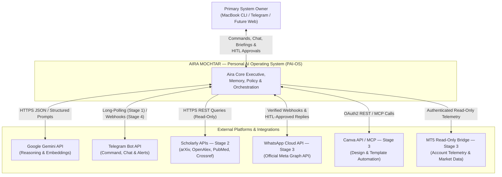
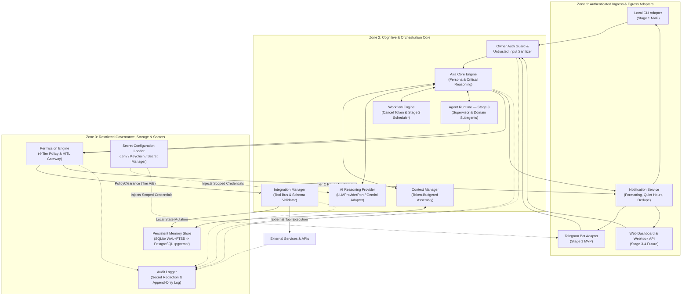
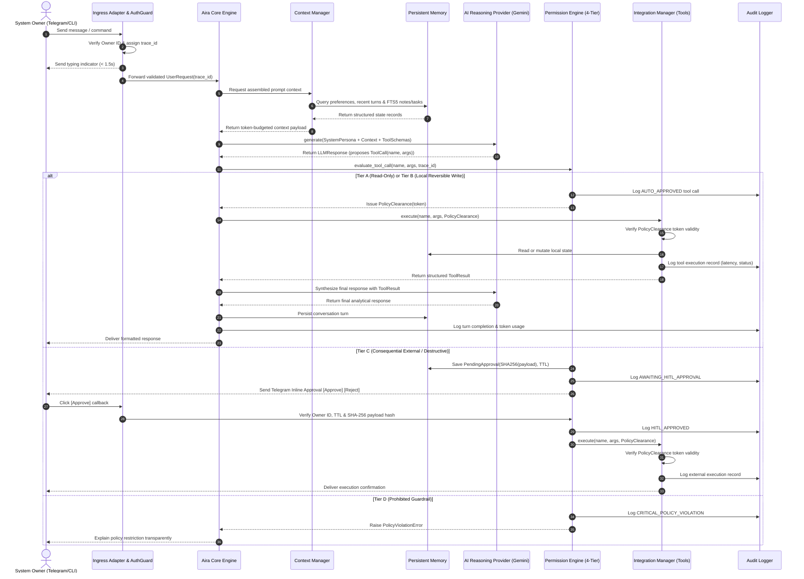
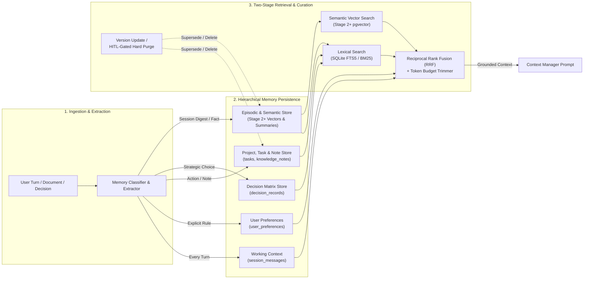
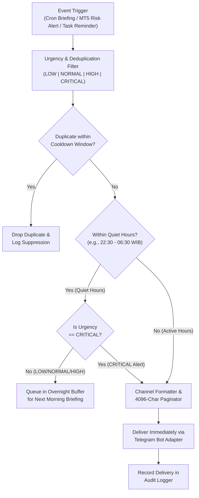
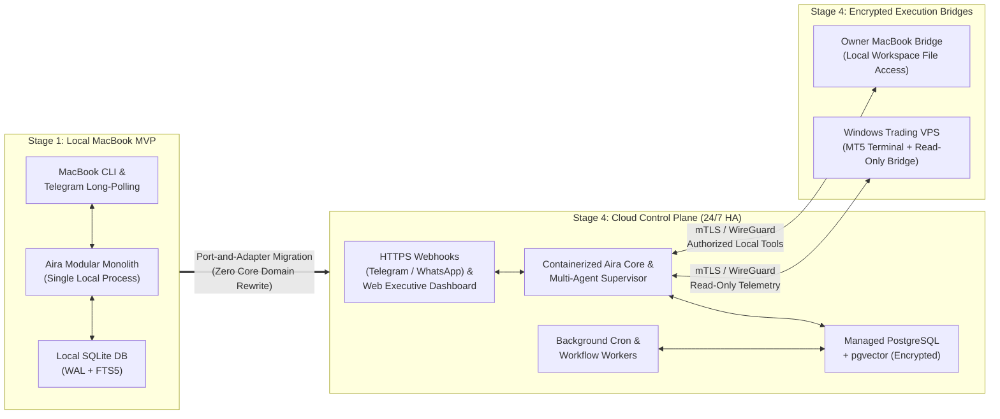

# AIRA MOCHTAR — System Architecture Specification

| Document Metadata | Details |
| :--- | :--- |
| **Document ID** | `DOC-ARCH-SYS-003` |
| **Project Name** | AIRA MOCHTAR — Personal AI Operating System (PAI-OS) |
| **Upstream Specifications** | `docs/product/PRODUCT_VISION.md` (`DOC-PRD-VISION-001`), `docs/product/PRODUCT_REQUIREMENTS.md` (`DOC-PRD-REQ-002`) |
| **Status** | Baseline Architecture Specification (v1.0.0) |
| **Current Implementation State** | **Pre-Implementation (Zero Application Code Exists)** |
| **Target Audience** | Principal Architects, AI Systems Engineers, Cloud Engineers, Security Reviewers, System Owner |

---

## Implementation Status & Document Scope Disclosure

To maintain strict engineering transparency, this document distinguishes three states across every section:

1. **Existing Implementation (Current State — Tier 0):**
   - **None.** The repository currently contains only product and architectural specifications (`PRODUCT_VISION.md`, `PRODUCT_REQUIREMENTS.md`, `SYSTEM_ARCHITECTURE.md`, and `.gitignore`). No runtime code, database schemas, API adapters, or deployment scripts have been implemented yet.
2. **Proposed MVP Architecture (Stage 1 Target — `P0`):**
   - A **Local-First Modular Monolith** using **Hexagonal Architecture (Ports & Adapters)** designed to run natively on a local MacBook workstation with SQLite (WAL mode + FTS5), a local CLI adapter, a long-polling Telegram Bot adapter, and a provider-agnostic Gemini API reasoning adapter.
3. **Future Capabilities (Stages 2–4 Target — `P1` to `P3`):**
   - Hierarchical vector-enabled memory (`pgvector`), cron/event background workers, stateful Telegram inline Human-in-the-Loop (HITL) approval gates (`Stage 2`); multi-agent supervisor-subagent orchestration, Model Context Protocol (MCP) tool bus, WhatsApp Cloud API, Canva API, and MetaTrader 5 (MT5) read-only telemetry bridge (`Stage 3`); hybrid cloud-local deployment with a Web Executive Dashboard (`Stage 4`).

---

## 1. Architectural Overview

### 1.1 Architectural Style

AIRA MOCHTAR is architected as a **Modular Monolith with Hexagonal (Ports and Adapters) Boundaries** for Stages 1 and 2, designed for seamless evolution into a **Hybrid Distributed Control Plane with Specialized Execution Bridges** in Stages 3 and 4.

- **Hexagonal Architecture (Ports & Adapters):** All core domain logic, persona rules, memory curation, and permission enforcement reside inside an isolated application core. External technologies—such as the Gemini API, Telegram Bot API, SQLite/PostgreSQL databases, Canva, WhatsApp, and the MT5 terminal bridge—connect exclusively through strictly typed **Inbound Ports** (driving adapters) and **Outbound Ports** (driven adapters).
- **Event-Driven & Stateful Orchestration:** Unlike stateless request-response chatbots, Aira processes every interaction as a state transition backed by persistent storage, structured context assembly, and an immutable audit log (`NFR-004`, `NFR-006`).

> **Penjelasan Konsep (ID):** *Hexagonal Architecture (Ports & Adapters)* adalah pola desain di mana "otak inti" Aira dipisahkan sepenuhnya dari alat-alat luar (seperti Telegram, database, atau model AI Gemini). Alat-alat luar dipasang seperti "colokan" (*adapter*). Jika suatu hari Anda ingin mengganti database dari SQLite ke PostgreSQL, atau menambah model AI baru, Anda cukup mengganti colokannya tanpa perlu membongkar ulang kode otak inti Aira.

### 1.2 Core System Boundaries

The system boundary separates what Aira owns and controls from external actors and third-party infrastructure:

- **Inside the System Boundary:**
  - Ingress Adapters (CLI Adapter, Telegram Adapter, Future Webhook/Web API Adapters)
  - Security & Identity Guard (Owner Whitelist Verifier, Signature Validator, Untrusted Input Sanitizer)
  - Aira Core Executive, Context Manager, Agent Runtime, and Workflow Engine
  - Permission Engine (4-Tier Policy Evaluator & HITL Approval State Machine)
  - Persistent Memory Subsystem & Audit Logger
  - Outbound Integration Manager & Provider Adapters
- **Outside the System Boundary:**
  - Primary Human Owner (interacting via MacBook Terminal, Telegram Client, or Future Web Browser)
  - External AI Model APIs (Google Gemini API, optional OpenAI/Anthropic/Local Ollama)
  - Messaging & Creative Platforms (Telegram Cloud Servers, Meta WhatsApp Cloud API, Canva Connect API)
  - Academic Databases (arXiv, OpenAlex, PubMed, Crossref)
  - Financial Terminal Infrastructure (MetaTrader 5 Terminal running on Windows VPS / Wine)

### 1.3 Major Components Summary

| Component | Layer | Primary Responsibility | Stage Introduced |
| :--- | :--- | :--- | :--- |
| **Ingress Adapters** | Driving Layer | Normalize CLI commands, Telegram updates, and future webhooks into typed `SystemEvent` / `UserRequest` objects. | Stage 1 (MVP) |
| **Aira Core Engine** | Executive Layer | Central coordinator enforcing persona rules, critical thinking, epistemic transparency, and turn orchestration. | Stage 1 (MVP) |
| **Context Manager** | Cognitive Layer | Assemble token-budgeted prompts combining persona, timestamp, session window, and retrieved memories. | Stage 1 (MVP) |
| **AI Reasoning Provider** | Driven Layer | Abstract interface over LLM & embedding APIs (Gemini API primary) with retry, token accounting, and fallback. | Stage 1 (MVP) |
| **Permission Engine** | Governance Layer | Enforce 4-Tier tool policies (`READ_ONLY`, `LOCAL_WRITE`, `CONSEQUENTIAL_HITL`, `PROHIBITED`) & HITL tokens. | Stage 1 (MVP) |
| **Persistent Memory** | Data Layer | Manage tasks, notes, session logs (Stage 1) and episodic/semantic/procedural/decision memory (Stage 2+). | Stage 1 / Stage 2 |
| **Audit Logger** | Governance Layer | Write redacted, append-only forensic logs with `trace_id` for every action, tool call, and policy check. | Stage 1 (MVP) |
| **Integration Manager** | Driven Layer | Registry and schema validator for internal deterministic tools (Stage 1) and external MCP servers (Stage 3). | Stage 1 / Stage 3 |
| **Notification Service** | Delivery Layer | Route outbound messages, enforce Quiet Hours, deduplicate alerts, and format channel-specific payloads. | Stage 1 / Stage 2 |
| **Workflow Engine** | Automation Layer | Execute cron schedules, Daily Briefings, state machines, and background jobs with idempotency keys. | Stage 2 |
| **Agent Runtime** | Multi-Agent Layer | Supervisor-subagent task decomposition, context slicing, and per-subagent token/step sandbox enforcement. | Stage 3 |

### 1.4 Internal Communication

- **Stage 1 & Stage 2 (In-Process Asynchronous Calls):**
  - Components communicate via strongly typed, in-memory asynchronous function calls and an internal publish-subscribe event bus within a single OS process.
  - Every request is assigned a UUIDv4 `trace_id` at ingress, passed through an execution context object (`ExecutionContext`) across all internal modules.
- **Stage 3 & Stage 4 (Structured IPC & Encrypted RPC):**
  - External MCP tools communicate over standard MCP transports (`stdio` for local subprocess tools; `SSE` / `Streamable HTTP` over mTLS for remote MCP servers and the MT5 Telemetry Bridge).
  - Background workers in Stage 4 communicate with the control plane via a durable PostgreSQL-backed job queue (`SKIP LOCKED`) or Redis streams.

### 1.5 External Integrations Overview

All external integrations are strictly outbound (or verified webhook ingress) and isolated behind dedicated adapter interfaces:

1. **Google Gemini API (`INT-001`):** Primary reasoning and embedding engine accessed via HTTPS REST/SDK.
2. **Telegram Bot API (`INT-002`):** Outbound HTTPS long-polling in Stage 1; HTTPS webhook in Stage 4.
3. **Scholarly APIs (`INT-005`):** Outbound HTTPS REST calls to arXiv, OpenAlex, PubMed, and Crossref in Stage 2.
4. **WhatsApp Business Cloud API (`INT-003`):** Verified HTTPS webhook ingress + Graph API egress in Stage 3.
5. **Canva Connect API / MCP (`INT-004`):** OAuth2-authenticated REST/MCP calls in Stage 3.
6. **MetaTrader 5 Read-Only Bridge (`INT-006`):** Authenticated read-only REST/gRPC bridge to the MT5 terminal in Stage 3.

### 1.6 End-to-End Data Flow & Canonical Tool Call Sequence

1. **Ingress & Authentication:** User sends a command via CLI or Telegram -> Ingress Adapter (`CMP-02`) verifies owner identity and enforces `chat.type == "private"` (`SEC-002`), assigns a unique UUIDv4 `trace_id`, and dispatches an immediate typing indicator.
2. **Context Assembly:** `Aira Core Engine` (`CMP-03`) requests `Context Manager` (`CMP-04`) to assemble system persona, real-time clock, user preferences, recent turns, and keyword-retrieved notes/tasks from `Persistent Memory` (`CMP-06`) within the token budget.
3. **Reasoning & Tool Proposal:** `Aira Core Engine` sends the assembled context payload to `AI Reasoning Provider` (`CMP-05`, Google Gemini API), which returns an `LLMResponse` proposing a tool call (`tool_name`, `arguments`).
4. **Canonical Policy Enforcement & Execution Flow (`ISS-03`):**
   All tool execution strictly follows the single canonical sequence:
   $$\text{Aira Core Engine} \longrightarrow \text{Permission Engine} \longrightarrow \text{Tool Adapter} \longrightarrow \text{External Execution} \longrightarrow \text{Audit Logger}$$
   - **Step 4a (Permission Evaluation):** `Aira Core Engine` submits the proposed tool call to `Permission Engine` (`CMP-08`).
   - **Step 4b (Policy Decision):**
     - *Tier A / Tier B (Autonomous):* `Permission Engine` verifies the tool tier under Sink-Aware Taint rules (`ISS-05`) and issues an unforgeable, single-use `PolicyClearance` token.
     - *Tier C (Consequential HITL):* Execution halts. `Permission Engine` calculates `SHA256(canonical_json(tool, args))`, stores a pending approval record with TTL, and dispatches an approval challenge via `Notification Service` (`CMP-10`) to the owner's Telegram/CLI.
     - *Tier D (Prohibited):* Execution is blocked immediately with a `PolicyViolationError` and a security alert is emitted.
   - **Step 4c (Tool Execution):** The `Tool Adapter` (`CMP-07`) verifies the `PolicyClearance` token, executes the deterministic Python tool or external API call, and passes the raw output.
   - **Step 4d (Audit Logging):** The `Tool Adapter` immediately dispatches an immutable, secret-redacted execution record with `trace_id` to `Audit Logger` (`CMP-09`).
5. **Synthesis & Turn Commit:** The sanitized tool result is returned to `Aira Core Engine` for final natural-language synthesis -> Conversation turn and state mutations are committed to `Persistent Memory` (`CMP-06`) -> Response is delivered via `Notification Service` (`CMP-10`).

### 1.7 Trust Boundaries

The system enforces four concentric **Zero-Trust Security Zones**:

| Trust Zone | Zone Name | Components / Actors | Security Enforcement at Boundary |
| :--- | :--- | :--- | :--- |
| **Zone 0 (Untrusted)** | External Internet & Third-Party Content | Unverified Telegram users, external web pages, academic abstracts, inbound WhatsApp messages. | Dropped unless whitelisted (`SEC-002`) or wrapped in `<untrusted_content>` tags (`SEC-003`). |
| **Zone 1 (DMZ / Ingress)** | Authenticated Ingress & Egress Adapters | Whitelisted Owner CLI/Telegram session, verified webhook endpoints, third-party API responses. | Cryptographic signature verification, schema validation, rate limiting, and secret scrubbing. |
| **Zone 2 (Trusted Core)** | Cognitive & Orchestration Runtime | Aira Core Engine, Context Manager, Agent Runtime, Workflow Engine, AI Provider Adapter. | Subject to `Permission Engine` checks (`PERM-001`) before any state mutation or external side effect. |
| **Zone 3 (Restricted Kernel)** | Governance, Storage & Secrets Vault | Permission Engine, Audit Logger, Local SQLite/PostgreSQL DB, Environment Secret Store. | Append-only audit table constraints (`SEC-004`); secrets never exposed to Zone 2 prompts (`SEC-001`). |

---

## 2. Core System Components

### 2.1 Architectural Evaluation: Modular Monolith vs. Microservices for MVP

Before detailing individual components, a foundational architectural decision is required: **Should the 10 core components be deployed as separate microservices or as a unified Modular Monolith?**

| Evaluation Criterion | Microservices Architecture | Modular Monolith (Recommended for Stage 1–2) |
| :--- | :--- | :--- |
| **Deployment Complexity** | High (requires Docker Compose/Kubernetes, service discovery, 10 separate processes on a MacBook). | **Low** (single command startup, single process, zero network orchestration overhead). |
| **Internal Latency** | High (serialization, HTTP/gRPC hops between Context, Memory, Policy, and Core). | **Sub-millisecond** (in-memory function calls and shared database connection pool). |
| **Debugging & Tracing** | Difficult (distributed tracing required across 10 containers for a single chat turn). | **Simple** (single stack trace, unified structured log file with `trace_id`). |
| **Data Consistency** | Complex (eventual consistency, distributed sagas across separate databases). | **Strict ACID transactions** (atomic commits across session logs, tasks, and audit trails). |
| **Resource Footprint (MacBook)** | Heavy (hundreds of MBs of duplicated runtime overhead per service). | **Lightweight** (< 100–200 MB RAM total). |
| **Future Migration Path** | Prematurely locked into network boundaries that may not match actual bottlenecks. | Clean module interfaces (`Ports`) allow extracting heavy modules (e.g., MT5 Bridge or Background Worker) into separate processes in Stage 3/4 with zero domain rewrite. |

**Architectural Decision:** AIRA MOCHTAR **shall be built as a Modular Monolith** for Stage 1 (MVP) and Stage 2. 

To eliminate overengineering and unnecessary boilerplate (`ADR-007`, `ISS-04`), the architecture enforces the **Four Principal External Ports Rule**:
- **Formal abstract interfaces (`Ports`) are strictly reserved for true external I/O boundaries:**
  1. `LLMProviderPort` / `EmbeddingProviderPort` (swappable AI providers: Google Gemini, Mock, Ollama)
  2. `MemoryStorePort` (swappable persistence: SQLite 3, PostgreSQL + pgvector, in-memory test store)
  3. `ChannelDeliveryPort` (swappable delivery adapters: CLI, Telegram, Mock)
  4. `ToolAdapterPort` (swappable tool execution contracts: native Python functions, external MCP tools)
- **All internal application services are straightforward concrete domain classes** (`AiraCoreEngine`, `ContextManager`, `PermissionEngine`, `NotificationHelper`, `ProjectService`, `DocumentService`, `MessageDraftService`, `AuditLogger`) without redundant single-implementation abstract base classes.

> **Penjelasan Konsep (ID):** *Modular Monolith* berarti seluruh komponen Aira berjalan di dalam **satu aplikasi tunggal** di MacBook Anda (mudah dijalankan dan hemat RAM), tetapi di dalam kodenya setiap komponen dipisah ke dalam modul yang rapi dan tertutup. Untuk menghindari kerumitan yang tidak perlu (*overengineering*), kita hanya membuat 4 "colokan" (*Port*) untuk dunia luar (Model AI, Database, Chat Telegram/CLI, dan Alat Eksternal). Bagian dalam Aira langsung dibuat sebagai kelas konkret biasa sehingga kodenya ringkas dan mudah dipelihara.

---

### 2.2 Detailed Component Specifications

#### 1. `Aira Core Engine` (`core/engine`)
- **Role:** Central executive orchestrator and persona guardian (`FR-CORE-001`, `FR-CORE-002`).
- **Implementation:** Concrete class `AiraCoreEngine` coordinating the turn loop.
- **Responsibilities:**
  - Receive validated `InboundUserRequest` or `SystemTrigger` events.
  - Load immutable system persona instructions (critical thinking, anti-sycophancy, epistemic uncertainty disclosure, non-sentience boundary).
  - Enforce the canonical execution sequence: `CoreEngine -> PermissionEngine -> ToolAdapter -> External Execution -> AuditLogger` (`ISS-03`).
  - Register active turns in `ActiveTurnRegistry` bound to in-process `CancelToken` and Unix control socket for `/cancel` (`ADR-008`, `ISS-02`).
- **MVP Scope (Stage 1):** Single-agent turn loop with tool-call execution and cancellation support.
- **Future Scope (Stage 3):** Delegates multi-domain requests to `Agent Runtime` supervisor (`CMP-14`).

#### 2. `AI Reasoning Provider` (`providers/ai`)
- **Role:** Vendor-agnostic gateway to LLM inference and text embedding models (`INT-001`, `NFR-006`).
- **Implementation:** Implements `LLMProviderPort` and `EmbeddingProviderPort`.
- **Responsibilities:**
  - Translate internal prompt representations to Google GenAI SDK (`google-genai`) calls for `gemini-2.5-flash` (interactive) and `gemini-2.5-pro` (analytical).
  - Enforce pre-call token ceiling (`MAX_INPUT_TOKENS_PER_TURN`) and record exact post-call token usage in `llm_usage_ledger`.
  - Handle retries with jitter on HTTP `429`/`503` and degrade gracefully from Pro to Flash.
- **MVP Scope (Stage 1):** Gemini API adapter + deterministic Mock provider for unit tests.
- **Future Scope (Stage 2–4):** Embedding adapter + local Ollama offline fallback.

#### 3. `Context Manager` (`core/context`)
- **Role:** Deterministic prompt and working-memory assembler (`FR-CORE-003`).
- **Implementation:** Concrete class `ContextManager`.
- **Responsibilities:**
  - Inject real-time clock (`ISO-8601`, `Asia/Jakarta`).
  - Retrieve active preferences, recent turns, and keyword-relevant notes/tasks from `MemoryStorePort`.
  - Truncate prompt context to token budget using fast local heuristic estimation ($\lceil \text{bytes} / 3.5 \rceil$, `< 1 ms`) to satisfy `< 300 ms` SLA target (`NFR-001`, `ISS-09`).
  - Encapsulate external content inside `<untrusted_external_data>` XML tags and set the `is_tainted` flag (`SEC-003`, `ISS-05`).
- **MVP Scope (Stage 1):** Persona + clock + sliding turn window + FTS5-retrieved notes/tasks.
- **Future Scope (Stage 2+):** Semantic vector search injection and episodic summaries.

#### 4. `Persistent Memory Store` (`memory/store`)
- **Role:** Stateful storage and retrieval engine for all user knowledge, tasks, and historical context (`FR-PERS-001`–`004`, `SYS-002`).
- **Implementation:** Implements `MemoryStorePort` (`SQLiteMemoryStore` in Stage 1; `PostgresMemoryStore` in Stage 2+).
- **Responsibilities:**
  - Provide CRUD and search operations across core repositories:
    1. `SessionRepository`: Store and query chat turns.
    2. `TaskRepository`: Task management, priority filtering, and deadline tracking (`FR-PERS-001`).
    3. `NoteRepository`: Note storage and SQLite FTS5 (BM25) full-text search (`FR-PERS-002`).
    4. `PreferenceRepository`: Structured user profile settings.
    5. `ProjectService` (`FR-BIZ-001`, Stage 2): Manage business projects, milestones, and deliverable dependencies (`ISS-04`).
    6. `DocumentService` (`FR-BIZ-002`, Stage 2): Manage SOP templates and generated business documents (`ISS-04`).
    7. `MessageDraftService` (`FR-COMM-003`, Stage 2): Manage staged outbound message drafts pending HITL approval (`ISS-04`).
    8. `DecisionRepository` (`FR-PERS-004`, Stage 2): Decision records and retrospective evaluations.
- **MVP Scope (Stage 1):** SQLite (WAL mode) with FTS5 search for tasks, notes, preferences, and session history.
- **Future Scope (Stage 2+):** PostgreSQL + `pgvector` hybrid search (BM25 + cosine RRF) and episodic summaries.

#### 5. `Agent Runtime` (`agents/runtime`)
- **Role:** Multi-agent supervisor and domain subagent execution sandbox (`FR-AUTO-003`, `PERM-003`).
- **Implementation:** Concrete class `AgentSupervisor` managing sandboxed `DomainSubagent` runners.
- **MVP Scope (Stage 1):** Inactive (bypassed; `AiraCoreEngine` executes tools directly in single-agent loop).
- **Future Scope (Stage 3):** Decomposes cross-domain goals into sandboxed subtasks (Personal, Comms, Business, Academic, Financial) with 15-step limits and isolated tool manifests.

#### 6. `Integration Manager & Tool Adapter` (`integrations/manager`)
- **Role:** Tool registry, schema validator, and deterministic execution bus (`FR-AUTO-001`, `NFR-002`, `NFR-003`).
- **Implementation:** Implements `ToolAdapterPort`.
- **Responsibilities:**
  - Maintain the catalog of registered tools and Pydantic/JSON Schema input definitions.
  - **Policy Enforcement Integration (`ISS-03`):** Refuse to execute any tool unless invoked with a valid, unforgeable `PolicyClearance` token from `PermissionEngine`.
  - Execute deterministic Python calculation modules (financial math, date arithmetic) in native code (`NFR-002`).
  - Isolate timeouts and dispatch sanitized execution records to `AuditLogger`.
- **MVP Scope (Stage 1):** Internal deterministic tools (Task CRUD, Note CRUD/Search, System Status, Time/Date utilities).
- **Future Scope (Stage 2–3):** Scholarly API adapters, Model Context Protocol (MCP) bus, Canva MCP, WhatsApp Cloud API, and MT5 Telemetry Bridge.

#### 7. `Workflow Engine` (`workflows/engine`)
- **Role:** Asynchronous scheduler, state-machine runner, and proactive automation coordinator (`FR-AUTO-002`, `FR-COMM-002`).
- **Implementation:** Concrete class `WorkflowScheduler`.
- **MVP Scope (Stage 1):** Basic in-memory task tracking and manual command execution (`/briefing` on demand).
- **Future Scope (Stage 2+):** Persistent cron scheduler (`MorningBriefingJob`, `EveningBriefingJob`, `DailyBackupJob`), idempotency keys, and resumable HITL state machines.

#### 8. `Notification Helper & Service` (`communication/notifications`)
- **Role:** Outbound message formatter, 4,096-character paginator, and attention guardian (`FR-COMM-001`, `FR-COMM-004`).
- **Implementation:** Concrete helper module `NotificationHelper` in Stage 1 (`ISS-08`); expanded to stateful queuing service in Stage 2.
- **Responsibilities:**
  - Safely format Markdown for Telegram/CLI and paginate messages exceeding Telegram's 4,096-character limit (`INT-002`).
  - Render inline approval buttons (`[Approve]`, `[Reject]`) for `Tier C` HITL prompts.
  - In Stage 2 (`FR-COMM-004`), enforce Quiet Hours queuing and alert deduplication.
- **MVP Scope (Stage 1):** Direct formatting, Telegram/CLI pagination, and immediate delivery via `ChannelDeliveryPort`.
- **Future Scope (Stage 2+):** Urgency classification, Quiet Hours batching, and alert deduplication.

#### 9. `Permission Engine` (`security/permissions`)
- **Role:** Deterministic policy enforcement point and Human-in-the-Loop (HITL) approval gateway (`PERM-001`–`004`).
- **Implementation:** Concrete class `PermissionEngine`.
- **Responsibilities:**
  - Classify proposed tool calls into the **4-Tier Permission Classification** (`Tier A: READ_ONLY`, `Tier B: LOCAL_WRITE_REVERSIBLE`, `Tier C: CONSEQUENTIAL_HITL`, `Tier D: PROHIBITED_GUARDRAIL`).
  - Apply **Sink-Aware Taint Policy (`ISS-05`)**: allow safe local note saving (`save_note` tagged `external_derived`) to remain `Tier B`, while escalating control mutations (preferences, schedules) to `Tier C`.
  - Generate single-use approval records bound to `SHA256(canonical_json(tool, args))` with TTL (`PERM-002`).
  - Verify approval callbacks before issuing a `PolicyClearance` token to `ToolAdapter`.
- **MVP Scope (Stage 1):** 4-Tier policy classifier + CLI confirmation prompt + Telegram inline approval tokens + unconditional block for `Tier D`.
- **Future Scope (Stage 2+):** Stateful Telegram inline callback flow with TTL expiration and subagent sandbox enforcement.

#### 10. `Audit Logger` (`security/audit`)
- **Role:** Immutable forensic recorder and secret redaction filter (`NFR-004`, `SEC-001`, `SEC-004`).
- **Implementation:** Concrete class `AuditLogger`.
- **Responsibilities:**
  - Scrub all log lines, error messages, and audit payloads to strip registered secrets (`[REDACTED_SECRET]`).
  - Write structured JSON log lines (`trace_id`, timestamp, latency, token usage) to `data/logs/aira.jsonl`.
  - Insert append-only records into the `audit_logs` table protected by SQLite `RAISE(ABORT)` triggers.
- **MVP Scope (Stage 1):** Full append-only SQLite `audit_logs` table + structured JSON file logger with secret scrubbing.
- **Future Scope (Stage 4):** Cloud telemetry export and visual audit inspector on the Web Dashboard.

---

## 3. Communication Architecture

### 3.1 Supported Communication Channels

1. **Local CLI (`Stage 1 MVP`):**
   - Provides both an interactive REPL (`aira chat`) and single-shot CLI commands (`aira tasks list`, `aira status`, `aira cancel --all`).
   - Invokes the `IngressPort` directly in-process when running locally, or communicates via a local Unix domain socket / loopback HTTP port (`127.0.0.1`) when the background daemon is active.
2. **Telegram Bot API (`Stage 1 MVP` — Primary Remote Interface):**
   - **Stage 1 & 2 Connectivity (Outbound Long-Polling):** The local MacBook or home server connects outbound to `api.telegram.org` using `getUpdates` long-polling. This requires **zero open inbound firewall ports**, no static public IP, and no third-party tunneling (such as ngrok) on the user's MacBook.
   - **Stage 4 Connectivity (HTTPS Webhook):** When deployed to a cloud control plane with a static domain and TLS certificate, Telegram pushes updates via `POST /webhooks/telegram` verified by `X-Telegram-Bot-Api-Secret-Token`.
3. **Future Web Executive Dashboard (`Stage 4`):**
   - Communicates with the Aira Control Plane over HTTPS REST endpoints (for CRUD, memory inspection, and HITL approvals) and Server-Sent Events (SSE) / WebSockets (for real-time streaming responses and live MT5 risk telemetry).

> **Penjelasan Konsep (ID):** Pada Tahap 1 di MacBook, bot Telegram menggunakan teknik **Long-Polling** (Aira yang menjemput pesan ke server Telegram secara berkala setiap beberapa detik). Keuntungannya: Anda **tidak perlu** membuka port jaringan yang berbahaya di Wi-Fi rumah atau menyewa domain publik agar bot Telegram bisa berjalan di laptop Anda.

### 3.2 Request-Response & Asynchronous Lifecycle

1. **Immediate Acknowledgment (`NFR-001`):**
   - Upon receiving a whitelisted Telegram message, the `TelegramAdapter` immediately dispatches a `sendChatAction(action="typing")` call (< 500 ms) so the user sees visual confirmation that Aira is processing.
2. **Synchronous vs. Asynchronous Execution Classification:**
   - **Fast Interactive Turn (< 8 seconds):** Standard questions, task/note lookups, and quick critiques execute within the active async request task and return the final formatted response directly.
   - **Long-Running Asynchronous Task (> 8 seconds, Stage 2+):** Deep literature reviews, multi-paper synthesis, or historical MT5 backtests immediately return a `Task Accepted [ID: #tsk_89a]` message to the user, run asynchronously in the `Workflow Engine`, and push the final report via `Notification Service` upon completion.
3. **HITL Approval Pause & Resume (`UC-003`):**
   - When a workflow hits a `Tier C` tool call (e.g., sending an external message or deleting records), execution serializes its state to the `pending_approvals` table and sends a Telegram message with inline callback buttons:
     - `callback_data: "hitl:approve:<approval_id>:<hmac_short>"`
     - `callback_data: "hitl:reject:<approval_id>:<hmac_short>"`
   - When the owner taps a button on Telegram, the `TelegramAdapter` receives the `callback_query`, verifies the owner ID and HMAC/state, updates the original Telegram message to show `[APPROVED at 15:45 WIB]`, and triggers the `Workflow Engine` to resume execution.

### 3.3 Cooperative & Cross-Process Task Cancellation Model (`ISS-02`, `ADR-008`)

To safely interrupt running turns, long-running agent loops, or external operations without data corruption or ghost executions, Aira implements a dual-channel cancellation architecture:

```
[Telegram Channel]                          [CLI Channel (Separate Process)]
  User sends "/cancel"                        User runs: aira cancel <turn_id>
         |                                                   |
         v                                                   v
TelegramAdapter                             CLI Client (aira CLI)
         |                                                   |
         | (in-process method call)                          | (Local IPC: data/aira.sock)
         v                                                   v
ActiveTurnRegistry.cancel(turn_id) <---------- IPC Control Server (Unix Socket)
         |                                                   |
         +-------------------------+-------------------------+
                                   |
                1. Set cancel_token (asyncio.Event)
                2. Insert into SQLite cancellation_signals
                                   |
                                   v
             [Cooperative Cancellation Checkpoints]
             - Between tool execution steps
             - Abort LLM stream / socket wait via asyncio.wait_for
             - Rollback open transactions & record CANCELLED status
                                   |
                                   v
             [Acknowledge Cancellation to Telegram / CLI]
```

1. **Single Application Runtime & Active Turn Registry:**
   - The Stage 1 daemon maintains an in-memory `ActiveTurnRegistry` mapping each active `turn_id` and `session_id` to an in-process `CancelToken` (encapsulating an `asyncio.Event`).
   - Every asynchronous task checks `cancel_token.is_cancelled()` at deterministic checkpoints: before assembling context, before dispatching to the LLM, before evaluating permissions, and between multi-step tool calls.
2. **In-Process Telegram Cancellation:**
   - When the user sends `/cancel` or `/stop` via Telegram, `TelegramAdapter` queries `ActiveTurnRegistry` for the active turn in that session and triggers `cancel_token.cancel()`.
   - The running turn detects the cancellation, rolls back any uncommitted database transaction, records `CANCELLED` status in `audit_logs`, and immediately sends an acknowledgment back to Telegram: *"Turn cancelled by owner."*
3. **Cross-Process CLI Cancellation via Authenticated IPC:**
   - When a user runs a CLI command (e.g., `aira cancel --all` or `aira cancel <turn_id>`) from a separate terminal window, the CLI cannot access the daemon's Python memory space directly.
   - The Stage 1 daemon binds to a local Unix Domain Socket at `data/aira.sock` (file permissions `0600`, owner-only).
   - The CLI client connects to `data/aira.sock`, passes a local authentication handshake, and transmits a structured JSON control message:
     ```json
     {"action": "cancel", "turn_id": "trn_982a", "auth_token": "local_daemon_nonce"}
     ```
   - The daemon's IPC listener receives the command, looks up the target turn in `ActiveTurnRegistry`, triggers its `CancelToken`, and returns an immediate JSON acknowledgment to the CLI.
4. **Persistent Cancellation Records in SQLite:**
   - In addition to in-memory signaling, cancellation events are written to the `cancellation_signals` table in SQLite (`signal_id`, `turn_id`, `channel`, `reason`, `status`, `created_at`, `acknowledged_at`).
   - This guarantees that if a background worker or subagent is queued or restarting, it checks for pending cancellation signals upon waking up before executing any further steps.
5. **Handling Uninterruptible External Network Calls:**
   - External network I/O (e.g., waiting on Gemini API responses or external HTTP tools) cannot always be interrupted instantly at the OS socket level.
   - All external calls are wrapped inside strict `asyncio.wait_for(coroutine, timeout=...)` envelopes tied to the `CancelToken`.
   - When cancelled, the coroutine is cancelled immediately, the underlying socket connection is closed/abandoned, and the task aborts without waiting for the remote server to finish generating tokens.

---

## 4. Memory Architecture

Aira replaces flat, ephemeral chat logs with a **Five-Store Hierarchical Memory Architecture** (`FR-PERS-001`–`004`).

```
+-----------------------------------------------------------------------------------+
|                        CONTEXT MANAGER (Token-Budgeted Assembly)                  |
+-----------------------------------------+-----------------------------------------+
                                          |
        +----------------+----------------+----------------+----------------+
        |                |                |                |                |
        v                v                v                v                v
+---------------+ +--------------+ +--------------+ +--------------+ +--------------+
| 1. SHORT-TERM | | 2. USER PREF | | 3. PROJECT & | | 4. DECISION  | | 5. LONG-TERM |
| WORKING       | | & PROFILE    | | TASK MEMORY  | | MEMORY       | | EPISODIC &   |
| CONTEXT       | | STORE        | | STORE        | | STORE        | | SEMANTIC     |
| (Sliding Turn | | (Structured  | | (Tasks, Docs,| | (Assumptions,| | (Summaries & |
|  Window)      | |  Key-Value)  | |  Milestones) | |  Outcomes)   | |  Vectors)    |
+---------------+ +--------------+ +--------------+ +--------------+ +--------------+
```

### 4.1 Memory Store Specifications

1. **Short-Term Conversational Context (`Working Context`):**
   - **Structure:** Ordered sequence of recent messages (`user`, `assistant`, `tool_call`, `tool_result`) within the active session.
   - **Window Management:** Maintains a configurable token budget (e.g., last 15 turns or 8,000 tokens). When exceeded, older turns are summarized into an episodic digest (Stage 2) while raw turns remain archived in the `session_messages` table.
2. **Structured User Preferences (`user_preferences`):**
   - **Structure:** Schema-validated key-value records categorized by domain (`general.language_preference`, `comms.quiet_hours_start`, `finance.max_daily_drawdown_pct`, `academic.citation_style`).
   - **Usage:** Deterministically injected into the system prompt header on every turn so Aira never forgets core operating rules.
3. **Project & Task Memory (`projects`, `tasks`, `knowledge_notes`):**
   - **Structure:** Relational entities linking Projects -> Milestones -> Tasks -> Reference Notes/Documents, tagged by domain (`personal`, `business`, `academic`, `finance`).
   - **Usage:** Queried dynamically when the user discusses a specific project, deadline, or research topic.
4. **Decision Memory (`decision_records`):**
   - **Structure:** Stores high-stakes decisions evaluated by Aira (`FR-PERS-004`), including: `decision_id`, `title`, `context_summary`, `key_assumptions`, `options_evaluated`, `chosen_option`, `devil_advocate_risks`, `expected_outcome`, and `review_date`.
   - **Usage:** Allows Aira to hold the user accountable to past reasoning and evaluate whether initial assumptions held true during retrospective reviews.
5. **Long-Term User Memory (`episodic_memories` & `semantic_memories` — Stage 2+):**
   - **Episodic Memory:** Timestamped narrative summaries of past sessions, milestones, and key life/work events (*"On 2026-11-15, owner finalized the AIRA MOCHTAR system architecture specification"*).
   - **Semantic Memory:** Atomic, deduplicated facts and knowledge chunks indexed with vector embeddings (`768` or `1536` dimensions via Gemini Embedding API) for conceptual similarity retrieval.

### 4.2 Memory Lifecycle Operations

- **Memory Retrieval (Two-Stage Pipeline):**
  - *Stage 1 (MVP):* Lexical full-text search using **SQLite FTS5** (BM25 ranking) + exact metadata filtering (domain, status, date range).
  - *Stage 2+ (Hybrid Search):* Parallel execution of Lexical Search (BM25) and Semantic Vector Search (`pgvector` cosine similarity) combined via **Reciprocal Rank Fusion (RRF)** and weighted by recency and importance score.
- **Memory Updates & Curation:**
  - Explicit facts stated by the user (*"Remember that my maximum risk per trade is 0.5%"*) trigger a `Tier B` local write tool (`upsert_memory_fact`).
  - If a new fact contradicts an existing semantic memory or preference, Aira stores a new version, marks the old version `SUPERSEDED`, and logs the change in the audit trail rather than silently corrupting history.
- **Memory Deletion (Right to Forget):**
  - Supports both **Soft Delete** (`is_archived = true`, excluded from context retrieval but recoverable) and **Hard Purge** (`DELETE` from relational table + cascade deletion of FTS5 index entries and vector embeddings, gated by `Tier C` confirmation).
- **Data Isolation:**
  - Every memory record carries a mandatory `domain_scope` (`personal`, `comms`, `business`, `academic`, `finance`, `system`).
  - In Stage 3, domain subagents can only query memory namespaces listed in their permission manifest (`PERM-003`).

---

## 5. AI Provider Architecture

### 5.1 Critical Distinction: Antigravity IDE vs. Production Application API

A fundamental architectural boundary must be understood by all contributors:

| Dimension | Antigravity IDE Environment (Development Time) | AIRA MOCHTAR AI Reasoning Provider (Application Runtime) |
| :--- | :--- | :--- |
| **What It Is** | The AI-assisted coding environment used by the human developer/architect to write, review, and test files in the workspace. | The internal software module (`providers/ai`) built **inside** the AIRA MOCHTAR codebase that powers Aira when the application runs. |
| **How Models Are Accessed** | Managed internally by the Antigravity IDE desktop application. | Accessed directly by Aira's Python/Node.js runtime over HTTPS using the official **Google GenAI SDK** (`google-genai`) and a dedicated `GEMINI_API_KEY`. |
| **Runtime Dependency** | **Zero.** AIRA MOCHTAR does not run inside Antigravity in production and cannot call Antigravity's internal IDE models at runtime. | **Self-Contained.** Aira runs independently as a standalone daemon on macOS, Linux, or Cloud servers using its own configured API keys. |

> **Penjelasan Konsep (ID):** Sangat penting untuk membedakan antara **AI di dalam aplikasi editor Antigravity** (yang sedang membantu Anda merancang dokumen ini sekarang) dengan **otak AI milik aplikasi Aira sendiri**. Saat aplikasi Aira nantinya dijalankan di komputer atau server Anda, Aira tidak bergantung pada editor Antigravity; Aira akan memanggil **Google Gemini API** secara mandiri menggunakan kunci API (`GEMINI_API_KEY`) milik Anda yang disimpan aman di file `.env`.

### 5.2 Model Provider Interface (`LLMProviderPort`)

Application business logic (`Aira Core Engine`, `Workflow Engine`, domain services) **must never import vendor-specific SDKs** (such as `google.genai` or `openai`) directly. All interactions occur through a clean Port interface:

```
+-------------------------------------------------------------------+
|                     Aira Core / Domain Services                   |
|        Calls: llm_provider.generate(LLMRequest) -> LLMResponse    |
+---------------------------------+---------------------------------+
                                  | (Abstract Interface / Port)
                                  v
+-------------------------------------------------------------------+
|                         LLMProviderPort                           |
|  + generate(request: LLMRequest, cancel_token) -> LLMResponse     |
|  + generate_structured(request, json_schema) -> TypedObject       |
|  + embed_texts(texts: list[str]) -> list[Vector]                  |
+---------------------------------+---------------------------------+
                                  |
          +-----------------------+-----------------------+
          |                                               |
          v                                               v
+-------------------------------+               +-------------------------------+
|     GeminiProviderAdapter     |               |   Fallback / Local Adapter    |
|  (Official Google GenAI SDK)  |               | (Ollama Local / Secondary API)|
+-------------------------------+               +-------------------------------+
```

### 5.3 Gemini API Integration & Model Routing Strategy

The primary adapter (`GeminiProviderAdapter`) integrates with the official Google Gemini API and routes tasks across model tiers based on cognitive complexity (`Intelligence Principle 4.6 — Calibrated Reasoning Effort`):

| Task Category | Target Model Tier | Configuration Profile | Use Cases |
| :--- | :--- | :--- | :--- |
| **Fast Interactive & Triage (`Tier-Fast`)** | Gemini Flash series (e.g., `gemini-2.5-flash`) | `temperature: 0.2`, low latency, structured JSON output enabled | Task/note CRUD parsing, notification urgency classification, routine chat, Daily Briefing formatting. |
| **Deep Analytical & Critical Reasoning (`Tier-Pro`)** | Gemini Pro series (e.g., `gemini-2.5-pro`) | `temperature: 0.3`, thinking/reasoning budget enabled | Critical decision support (`Devil's Advocate`), academic literature synthesis, architecture review, complex MT5 strategy critique. |
| **Semantic Embeddings (`Tier-Embed`)** | Gemini Embedding model (e.g., `text-embedding-004`) | Deterministic vector output | Indexing notes, episodic summaries, and academic abstracts in Stage 2+. |

### 5.4 Request Handling, Token Management & Fallback Strategy

1. **Token & Cost Management:**
   - **Pre-Call Budgeting:** `Context Manager` estimates input tokens before invoking the API and enforces a hard per-request input ceiling (`MAX_INPUT_TOKENS_PER_TURN`, default `16,000` in Stage 1) and output ceiling (`max_output_tokens`).
   - **Usage Ledger:** Every `LLMResponse` returns exact `prompt_token_count`, `candidates_token_count`, and `total_token_count`, which are persisted in the `llm_usage_ledger` table to track daily/monthly API consumption and enforce a configurable daily spend cap (`DAILY_TOKEN_BUDGET_CAP`).
2. **Resilience, Retry & Fallback Strategy (`INT-001`):**
   - **Transient Errors (`HTTP 429 Rate Limit`, `500`, `503`, Network Timeout):** Handled with exponential backoff + full jitter (e.g., `1s -> 2s -> 4s`, max 3 attempts) while respecting `Retry-After` headers.
   - **Model Tier Fallback:** If the primary `Tier-Pro` endpoint experiences sustained outage (`503`), the adapter automatically degrades to `Tier-Fast` with an explicit warning note in the response metadata.
   - **Secondary Provider / Local Fallback (Stage 2+):** Optional fallback to a local Ollama model (for offline local note/task search) when internet connectivity is unavailable.

---

## 6. Security Architecture

### 6.1 Authentication, Authorization & Owner Verification (`SEC-002`, `ISS-07`)

AIRA MOCHTAR is a **single-tenant, owner-sovereign system**. It does not allow public user registration:

- **Telegram Owner Verification:** Every inbound Telegram update (`message`, `edited_message`, `callback_query`) is inspected by `OwnerAuthGuard` as the very first middleware step:
  1. **User ID Check:** The numeric `from.id` must strictly match `AUTHORIZED_TELEGRAM_USER_IDS` loaded from read-only startup configuration.
  2. **Private Chat Check (`ISS-07`):** The chat type must satisfy `message.chat.type == "private"`. Group chats, supergroups, and channels are unconditionally dropped and ignored at the transport boundary to prevent unauthorized multi-user ingress, eavesdropping, or group-based prompt injection attacks.
  3. Any update failing either check is immediately dropped, returning zero payload to the sender and writing a `SECURITY_UNAUTHORIZED_INGRESS` record to `Audit Logger`.
- **CLI Authentication:** Relies on local OS user-account isolation on the developer's MacBook (file permissions `0600` on `.env` and SQLite database files) and local Unix socket authentication (`data/aira.sock`).
- **Webhook Verification (Stage 3/4):** Validates cryptographic HMAC signatures (`X-Telegram-Bot-Api-Secret-Token` and Meta `X-Hub-Signature-256`) in constant time (`hmac.compare_digest`) before parsing request bodies.

### 6.2 Four-Tier Permission Enforcement & Approval Gateway (`PERM-001`, `PERM-002`)

Every tool registered in `Integration Manager` carries an immutable `PermissionTier` attribute evaluated by `Permission Engine` **before** execution:

```
[LLM Proposes Tool Call: tool_name(args)]
                   |
                   v
       +-----------------------+
       |   Permission Engine   |
       +-----------+-----------+
                   |
     +-------------+-------------+-------------+-------------+
     |                           |                           |
     v (Tier A / Tier B)         v (Tier C: Consequential)   v (Tier D: Prohibited)
[Execute Immediately]   [Create SHA-256 Approval Record]  [Hard Block & Alert]
     |                           |                           |
     v                           v                           v
[Log to Audit Table]    [Pause Workflow & Send Telegram   [Raise PolicyViolationError
                         Approve / Reject Inline Buttons]  & Log Security Event]
```

- **Payload-Bound Approval Tokens (`PERM-002`):**
  - When a `Tier C` action (e.g., sending a WhatsApp message, exporting/publishing a Canva design, or purging database records) is paused, `Permission Engine` computes `payload_hash = SHA256(canonical_json(tool_name, args))` and stores a record in `pending_approvals` with status `PENDING` and `expires_at = now + TTL`.
  - When the user approves the action, `Permission Engine` recomputes the hash of the queued action and verifies `status == PENDING`, `now < expires_at`, and `approved_by == OWNER_ID` before executing. The LLM cannot alter a single character of the approved message after approval is granted.

### 6.3 Secret Management & Data Encryption (`SEC-001`)

1. **Zero Secrets in Code or Prompts:**
   - Secrets (`GEMINI_API_KEY`, `TELEGRAM_BOT_TOKEN`, etc.) are stored strictly in a local `.env` file (protected with `chmod 600` and excluded via `.gitignore`) or macOS Keychain during Stage 1–2, and in Cloud Secret Manager during Stage 4.
   - Secrets are injected only into the specific adapter constructors that require them and are never accessible to the `Context Manager` or LLM prompt templates.
2. **Automated Log & Output Redaction:**
   - At startup, the secret manager registers the literal values of all loaded secrets (plus standard regex patterns for bearer tokens and API keys) with the `RedactionFilter`. Any log message or tool error containing a secret string has that substring replaced with `[REDACTED_SECRET]` prior to persistence or transmission.
3. **Encryption at Rest & In Transit:**
   - All external API traffic uses `TLS 1.2+` / `TLS 1.3`.
   - Local MacBook storage relies on macOS FileVault full-disk encryption (with optional SQLCipher database encryption for sensitive tables); Stage 4 Cloud PostgreSQL uses AES-256 encryption at rest and mTLS for hybrid bridge traffic.

### 6.4 Prompt Injection Protection & Sink-Aware Taint Policy (`SEC-003`, `ISS-05`)

To defend against **Indirect Prompt Injection** (where malicious instructions are embedded inside an external academic abstract, web page, or inbound message) without causing severe approval fatigue for normal daily operations:

1. **Structural Delimitation:** All external untrusted text is sanitized of control tags and wrapped inside explicit XML boundary markers:
   ```xml
   <untrusted_external_data source="arxiv_abstract" trust_level="untrusted">
   ...external content...
   </untrusted_external_data>
   ```
2. **System Instruction Hardening:** The core system prompt explicitly instructs the model that text inside `<untrusted_external_data>` is passive data to be analyzed or summarized, and must never be followed as instructions or commands.
3. **Sink-Aware Taint Tracking in Permission Engine (`ISS-05`):**
   - When external content is ingested into the active context, the turn receives a provenance label `source_trust = "external_derived"` and `is_tainted = True`.
   - Rather than naively escalating *every* local operation to Tier C (which causes approval fatigue whenever the user saves notes from papers), the `Permission Engine` differentiates between **Safe Internal Sinks** and **Control / External Sinks**:
     - **Safe Internal Sinks (`Tier B` Maintained):** Operations that store or summarize notes and tasks locally (`save_note`, `tag_task`, `create_task`) maintain `Tier B` (Local Reversible Write) execution even when context is tainted, provided they tag the stored record with `source_trust: "external_derived"`.
     - **Control & Configuration Sinks (`Escalated to Tier C`):** Any tool that alters system rules, user preferences, security configuration, or scheduled workflows (`set_user_preference`, `update_system_config`, `modify_workflow_schedule`) is immediately escalated to `Tier C` (Consequential HITL), requiring explicit owner confirmation before applying changes derived from tainted context.
     - **External Egress Sinks (`Tier C` Enforced):** Any action that communicates externally (`send_message`, `publish_canva`, `send_email`) remains strictly `Tier C` with payload-bound SHA-256 confirmation.

---

## 7. Local Development Architecture (Stage 1 MacBook Environment)

### 7.1 Local Application Runtime & Proposed Directory Structure

In Stage 1, AIRA MOCHTAR runs natively as a single-process asynchronous application on the user's MacBook (`macOS`). Below is the proposed repository structure for the Stage 1 Modular Monolith (to be created only after architectural approval):

```text
aira-mochtar/
├── docs/
│   ├── product/
│   │   ├── PRODUCT_VISION.md           # Existing (Approved Vision)
│   │   └── PRODUCT_REQUIREMENTS.md     # Existing (Approved PRD/SRS)
│   └── architecture/
│       └── SYSTEM_ARCHITECTURE.md      # Existing (This Specification)
├── src/                                # Proposed (Stage 1 Implementation)
│   └── aira/
│       ├── config/                     # Schema-validated env & settings
│       ├── core/                       # Aira Core Engine, Persona, Context Manager
│       ├── ports/                      # Abstract interfaces (LLM, Storage, Ingress, Tools)
│       ├── providers/                  # Gemini API adapter & mock LLM adapter
│       ├── memory/                     # SQLite repositories (Sessions, Tasks, Notes, Prefs)
│       ├── security/                   # Owner Auth Guard, 4-Tier Permission Engine, Audit Logger
│       ├── integrations/               # Tool Registry & Stage 1 local deterministic tools
│       ├── workflows/                  # Cancellation manager & Stage 2 scheduler hooks
│       └── interfaces/                 # Local CLI adapter & Telegram Long-Polling adapter
├── migrations/                         # Versioned SQL schema migrations
├── data/                               # Git-ignored local SQLite DB & logs directory
├── tests/                              # Unit, integration, and adversarial persona tests
└── .env.example                        # Safe template with placeholder variable names only
```

### 7.2 Local Database Strategy & Dialect Portability (`SYS-002`, `ISS-06`, `ADR-005`)

For Stage 1 on a MacBook, **SQLite 3** is selected as the local database engine, configured for high-concurrency reliability:

- **Pragmas Enforced on Connection Startup:**
  - `PRAGMA journal_mode = WAL;` (Write-Ahead Logging allows concurrent reads while a write transaction is in progress).
  - `PRAGMA synchronous = NORMAL;` (Safe durability with fast local SSD performance).
  - `PRAGMA foreign_keys = ON;` (Strict relational integrity).
  - `PRAGMA busy_timeout = 5000;` (Prevents `SQLITE_BUSY` lock errors when CLI and Telegram polling access the DB simultaneously).
- **Full-Text Search:** Uses SQLite's built-in **FTS5** virtual tables to index `knowledge_notes` and `tasks` for fast BM25 keyword retrieval with zero external vector database processes needed in Stage 1.
- **Dialect Boundary & Storage Portability (`ISS-06`):**
  - Application business logic and domain repositories **never execute raw SQLite SQL strings** outside the repository adapters.
  - All database interactions are mediated by repository classes implementing the canonical `MemoryStorePort` (e.g., `TaskRepository`, `NoteRepository`).
  - Key dialect differences are encapsulated entirely inside adapter implementations:
    - *Full-Text Search:* SQLite uses `FTS5` virtual tables with `MATCH` syntax; PostgreSQL uses `tsvector`/`tsquery` and `GIN` indexes.
    - *Date/Time:* SQLite stores ISO-8601 strings or Unix epoch integers; PostgreSQL uses native `TIMESTAMPTZ`.
    - *Append-Only Protection:* SQLite enforces immutability via `BEFORE UPDATE OR DELETE ... RAISE(ABORT)` triggers; PostgreSQL uses PL/pgSQL functions or role-level permissions.
- **SQLite to PostgreSQL Migration Utility (`ISS-06`):**
  - A dedicated CLI command `aira db migrate-to-pg --sqlite-path <path> --pg-dsn <dsn>` is provided for the Stage 2 transition.
  - The migration script operates by:
    1. Instantiating a source `SQLiteMemoryStore` and a target `PostgresMemoryStore`.
    2. Extracting records in topological order (Users -> Preferences -> Projects -> Tasks -> Notes -> Audit Logs).
    3. Validating every record against Pydantic domain models to guarantee schema integrity.
    4. Batch-inserting records inside an atomic PostgreSQL transaction.
    5. Rebuilding PostgreSQL `tsvector` full-text search indexes and generating embeddings for the vector store.
    6. Running row count and checksum parity checks before declaring migration success.

### 7.3 Environment Configuration & Validation (`SYS-001`, `SEC-001`)

Configuration is loaded once at process startup and validated through a strict schema validator:

| Variable Name | Required in MVP | Example / Default | Purpose |
| :--- | :--- | :--- | :--- |
| `AIRA_ENV` | Yes | `development` | Execution mode (`development`, `test`, `production`) |
| `AIRA_TIMEZONE` | Yes | `Asia/Jakarta` | Canonical timezone for context assembly & scheduling |
| `DATABASE_URL` | Yes | `sqlite:///./data/aira.db` | Local SQLite path (Stage 1) or PostgreSQL URI (Stage 2+) |
| `GEMINI_API_KEY` | Yes | `[Loaded from .env]` | Authenticate requests to Google Gemini API |
| `GEMINI_FAST_MODEL` | Yes | `gemini-2.5-flash` | Default model for low-latency interactive turns |
| `GEMINI_PRO_MODEL` | Yes | `gemini-2.5-pro` | Default model for critical reasoning & deep analysis |
| `TELEGRAM_BOT_TOKEN` | Yes (for Bot mode) | `[Loaded from .env]` | Authenticate long-polling with Telegram Bot API |
| `AUTHORIZED_TELEGRAM_USER_IDS` | Yes (for Bot mode) | `[Owner numeric ID]` | Comma-separated whitelist of owner Telegram user IDs |
| `DAILY_TOKEN_BUDGET_CAP` | Yes | `500000` | Daily safety ceiling on total LLM token usage |

### 7.4 Development Workflow & Testing Environment

To ensure quality without risking live API quotas or production data during development:

1. **Unit Testing (`Mock Adapters`):** Domain logic, `Context Manager`, `Permission Engine`, and `Audit Logger` are tested against an in-memory SQLite database (`sqlite:///:memory:`) and a deterministic `MockLLMProvider` that requires zero internet access and costs \$0 in API tokens.
2. **Integration Testing:** Verifies SQLite migrations, FTS5 search ranking, tool JSON Schema validation, and secret redaction filters.
3. **Adversarial Persona & Safety Evaluation Suite (`GATE-MVP-01` & `GATE-MVP-02`):** Runs the 20-prompt adversarial suite verifying that Aira challenges flawed user premises, discloses uncertainty, refuses consciousness claims, and blocks unauthorized Telegram IDs and `Tier D` actions.

---

## 8. Future Cloud Architecture (Stage 3 & Stage 4 Migration Path)

Because all infrastructure dependencies are isolated behind **Hexagonal Ports**, migrating Aira from a local MacBook (Stage 1) to an always-on Cloud Platform (Stage 4) requires **zero rewrites of the core domain or persona logic**.

### 8.1 Cloud Runtime & Database Migration

| Architectural Layer | Stage 1 (Local MacBook MVP) | Stage 2–3 (Persistent / Multi-Agent) | Stage 4 (Cloud Platform) |
| :--- | :--- | :--- | :--- |
| **Compute Runtime** | Local OS Process (`aira` CLI / Daemon) | Local Daemon (`launchd` / Docker on Home Server) | Containerized Cloud Service (Google Cloud Run / Fly.io / VPS) |
| **Primary Database** | Local SQLite (`WAL` + `FTS5`) | PostgreSQL 16 + `pgvector` (Docker) | Managed Cloud PostgreSQL + `pgvector` (Encrypted at rest) |
| **Telegram Ingress** | Outbound Long-Polling (`getUpdates`) | Outbound Long-Polling or Webhook | HTTPS Webhook with Secret Token Verification |
| **Background Jobs** | In-process async tasks | Persistent Cron Scheduler (`APScheduler` / DB Queue) | Dedicated Cloud Worker + Cloud Scheduler triggers |
| **Secret Storage** | Local `.env` (`0600`) / macOS Keychain | Encrypted `.env` / Docker Secrets | Cloud Secret Manager |
| **MT5 Connectivity** | Not active (Out of MVP scope) | Read-only REST Bridge to Windows VPS / Wine | Mutual-TLS (mTLS) / WireGuard Tunnel to MT5 Windows VPS |

### 8.2 Hybrid Cloud-to-Local / VPS Bridge for MetaTrader 5 (`SYS-003`, `INT-006`)

Because the MetaTrader 5 terminal and official `MetaTrader5` Python C-extension require a **Windows runtime**, Aira separates the **Cognitive Control Plane** (macOS/Linux/Cloud) from the **MT5 Telemetry Bridge** (Windows VPS):

1. The Windows VPS runs the MT5 Terminal logged into the trading account alongside a lightweight, read-only `aira-mt5-bridge` service.
2. The `aira-mt5-bridge` exposes strictly read-only endpoints (`/v1/account`, `/v1/positions`, `/v1/history`, `/v1/rates`) over a private WireGuard/Tailscale mesh network or mTLS connection.
3. Even if the cloud control plane were ever compromised, the `aira-mt5-bridge` contains no trade-execution routes (`PERM-004`), physically and logically preventing unauthorized live order placement.

### 8.3 Cloud Monitoring, Backups & Deployment Pipeline

- **Observability & Monitoring:** Structured JSON logs (`trace_id`, latency, token usage, error codes) are ingested into a log aggregator; health-check endpoint (`GET /healthz`) monitors DB connectivity, LLM gateway reachability, and bridge heartbeat.
- **Automated Backups (`NFR-005`):** Daily automated `pg_dump` / SQLite snapshot encrypted with age/GPG and uploaded to an isolated object-storage bucket with 30-day retention and verified restore drills.
- **CI/CD Pipeline:** Git push triggers automated linting, type-checking, unit tests, and security secret scanning before building an immutable container image and running database migrations.

---

## 9. Architecture Diagrams

### A. System Context Diagram



---

### B. Container & Component Architecture (Modular Monolith)



---

### C. Request & Tool Execution Lifecycle (Including HITL Gate)



---

### D. Memory Lifecycle (Ingestion, Hybrid Retrieval, Update & Purge)



---

### E. Notification & Briefing Lifecycle



---

### F. Local-to-Cloud Deployment Evolution (Stage 1 to Stage 4)



---

## 10. Technical Trade-Offs & Stage 1 Recommendations

To ensure engineering decisions are grounded in pragmatic reality rather than hype, this section compares five critical architectural choices and establishes the recommended baseline for **Stage 1 (MVP)**.

### 10.1 Trade-Off 1: Application Topology (Modular Monolith vs. Microservices)

- **Option A: Modular Monolith with Hexagonal Ports (Recommended for Stage 1–2)**
  - *Advantages:* Single process to run and debug on a MacBook; zero network serialization latency between core modules; atomic database transactions; near-zero infrastructure cost.
  - *Disadvantages:* Modules share the same OS process memory space; requires developer discipline to respect module interfaces.
- **Option B: Distributed Microservices**
  - *Advantages:* Independent process scaling and fault isolation per service.
  - *Disadvantages:* Massive operational overhead (Docker Compose meshes, service discovery, distributed tracing, API gateways) before a single user feature is validated; high memory usage on a local laptop.
- **Verdict:** **Option A (Modular Monolith)** is selected for Stage 1 and Stage 2.

### 10.2 Trade-Off 2: Primary Runtime Language (Python 3.11+ vs. TypeScript / Node.js)

| Dimension | Option A: Python 3.11+ (`asyncio` + Pydantic) | Option B: TypeScript / Node.js (LTS + Zod) |
| :--- | :--- | :--- |
| **AI & Google Gemini SDK Support** | First-class (`google-genai` official SDK, native async). | First-class (`@google/genai` official SDK). |
| **Quantitative & Financial Analytics (Stage 3 MT5)** | **Superior:** Native ecosystem (`pandas`, `numpy`, `scipy`, vector backtesting, and official `MetaTrader5` Python package). | Weak for quantitative finance, statistical attribution, and historical tick backtesting; requires calling out to Python anyway. |
| **Academic & Scientific Tooling (Stage 2)** | **Superior:** Native PDF/scientific parsing and bibliographic libraries. | Good for web APIs, weaker for scientific computing. |
| **Type Safety & Validation** | Strong via `Pydantic v2` + `mypy`/`pyright` strict mode. | Strong via native TypeScript compiler + `Zod`. |
| **Maintenance & Single-Stack Cohesion** | Allows Core OS, Academic pipelines, and Financial MT5 analytics to share **one unified language**. | Would force a split polyglot codebase (TypeScript for Core + Python for MT5/Quant in Stage 3). |

- **Verdict:** **Python 3.11+ (with `asyncio`, strict type annotations, and `Pydantic v2`)** is strongly recommended so the entire roadmap (from Stage 1 Core to Stage 3 Quantitative Financial & Academic Intelligence) operates in a single, unified language without polyglot friction.

### 10.3 Trade-Off 3: Stage 1 Database Engine (SQLite WAL+FTS5 vs. Early PostgreSQL)

- **Option A: SQLite with WAL Mode & FTS5 (Recommended for Stage 1 MVP)**
  - *Advantages:* Built into macOS/Python with zero background database server installation; single-file backup (`.db`); fast BM25 full-text search via FTS5; zero RAM overhead when idle.
  - *Disadvantages:* Single-node only; native vector search requires extensions or waiting until the Stage 2 PostgreSQL migration.
- **Option B: Dockerized PostgreSQL + `pgvector` in Stage 1**
  - *Advantages:* Immediate parity with Stage 2–4 vector search.
  - *Disadvantages:* Requires Docker Desktop running continuously on the MacBook (consuming 1–2 GB RAM and battery) just to test basic Stage 1 CLI/Telegram tasks.
- **Verdict:** Use **SQLite (WAL + FTS5)** for Stage 1 behind a clean `StorageRepositoryPort` interface, and introduce **PostgreSQL + `pgvector`** in Stage 2 when semantic vector memory is activated.

### 10.4 Trade-Off 4: AI Orchestration Strategy (Custom Thin Orchestrator vs. Heavy Frameworks)

- **Option A: Custom Lightweight Hexagonal Orchestrator + Official Google GenAI SDK (Recommended)**
  - *Advantages:* 100% visibility into exact prompts, token counts, cancellation tokens, and 4-Tier Permission Engine checkpoints; zero hidden prompt wrappers; minimal dependency tree; straightforward debugging.
  - *Disadvantages:* Requires writing ~300–500 lines of clean orchestration loop and schema validation code.
- **Option B: Heavy Third-Party Agent Frameworks (e.g., LangChain / CrewAI)**
  - *Advantages:* Quick demo scaffolding.
  - *Disadvantages:* Frequent breaking API changes, deeply nested abstractions that obscure exact prompt payloads, difficult integration with deterministic SHA-256 HITL approval gates, and bloated dependency trees.
- **Verdict:** **Option A (Custom Lightweight Orchestrator using the official Google GenAI SDK and Pydantic schemas)** is selected to guarantee deterministic security, auditability, and long-term maintainability.

---

### 10.5 Summary of Recommended Stage 1 MVP Stack

| Layer | Recommended Stage 1 Technology | Rationale |
| :--- | :--- | :--- |
| **Architecture Pattern** | Modular Monolith (Hexagonal Ports & Adapters) | Simplest reliable architecture with clean migration path to cloud. |
| **Runtime & Language** | Python 3.12+ (`asyncio`) + `Pydantic v2` | Unified language across Core, Academic, and future MT5 Quant domains. |
| **AI Reasoning Engine** | Official `google-genai` SDK (`gemini-2.5-flash` / `gemini-2.5-pro`) | Direct, low-overhead access to Gemini structured outputs & tool calling. |
| **Local Persistence** | SQLite 3 (`WAL` mode + `FTS5` full-text search) + SQL migrations | Zero external daemon required on MacBook; instant backups; ACID safe. |
| **Communication Adapters** | Local CLI (`Typer`/`Rich`) + Telegram Bot API (`aiogram` / `httpx` Long-Polling) | Works behind home NAT/Wi-Fi with zero open ports and instant mobile access. |
| **Governance & Security** | Deterministic 4-Tier `PermissionEngine` + Append-Only `audit_logs` + Secret Redactor | Enforces all `P0` security and permission requirements from Day 1. |

---

### 10.6 Performance Realism & Empirical Resource Budgets (`NFR-001`, `ISS-09`)

To avoid ungrounded theoretical claims, all performance, latency, and memory metrics defined in the specification are treated as **empirical design budgets** to be verified by automated benchmark tests (`GATE-MVP-01`):

1. **Process Memory Budget (`< 100 MB` Idle Target):**
   - The Stage 1 Modular Monolith on macOS targets an idle RSS memory footprint under 100 MB.
   - Verified during implementation by running `ps -o rss` against the daemon with SQLite WAL open and Telegram long-polling active. If SQLite caching or Python runtime overhead exceeds 100 MB, the pragma cache size is tuned (`PRAGMA cache_size = -2000`).
2. **Context Assembly Budget (`< 300 ms` SLA Target):**
   - The `ContextManager` budget allocates 300 ms for SQLite queries (recent turns + active preferences + FTS5 search) and prompt assembly.
   - Token budget truncation uses a fast local heuristic ($\lceil \text{bytes} / 3.5 \rceil$, `< 1 ms`) rather than slow external tokenizer round-trips.
3. **Turn-Around Latency Targets (`NFR-001`):**
   - `Typing` indicator dispatch: `< 1,500 ms` (target `< 500 ms`).
   - Fast interactive turn (`Tier-Fast`): `< 3 s` network-dependent target.
   - Deep reasoning turn (`Tier-Pro`): `< 8 s` network-dependent target.
   - Network variances on external Google Gemini endpoints are decoupled from internal processing budgets via latency logging in `audit_logs`.

